# 03 — UI/UX review

JigSwap web app at `main` 6b04171e55, reviewed 2026-10-29. Covers the marketing site, public catalogue and docs, the signed-in app, and the admin console (code only). Viewports: desktop 1440, tablet 820 and mobile 390, in light, dark and Dutch.

Finding IDs (`UX-01` …) are numbered by severity: blockers first, then major, minor and polish. Each finding names the reviewer finding(s) it came from (e.g. `DISC-1`) so you can trace it back to the raw review data.

---

## 1. Summary

### Verdict

JigSwap is consistent and carefully built. Desktop is a calm, legible inset-card shell, the brand is distinctive, dark mode is fully themed, and the Dutch translation is complete. Most problems show up where a screen meets a real constraint. They show up at widths between 768 and about 1000px, on phones where the top bar, tab bar, install tip and toasts all stack, and wherever there is more data than the test account holds. Three blockers survived verification. The catalogue **Filters** panel never loads for anyone, and the fix is one line in the backend. On an 820px tablet the **message thread** is about 210px wide, so the composer is 34px wide. On phones, the **Edit Profile** form is wider than the screen, which pushes the only post-onboarding privacy switch off-screen. Below the blockers the findings fall into four themes:

- **Shared layouts that don't adapt:** the page head and mobile action rows, the 256px sidebar at 820px, one-card-per-screen phone grids, and the install tip.
- **Flows that lose work or hide state silently:** quick-setup Continue, the cover photo, exchange confirmations, goal progress, and silent mutation errors.
- **Discovery built for test-sized data:** catalogue search only covers loaded pages, Browse stops at 50, My Puzzles has no search, and Back resets state.
- **Vocabulary:** trade, swap and exchange are used interchangeably; Browse and catalogue are confused; there are three different "Add Puzzle" buttons; Dutch copy uses Title Case.

Accessibility debt is concentrated. Four root causes produce about 88% of all axe nodes (2767 of 3138): the marketing muted-text token, the sidebar missing a `<nav>` landmark, the notification bell label and the command-palette header. A handful of token and label fixes removes most of it.

### Scorecard (1–5)

These are the reviewers' scores, adjusted after verification. An adjustment is noted where verification changed the picture.

| Area                                           | Desktop | Tablet  | Mobile  | Note                                                                                                             |
| ---------------------------------------------- | ------- | ------- | ------- | ---------------------------------------------------------------------------------------------------------------- |
| Shell, navigation & IA                         | 3.5     | 2.5     | 3       | Tablet page head clips actions and the sidebar takes 31% of the width. Phone action row overflows to the left.   |
| Marketing, public catalogue, docs, auth        | 3.5     | 3       | 3       | The "waitlist dead end" was refuted (dev Clerk instance only). Contrast, SEO and the unstyled invite CTA remain. |
| Onboarding & dashboard home                    | 3.5     | 3       | 2.5     | Continue discards picks on every viewport. Shelf crops on tablet and phone.                                      |
| Library (add, copies, collections)             | 3       | 3       | 2.5     | Three mobile findings downgraded to minor. The functional defects (cover photo, defaults, privacy) remain.       |
| Catalogue & discovery                          | 2.5     | 2.5     | 2.5     | The Filters blocker applies everywhere. Phone grid and NL clipping downgraded to minor (mobile +0.5).            |
| Messaging                                      | 4       | 2       | 3       | Tablet thread is a confirmed blocker. Missing mobile unread signal downgraded (the bell covers it).              |
| People, profiles, notifications                | 3.5     | 2.5     | 2       | Mobile Edit Profile blocker confirmed.                                                                           |
| Sharing (circles, household, exchanges, loans) | 3       | 3       | 2.5     | Exchange lifecycle findings all held. Journey reviewer added lending and lent-out gaps.                          |
| Solving (completions, goals, insights)         | 3       | 3       | 2.5     | Picker and dialog findings downgraded (mobile +0.5). Goal progress and chart findings held.                      |
| Accessibility & i18n                           | 3       | 2.5     | 3       | Few root causes but a large volume of nodes.                                                                     |
| Admin console (code only)                      | 3.5     | 2.5     | 2       | Based on code review and DOM replicas only.                                                                      |
| **End-to-end journeys**                        | **3**   | **2.5** | **2.5** |                                                                                                                  |

### Top 10 fixes (impact ÷ effort)

| #   | Fix                                                                                                                                             | IDs                                | Why first                                                                                                                                  | Effort |
| --- | ----------------------------------------------------------------------------------------------------------------------------------------------- | ---------------------------------- | ------------------------------------------------------------------------------------------------------------------------------------------ | ------ |
| 1   | Filter `undefined` out of `getAllBrands`, and render each filter control independently                                                          | UX-01                              | Catalogue filtering (and brand autocomplete in 4 forms) is broken for everyone. One line.                                                  | S      |
| 2   | `grid-cols-1` on the Edit Profile grid, `break-all` on the URL preview                                                                          | UX-03                              | Makes the privacy switch reachable on phones. Two classes.                                                                                 | S      |
| 3   | Make the shell page-head and mobile action rows wrap (`flex-wrap`, no `shrink-0` on unbounded action groups)                                    | UX-04                              | Fixes clipped actions on Notifications (tablet and phone) and the off-screen guide button on NL `/my-puzzles/add`, for every page at once. | S      |
| 4   | Darken `--mk-text-muted` to `#5f596d`, and use body colour for legal paragraphs                                                                 | UX-12                              | Clears 1324 of the 1549 colour-contrast nodes. One token.                                                                                  | S      |
| 5   | Make `SignUpLink` forward props and ref                                                                                                         | UX-13                              | The invite landing page's only call to action currently looks like plain text.                                                             | S      |
| 6   | Move the messages split view to `lg`, and persist or default-collapse the sidebar on tablets                                                    | UX-02, UX-05                       | Unblocks replying on the most common tablet width.                                                                                         | M      |
| 7   | Hide the install tip on immersive routes and `/welcome`, make X snooze instead of permanently dismiss, collapse it to one row                   | UX-07                              | Stops it covering the newest chat messages, the quick-setup footer and about 27% of every phone screen.                                    | S      |
| 8   | Make quick-setup Continue commit pending picks and ticks ("Add 3 and continue")                                                                 | UX-16                              | Today Continue silently drops a new member's first effort.                                                                                 | M      |
| 9   | Labelling pass: skip link plus `<nav>` around the sidebar, bell and tab counts in accessible names, names on Browse card and catalogue controls | UX-08, UX-09, UX-15, UX-25, UX-107 | Clears all 39 critical button-name nodes, 74 of 78 label mismatches and about 1332 region nodes.                                           | S      |
| 10  | Exchange lifecycle feedback: show who has confirmed, confirm the irreversible handover, show the sale price, `toast.error` on failures          | UX-35, UX-36, UX-37                | The core swap/lend loop currently gives no state and no error feedback.                                                                    | M      |

Next tier, all cheap: `DEFAULT_FORM.availability` all false and `includeUnavailable: true` in the collection picker (UX-19, UX-21); `useFormatter().number()` on `/catalog/<id>` to stop the hydration error (UX-63); move the preferences `@container` onto a wrapper (UX-33).

---

## 2. Method & caveats

- **Variants captured:** desktop-light/dark 1440×900; tablet-light 820×1180 (touch, Android tablet UA); mobile-light/dark 390×844 @2x (touch, Android phone UA); mobile-nl (Dutch, light). There are 37 signed-in routes and 16 public routes. First-visit states (cookie banner, what's-new modal) were captured separately.
- **Evidence:** viewport tiles live in [`evidence/tiles/`](evidence/tiles/) as `<variant>/<name>__NN.jpg`. `__01` is above the fold, and each later tile scrolls about 90% of a viewport further. Paths in this doc are written relative to [`evidence/`](evidence/) (e.g. `tiles/mobile-light/app__dashboard__01.jpg`, `shots/tablet-light/app__notifications.json`, `agents/SOC/m-profile-edit-01.jpg`). The per-capture metrics JSON records horizontal overflow (page and inner region), tap targets under 24 and 24–44px, unnamed controls, truncated and small text, inputs under 16px, headings, console errors and axe results.
- **axe:** WCAG 2.2 A/AA plus best-practice rules on the light variants. Dark variants ran **only** the colour-contrast rule. mobile-nl ran no axe. So zero axe nodes in dark or NL does not mean those pages are clean.
- **Read-only interactions:** reviewers drove menus, sheets, the palette, keyboard order and DOM measurement with Playwright scripts (kept in `agents/<key>/`). Nothing was created, saved or sent. A few layouts that cannot be reached read-only were rendered as **client-side DOM replicas** using the app's classes and CSS: dense exchange rows, admin screens, the toast placement. These are labelled as replicas below.
- **Verification:** every finding was re-checked by a second agent, who confirmed or refuted it and recalibrated severity. In the tables, **confirmed** means it was observed or the code proves it. **Plausible** means the mechanism is real but the user-visible effect was not observed (for example iPad zoom or standalone PWA). Where findings were merged, the highest calibrated severity is used.
- **Excluded as capture artifacts:**
  - the volume of `presence:heartbeat RateLimited` errors (the uncaught path is still reported, UX-156);
  - Clerk "Access restricted / Join waitlist", which comes from the dev Clerk instance (production is `sign_up.mode = public`);
  - sparse data, which mostly produces empty states;
  - load times from an unminified dev server;
  - software-GL rendering of the 3D shelf;
  - the canonical `/members/<id>` → `/members/<handle>` redirect;
  - the install tip appearing in every mobile capture (each capture is a new session, while real users see it at most once per session from their second session; its size and placement are still reported);
  - the Android-UA install-tip variant (iOS gets a different one).
- **Admin console:** the test account is not an admin, so `/admin/*` redirects. Admin findings come from code review plus DOM replicas (`agents/ADMIN/mock*.jpg`). None of them were seen in the live app.
- **Severity scale:** _blocker_ = a primary task fails, or the layout is broken on a primary flow. _major_ = significant friction, data loss or a WCAG A/AA failure on a key flow. _minor_ = a real issue with a workaround. _polish_ = refinement. **Effort:** S (hours), M (a day or two), L (multi-day).

---

## 3. Viewport reports

### 3.1 Desktop (1440)

**What works**

- The inset-card shell works well: tinted chrome, a floating content card, a sticky frosted page head with breadcrumbs, clear active nav state, and visible 2px focus rings on sidebar items.
- The page-header slot gives each page one consistent place for its primary action.
- The marketing site holds together: the 3D-shelf hero, Baloo headings, eyebrow/section rhythm, and the three-column docs layout with sidebar, article and "On this page" with scroll-spy.
- The two-pane message centre at 1440 is clean.
- The catalogue detail page is well structured, and the suggest-edit view has a useful sticky "Changes (N)" panel.
- Household tabs live in the URL, and invites offer three methods.
- The Reports (DSA) decision flow in admin is well built.

**What breaks**

- Problems on desktop are mostly about behaviour and scale, not layout.
- The catalogue **Filters** panel never leaves "Loading…" (UX-01).
- The notification-preferences side panel sticks with a transparent background and swallows clicks on 20 of the 21 switches in its band (UX-33).
- The ⌘K palette drops every jump-to destination as soon as you type (UX-55).
- Two identical violet **Add Puzzle** buttons sit side by side on `/puzzles` and lead to different flows (UX-24).
- Keyboard users pass 25 Tab stops before reaching content (UX-08).

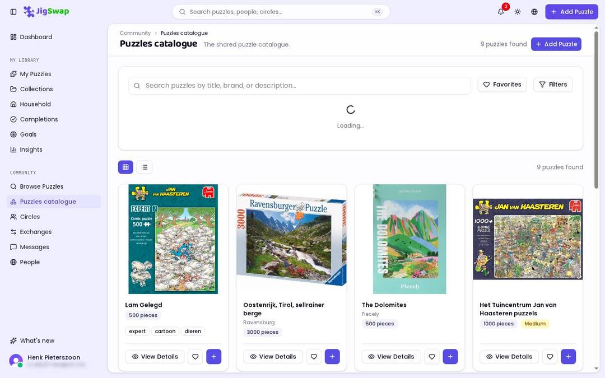

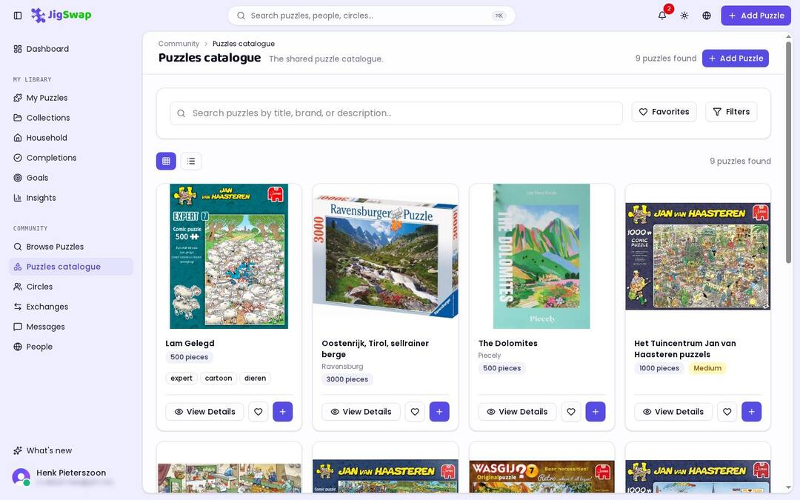

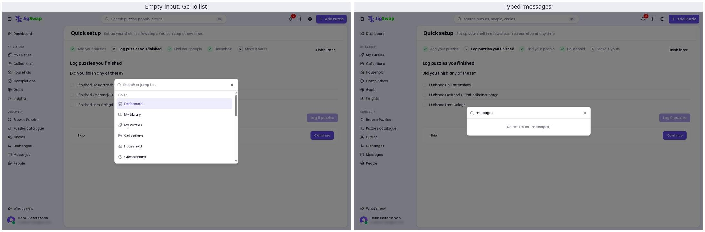

**Top desktop-specific issues:** UX-33 (preferences overlay), UX-55 (palette), UX-24 (Add Puzzle), UX-51 (admin queue detail not sticky), UX-158 (⌘K hint shown on all platforms). The add-copy form (below) shows three problems at once: a cover picker that is never saved (UX-18), "For Trade" pre-ticked (UX-19), and the header "Create a Puzzle" on a copy flow (UX-95).

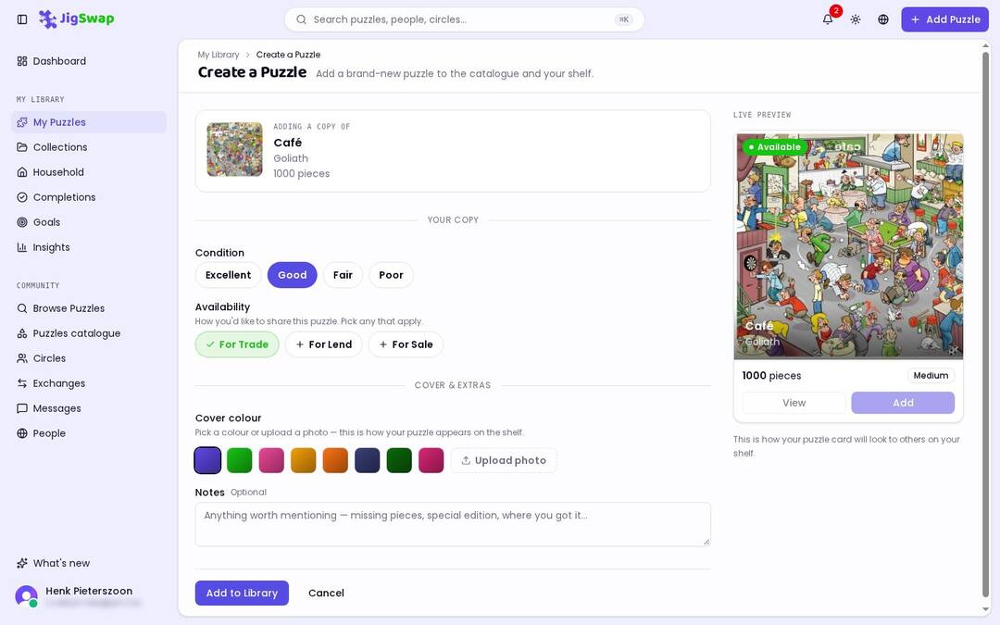

### 3.2 Tablet (820)

**What works**

- Grids reflow cleanly, and no public page overflows horizontally.
- Household cards drop to 2 columns, and circle rows wrap cleanly.
- Touch-sized onboarding targets are used throughout.

**What breaks**

- At 820px the app renders the **full desktop chrome**. The expanded 256px sidebar takes 31% of the width and leaves a content card of about 550px (UX-05). Almost every tablet issue follows from that:
  - The **message thread** shrinks to about 210px and the composer textarea to 34px. The DM name and the ⋯ Report/Block menu are pushed out of the card (UX-02).
  - The page head runs out of room: the Notifications h1 overlaps its meta text and "Mark all as read" is clipped (regionOverflowX 52; UX-04).
  - Member profile actions cover the member's name (UX-32).
  - The dashboard switches to its stacked phone layout and the 3D shelf crops (UX-17).
  - "View Det…" is truncated on every catalogue card (UX-109).
- Collapsing the sidebar fixes most of this, but the `sidebar_state` cookie is written and never read, so the sidebar comes back expanded on every reload.

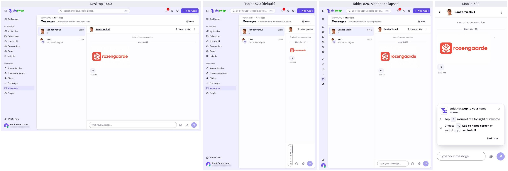

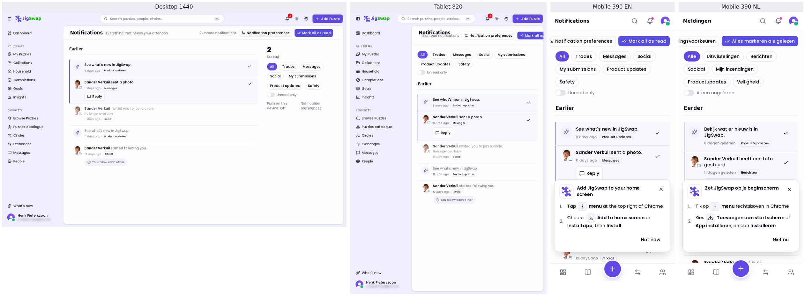

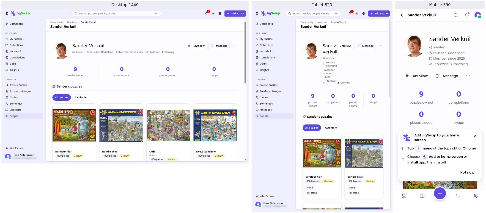

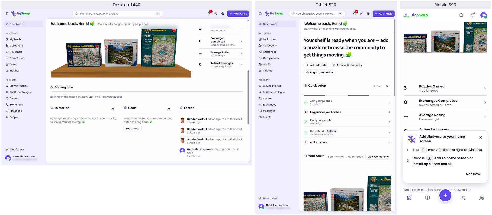

**Top tablet-specific issues:** UX-02 (blocker), UX-05, UX-04, UX-32, UX-17, UX-109. The public catalogue detail also leads with a large letterboxed square cover (UX-162), and on touch tablets the 14px inputs will likely trigger zoom-on-focus on iPadOS (UX-71, plausible).

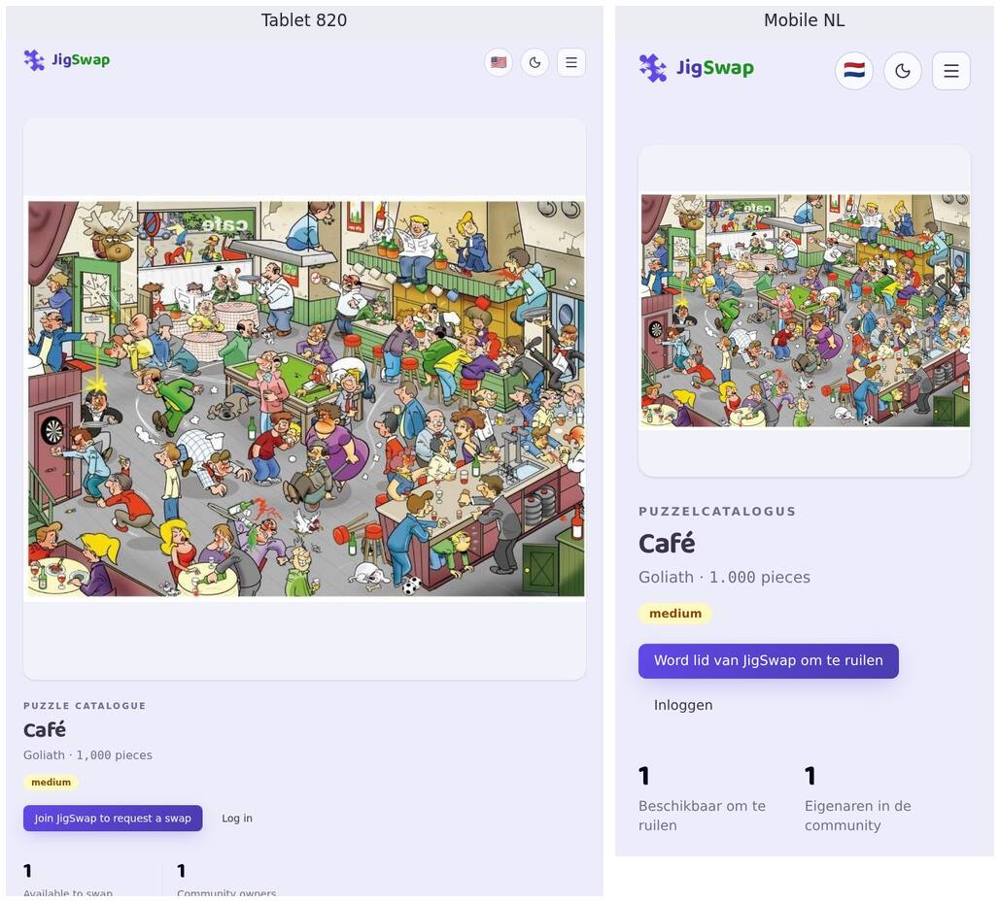

### 3.3 Mobile (390)

**What works**

- The chrome follows touch guidance: a 44px top bar with safe-area padding, and a 56px sticky tab bar that tracks the visual viewport.
- On immersive thread routes both bars step aside, so the composer stays above the keyboard.
- All inputs except the tag field are 16px, so phones don't zoom on focus.
- The quick sheet uses 56px rows.
- Nothing overflows horizontally on public pages.
- The message thread view is excellent apart from the install tip.

**What breaks**

- The **Edit Profile** form is 544px wide on a 390px screen. The overflow is clipped, so the Private-profile switch and the display-name Edit button cannot be reached (UX-03).
- The page-actions row overflows to the **left**, where it can't be scrolled to: Notifications by −18px (EN) and −66px (NL); on NL `/my-puzzles/add` the guide button is completely off-screen (UX-04).
- The **install tip** takes about 27% of the viewport on every page, including over the newest messages in a thread and over the `/welcome` footer (UX-07).
- Navigation: the four tabs are icon-only, the Library and Community tabs open launcher pages of tall cards, and Messages is three levels deep with no count (UX-06).
- Puzzle grids show **one card per screen**: 9 catalogue puzzles take 8 screens (UX-54).
- Smaller breakages:
  - the own-profile name is painted under the Edit Profile button (UX-31);
  - the Insights metric toggle is cut off by 71px (UX-45);
  - exchange rows leave about 130px for the title (about 75px in Dutch; UX-40);
  - the Dutch suggest-edit photo button is clipped (UX-104).

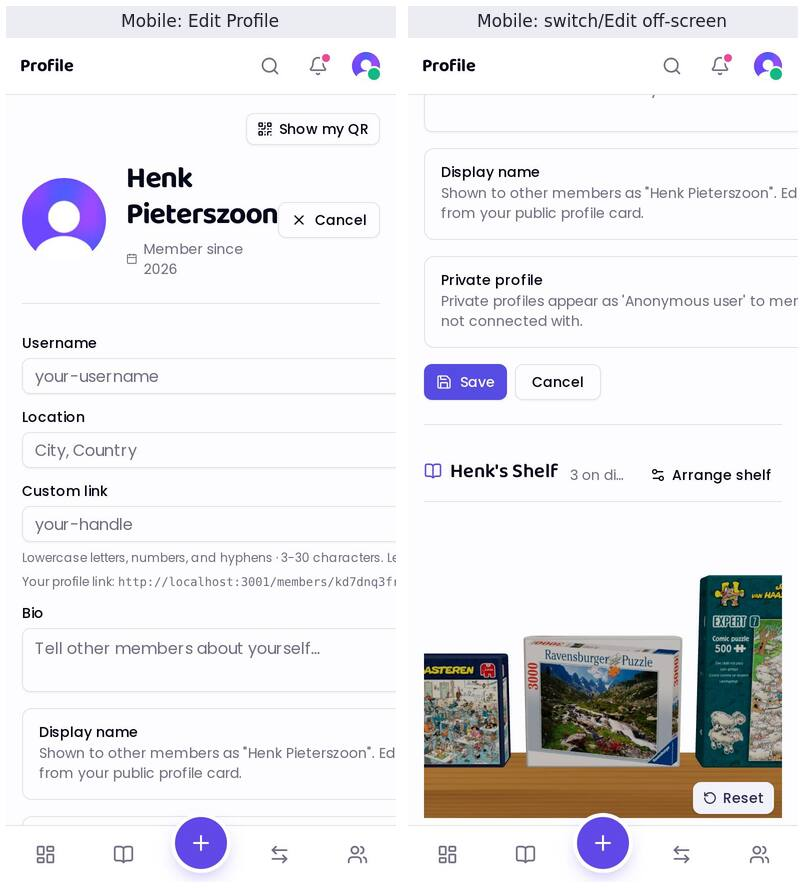

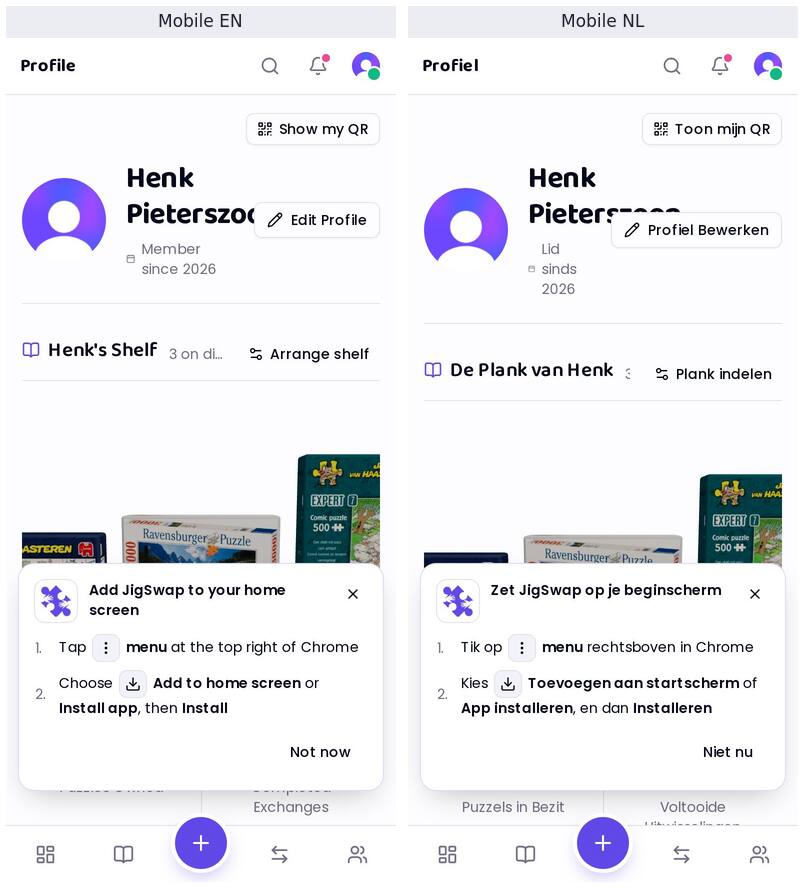

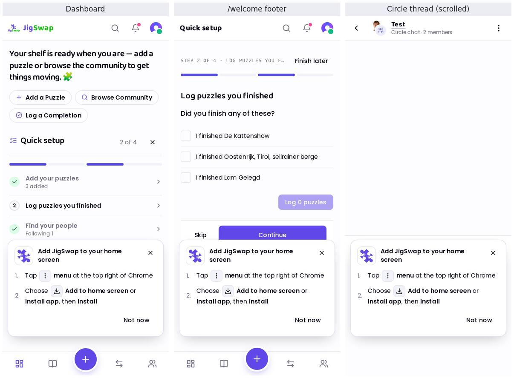

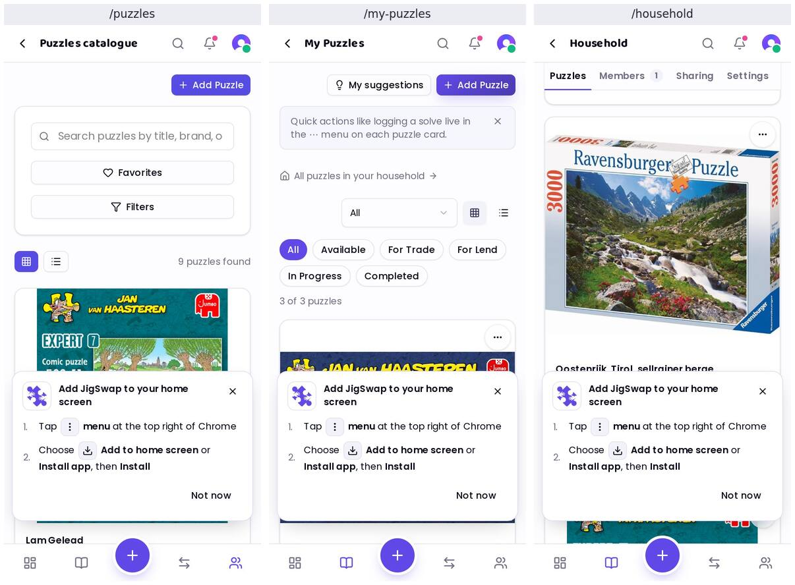

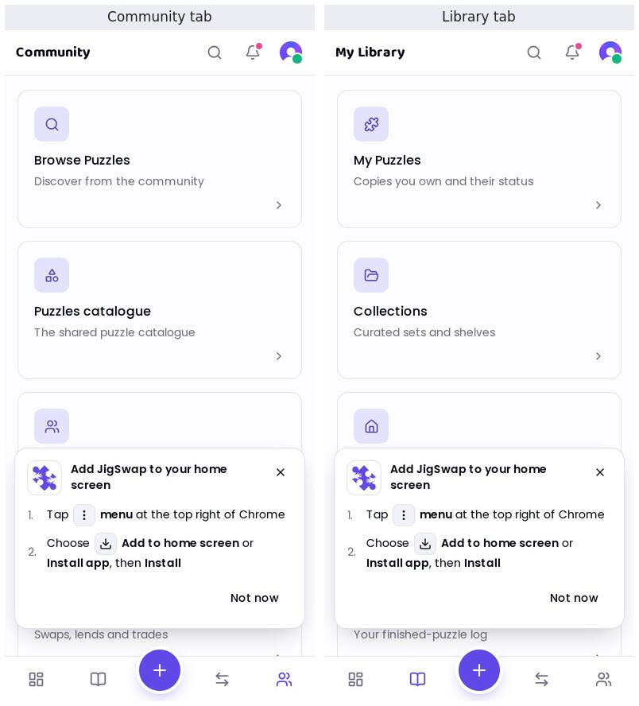

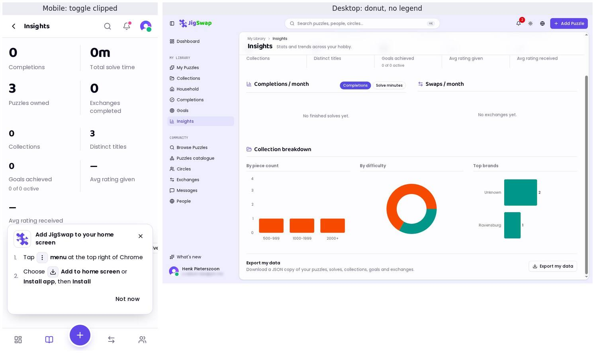

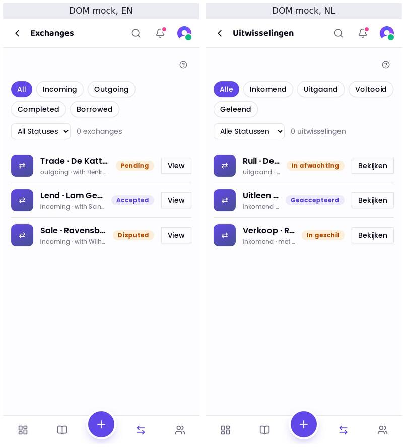

**Top mobile-specific issues:** UX-03 (blocker), UX-04, UX-07, UX-06, UX-54, UX-31, UX-45, UX-40, UX-34 (the preferences matrix loses its column headers), UX-56 (no theme or language switch inside the app).

---

## 4. Cross-cutting themes

### 4.1 Navigation & information architecture

- **One IA source, two different mental models.** `route-meta.ts` drives the sidebar, breadcrumbs, palette, tab highlighting and the group landing pages. That is a real strength. The problem is presentation. On phones, the group landing pages (`/library`, `/community`) are top-level destinations that sit between the tab and every second-level page. On desktop they hide behind 10px uppercase captions that don't look clickable. That gap is the root of UX-06 and UX-159.
- **Messaging is under-surfaced for a swap app.** Messages has no tab, no quick-sheet entry, and its unread count appears only in the desktop sidebar. On phones it is the 5th tall card under Community (UX-06).
- **Two concepts share one label.** "Browse puzzles" is the catalogue on the public site, but other members' copies inside the app, which sits next to a separate "Puzzles catalogue" (UX-23). "Add Puzzle" means three different outcomes (UX-24).
- **Loans have no home.** Borrowed loans sit on an orphaned `/borrowed` page plus a tab. Lent-out loans appear only as annotations on My Puzzles cards. A loan that is still out is labelled "Completed" (UX-39).
- **State does not survive navigation.** Filters, search, view mode and the selected tab live in `useState` on `/puzzles`, `/browse`, `/catalog`, `/my-puzzles`, `/trades` and `/admin/moderation`. Back resets everything, and nothing can be shared as a link (UX-28, UX-82, UX-22, UX-39, UX-145).
- **Shortcuts promise actions but open lists.** The palette loses its jump-to list when you type (UX-55). Quick actions such as "Propose a Swap" and "Log a Completion" open list pages (UX-58). The mobile ‹ chevron goes up to a hub page rather than back (UX-59).

### 4.2 Design-system consistency

- **Shared layout primitives assume desktop.** `PageHead` and `MobilePageActions` don't wrap (UX-04). `PuzzleViewProvider`'s `minmax(212px,1fr)` gives a single column on phones on five pages (UX-54). `DialogContent` has no max-height or scroll (UX-60). `size="sm"` buttons, `Switch` and `Checkbox` have no coarse-pointer sizing (UX-70). The Reports flow and the onboarding flow already use `h-11 md:h-8` and `pointer-coarse:min-h-11`. Promote that pattern into the primitives.
- **Viewport breakpoints inside a sidebar layout.** `md`/`lg` are viewport widths, but the content column is 256px narrower whenever the sidebar is expanded. This causes the tablet breakages (UX-02, UX-32, UX-109, UX-05). Use container queries (`@container`) on page roots, as `notification-preferences-panel.tsx` already tries to.
- **Confirmation patterns vary.** There are four: none, a 3-second inline arm, AlertDialog, and a Dialog with a reason. The strongest ones guard the safest actions (re-enable a puzzle) and the weakest guard irreversible ones (reject a submission, delete a photo, the final exchange handover). See UX-49, UX-141, UX-35.
- **Silent mutations.** Many mutations only `console.error` on failure: exchange actions, return loan, circle share, collection create/remove, recall. Household already has `household-error.ts` and toasts, so reuse that pattern (UX-37, UX-101, UX-102, UX-103).
- **Badges look the same.** Availability badges ("For Trade") and tags share one outline Badge style, and the card shell's difficulty pills have no dark variant (UX-173, UX-10).
- **Marketing and app use different tokens** for body font, button scale and breakpoints (768/861/1000). Part of this is deliberate (documented in `marketing.css`); the icon and logo duplication is not (UX-160).

### 4.3 Dark mode

Dark mode is fully themed in both the marketing and app layers. The card/chrome separation still reads, box art keeps its fidelity, and the QR card stays white so cameras can scan it. Dark ran only the axe colour-contrast rule, which found 43 nodes against about 1500 in light. Those 43 come from three specific causes:

- `--jigsaw-primary #705aea` used as **text** on dark cards (3.42:1). A `--primary-text` token already exists (`globals.css:82`) but 44 call sites use `text-jigsaw-primary`.
- White text on brand green `#19c316` (2.37:1, the same in both themes).
- Faded "unavailable" notification rows (3.93:1).
- Visual only (not an axe failure): the card shell's difficulty pills keep their light `bg-yellow-100` (`puzzle-card-shell.tsx:56-69`).

See UX-10 and UX-119.

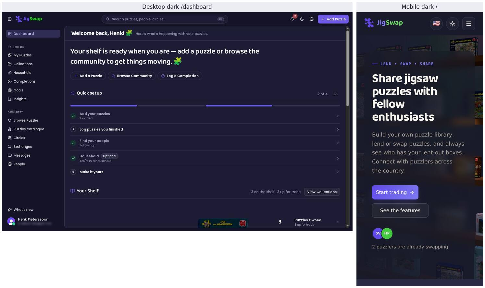

### 4.4 Accessibility

The base is solid:

- Radix provides the focus traps.
- The message thread has a labelled log and a polite live region.
- Notification rows have sr-only "Unread," prefixes.
- 3D and reveal animations respect reduced motion.
- `<html lang>` follows the locale.

The main gaps:

- no skip link (UX-08);
- unread counts that are visual only (UX-09);
- focus dropped to `<body>` after triggerless dialogs and after route changes (UX-67, UX-68);
- file pickers that can't be reached by keyboard (UX-11);
- puzzle-picker cards that aren't keyboard-operable (UX-44);
- charts with no text alternative (UX-46, UX-47).

**axe rules → nodes → root cause → fix** (light variants unless noted; dark ran contrast only; NL ran nothing)

| Rule (impact)                         | Nodes | Root cause (component)                                                                                                                                                                                                                                                                                                                                                                                                                     | Fix                                                                                                                                                                                                                                                       | IDs                        |
| ------------------------------------- | ----- | ------------------------------------------------------------------------------------------------------------------------------------------------------------------------------------------------------------------------------------------------------------------------------------------------------------------------------------------------------------------------------------------------------------------------------------------ | --------------------------------------------------------------------------------------------------------------------------------------------------------------------------------------------------------------------------------------------------------- | -------------------------- |
| color-contrast (serious)              | 1549  | 1324 public light nodes from `--mk-text-muted #7c7689` (`styles/marketing.css:129`, 3.58–4.37:1 on every marketing ground). About 182 app light nodes from `--muted-foreground` on tinted surfaces (`globals.css:22`: ⌘K kbd 4.34:1, hints 4.49:1), white on `#19c316` (2.37:1), green on green tint (2.13:1), and notification `opacity-70` (2.7:1). About 43 dark nodes from `#705aea` text (3.42:1), the marketing eyebrow and avatars. | `#5f596d` for mk-muted; `oklch(0.51 …)` for muted-foreground; a darker green token for fills behind white; `text-primary-text` in dark; drop `opacity-70`. The 74 sidebar-email nodes are a deliberately blurred, aria-hidden element and can be ignored. | UX-12, UX-10, UX-119       |
| region (moderate)                     | 1405  | 1332 = 18 sidebar items × 37 pages × desktop and tablet, because `SidebarContent` renders plain divs (`app-sidebar.tsx:54-60`). 37 = the palette `DialogHeader` rendered outside `DialogContent` on every mobile page (`ui/command.tsx:46-49`). 36 = Clerk auth pages, the 404 and the docs, which have no `<main>`.                                                                                                                       | Wrap the sidebar in `<nav aria-label>`; move `DialogHeader` inside the dialog; add `<main>` to the auth/404 wrappers.                                                                                                                                     | UX-08, UX-67, UX-73, UX-77 |
| label-content-name-mismatch (serious) | 78    | 74 = bell trigger `aria-label="Notifications"` overrides its visible count (`notification-bell.tsx:81`). 4 = docs mobile bar, where the visible text "Docs" differs from the aria-label (`docs-mobile-bar.tsx:17`).                                                                                                                                                                                                                        | Use a count-aware name (`bellWithCount`); drop or extend the docs aria-label.                                                                                                                                                                             | UX-09, UX-78               |
| button-name (critical)                | 39    | 27 = Browse card icon buttons (`ui/puzzle-card.tsx:459-497`). 6 = `/puzzles` grid/list toggles (`puzzle-client.tsx:237-250`). 6 = `/catalog` brand and piece SelectTriggers (`_public/catalog/index.tsx:175,195`).                                                                                                                                                                                                                         | Add aria-labels from existing keys; use a ToggleGroup for the view switch.                                                                                                                                                                                | UX-25, UX-107, UX-15       |
| heading-order (moderate)              | 27    | 15 = card titles as `h3` directly under the page `h1` (`puzzle-card-shell.tsx:140`; browse, my-puzzles, puzzles, catalog, completions/new). 12 = docs, how-it-works, people and household card `h3`s.                                                                                                                                                                                                                                      | Add an sr-only `h2` above each grid, or a `headingLevel` prop.                                                                                                                                                                                            | UX-66                      |
| target-size (serious)                 | 21    | Star-rating radios at 20×20 (`ui/star-rating.tsx:81`); overlapping circle avatars that expose 22px (`circle-avatar-stack.tsx:142`); buttons partly hidden under the sticky install tip.                                                                                                                                                                                                                                                    | Make radios `size-8 pointer-coarse:size-11`; use `-ml-2`; hide the tip on content-heavy routes.                                                                                                                                                           | UX-30, UX-130, UX-07       |
| landmark-one-main (moderate)          | 9     | `/sign-in`, `/sign-up` and the 404 render no `<main>` (`sign-in.$.tsx:15`, `NotFound.tsx:21`).                                                                                                                                                                                                                                                                                                                                             | Add a `<main>` wrapper (AuthShell).                                                                                                                                                                                                                       | UX-73, UX-77               |
| page-has-heading-one (moderate)       | 5     | The mobile dashboard and `/messages/new` have no visible h1 (`mobile-top-bar.tsx:58`). On the 404, CardTitle is a div.                                                                                                                                                                                                                                                                                                                     | Add an sr-only h1 inside main on phones; render the 404 title as an h1.                                                                                                                                                                                   | UX-66, UX-77               |
| landmark-unique (moderate)            | 4     | Unlabelled header `<nav>`, legal TOC and on-page TOC (`marketing/header.tsx:75`, `legal-doc.tsx:70`, `on-page-toc.tsx:34`).                                                                                                                                                                                                                                                                                                                | Add `aria-label`s.                                                                                                                                                                                                                                        | UX-166                     |
| image-redundant-alt (minor)           | 1     | Mobile logo `alt="JigSwap"` next to the wordmark (`mobile-top-bar.tsx:88`).                                                                                                                                                                                                                                                                                                                                                                | Use `alt=""`.                                                                                                                                                                                                                                             | UX-66                      |

Issues axe can't see but that matter just as much: keyboard focus loss (UX-67, UX-68), the unlabelled star `role=radio` with no arrow-key roving (UX-30), focus rings at about 1.8:1 on marketing grounds (UX-72), the 2.4.11 focus-obscured risk under the install tip (UX-07), and charts with no text alternative (UX-46, UX-47).

### 4.5 Internationalisation (Dutch)

The base is good:

- `en`, `nl` and `source` have full key parity (3748 keys) with ICU plurals.
- `<html lang>` follows the locale.
- The Dutch marketing headlines are idiomatic rather than literal.
- The layout absorbs longer Dutch strings almost everywhere.

The gaps:

- **Formatting ignores the app locale.** There are 17 argument-less `toLocaleString()` / `toLocaleDateString()` calls. They format with the server's or browser's locale, not the chosen JigSwap language. On public `/catalog/<id>` this causes a real hydration mismatch: the dev server runs with `LANG=nl_NL` and renders "1.000", the en browser renders "1,000". In production the mismatch flips onto Dutch visitors, because production Node is en-US and serves "3,000" (UX-63).
- **Hard-coded English** reaches Dutch users and screen readers: "pieces" and the raw "medium" on the public catalogue detail, the dialog "Close" label, star labels, "Toggle Sidebar", the loading and error states, tag removal, the preview placeholders, and "Unknown" in Insights (UX-64, UX-76, UX-136).
- **English Title Case carried into Dutch.** About 216 values, such as "Puzzel Toevoegen", "Te Ruilen" and "Pagina Niet Gevonden". Piece terms are also mixed: 15 × "stukken" vs 32 × "stukjes" (UX-65).
- **Layout breaks only Dutch triggers:** the suggest-edit photo button (UX-104), the admin category rows (UX-52), the guide button on `/my-puzzles/add` (UX-04), and the truncated quick-setup eyebrow "STAP 2 VAN 4 · LEG VAST WAT…" (UX-169).
- **Language switcher:** US emoji flag, no checked state, missing on phones (UX-57, UX-56).
- **SEO:** EN and NL share one URL with no hreflang, so the Dutch copy is effectively unindexable for a Dutch-first product (UX-14).

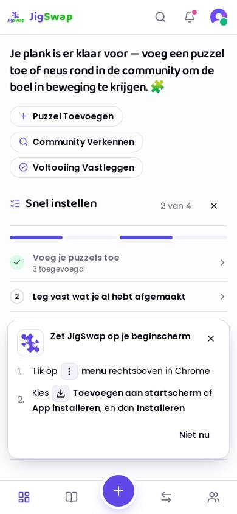

### 4.6 Perceived performance & robustness

- **Hydration mismatch** on `/catalog/<id>`, from `pieceCount.toLocaleString()`. React 19 discards the server-rendered HTML for that subtree and renders it on the client. The visible effect is a flash and a console error, not a broken page (UX-63).
- **Uncaught errors.** The `@convex-dev/presence` heartbeat rejects with no catch, so a `RateLimited` error becomes a page error. The `/messages` layout adds a second heartbeat room on the same 30-per-minute bucket (UX-156).
- **Infinite spinners.** Most admin lists, and the report drawer, show `PageLoading` whenever `data === undefined`, which is also what an error looks like (UX-143). The catalogue shows "No puzzles found" while it is still paging (UX-26).
- **Client-side scale traps:**
  - catalogue search pulls the whole catalogue 20 rows at a time (UX-26);
  - Browse stops at 50 rows (UX-27);
  - My Puzzles renders every copy (UX-22);
  - the What's new page renders 42 fully expanded entries (about 35k px on a phone; UX-90);
  - admin queues use uncapped `.collect()` (UX-51, UX-143).
- **3D shelf.** It renders continuously, with a contact-shadow pass on every frame, on the phone home screen. Its parallax effect has no input on touch (UX-89).
- **Scroll restoration** is enabled but has no effect, because `/puzzles` shows a full-page loader when it remounts (UX-28).

### 4.7 Copy & terminology

- **One concept, five names.** The exchange area is "Exchanges" (sidebar and page), "Swaps" (mobile tab), "Trades" (document title, notification filter, empty state), "In Motion" (dashboard) and "trading" (public CTA). The forTrade flag reads "For Trade", "Offer for Swap", "Available to swap" and "Up for Trade". A borrower's own request is labelled "Lend · …". In Dutch: "Uitwisselingen" / "Ruilen" / "Te Ruil" / "Voor ruil" (UX-53).
- **Labels say something different from what the button does.**
  - The puzzle-page CTA says "Request swap" even for a copy that is only offered for lending (UX-38).
  - "Add Puzzle" leads to three different outcomes (UX-24).
  - The Finish dialog is titled "Solve finished" and its hint says "leave empty", but an empty date isn't allowed (UX-132).
  - The welcome dialog says "3 steps" while the stepper shows 5 (UX-83).
  - The `/people` subtitle says "near you", but there is no proximity search (UX-181).
  - The add toast says "collection" but means My Puzzles (UX-92).
- **Empty and zero states read like failures.** Examples: "0.0 ☆☆☆☆☆", "0 (0)", "—d", "See all 1 available copies", "1 puzzles found", and "No trades yet" with no next step (UX-105, UX-106, UX-121, UX-127).
- **Generic boilerplate where specific copy would build trust:**
  - the cookie banner (UX-75);
  - the 404 page (UX-77);
  - the consent text versus a privacy page that is unusually honest;
  - rejected submissions that give no reason (UX-49).

---

## 5. Persona journeys

This section condenses the JOURNEY reviewer's work, which followed three personas from start to finish across the whole product. Each step points to the findings that block or slow it. Followed end to end, JigSwap holds together better than any single screen suggests. Quick setup, invite redemption and the household flows are carefully built: one URL per step, back-button safe, invite tokens survive the Clerk redirect. The personas hit walls where areas meet.

### Sanne: phone, referred newcomer, wants to lend her sister a puzzle

| Step                                                            | What happens                                                                                                                                                                                                                        | Blocking / slowing  |
| --------------------------------------------------------------- | ----------------------------------------------------------------------------------------------------------------------------------------------------------------------------------------------------------------------------------- | ------------------- |
| Lands on the home page from a shared link, taps "Start trading" | The CTA is above the fold even with the cookie banner. The cookie buttons are 28px tall and are announced twice ("Decline Decline").                                                                                                | UX-74               |
| Signs up                                                        | The sign-up page is a bare Clerk card with no logo, no way back and no language switch. In the reviewed build it shows the dev instance's waitlist card; production sign-up is open. The Dutch waitlist strings are garbled.        | UX-73               |
| Quick setup: adds her puzzles                                   | She picks 3, then taps the large sticky **Continue**. The picks are lost without warning. From her second session the install tip covers the footer. The step numbering doesn't add up ("Step 2 of 4" next to a row numbered 5).    | UX-16, UX-07, UX-83 |
| "Find your people" (invite her sister)                          | The step requires a username. Its button opens `/profile`, where on a phone the username field sits inside an Edit Profile form that is wider than the screen. Nothing brings her back to the step.                                 | UX-85, UX-03        |
| Lends her sister a puzzle                                       | The owner cannot start a loan; she can only switch on "Offer to Lend". Her sister has to find the copy and press **"Request swap"**, or an unlabelled chat icon on Browse, then pick "Borrow". The toast says "Trade request sent". | UX-38, UX-25, UX-53 |
| Hands it over                                                   | Both sisters must press "Mark Complete". Nothing shows who has already confirmed. Afterwards the loan is listed as "Completed" and there is no "lent out" view.                                                                     | UX-35, UX-39        |
| Messages her sister                                             | Messages sits behind Community → scroll → card, with no unread count on the tab bar. On her phone the return key sends the message, so she can't type a line break.                                                                 | UX-06, UX-113       |

### Marco: tablet (820), household organiser, starts a friends circle

| Step                                           | What happens                                                                                                                                                                                                                                          | Blocking / slowing |
| ---------------------------------------------- | ----------------------------------------------------------------------------------------------------------------------------------------------------------------------------------------------------------------------------------------------------- | ------------------ |
| Sets up the household                          | This works well: link, email and member-search invites, plus a Sharing tab with bulk permissions.                                                                                                                                                     | (strength)         |
| Creates a friends circle and invites friends   | The invite picker only lists people who follow him and whom he follows back. Friends who aren't on JigSwap get no direct path.                                                                                                                        | UX-128             |
| Shares the household's puzzles with the circle | He has to pick one copy at a time from a Select with no search, with no success or error feedback. Copies that aren't offered for swap or loan never appear to circle members. Members with view-only access see no share control and no explanation. | UX-41, UX-125      |
| Arranges a swap in Messages                    | The thread is about 210px wide and the composer textarea is 34px. Collapsing the sidebar helps, but it expands again on reload.                                                                                                                       | UX-02, UX-05       |
| Tracks who has which puzzle                    | He can see a Borrowed tab, but there is no Lent-out view, and active loans are labelled "Completed".                                                                                                                                                  | UX-39              |
| Explains the rules to the family               | "Sharing" and "View only" mean different things in the household and in circles, and the who-sees-what explainer is on the Settings tab.                                                                                                              | UX-129, UX-126     |

### Ineke: desktop, 300 puzzles, logs solves with times, writes reviews

| Step                                   | What happens                                                                                                                                                                                                                                      | Blocking / slowing    |
| -------------------------------------- | ------------------------------------------------------------------------------------------------------------------------------------------------------------------------------------------------------------------------------------------------- | --------------------- |
| Catalogues her collection              | There is no import. The quick picker takes at most 25 per batch and searches one term at a time. A puzzle missing from the catalogue sends her through the page-head "Add Puzzle", which submits it for moderation and puts nothing on her shelf. | UX-22, UX-24, UX-29   |
| Finds a brand in the catalogue         | The Filters panel never loads. Search only covers the pages already loaded. Back resets her filters.                                                                                                                                              | UX-01, UX-26, UX-28   |
| Manages and offers 50 puzzles for swap | My Puzzles has no search, no sort and no bulk select, and ⌘K doesn't find her own copies. Each one-tap offer quietly makes a private copy visible.                                                                                                | UX-22, UX-20          |
| Logs solves with times                 | Her first solve can't record a time. Times she does enter never appear in her history. Edit is offered on back-dated solves and then refused by the server.                                                                                       | UX-134, UX-133, UX-48 |
| Sets "50 this year"                    | The goal jumps to her lifetime solve count and is marked achieved. It can't be edited or deleted.                                                                                                                                                 | UX-42, UX-43          |
| Reviews puzzles                        | Post stays disabled until she picks a star, but the stars sit below the button and nothing says a rating is required. The stars are 20px targets.                                                                                                 | UX-30                 |

The journey reviewer scored 3 / 2.5 / 2.5 (desktop / tablet / mobile). Across all three personas the recurring cause is the same: the trade/swap/exchange/lend vocabulary is never settled (UX-53).

---

## 6. Findings by area

Duplicate findings from different reviewers have been merged. Each entry names its source finding IDs, and the severity shown is the verifier's calibrated one; where findings were merged, it is the highest of them. Viewports: **D** desktop 1440, **T** tablet 820, **M** mobile 390. Status: **confirmed** means observed, or proven by code. **Plausible** means the mechanism is real but the effect was not observed. Code paths are relative to the repo root. Evidence paths are relative to [`evidence/`](evidence/).

### 6.1 Shell, navigation & design system

The single IA source (`route-meta.ts`) and the inset-card desktop shell are strong. The problems are in shared layout pieces that assume a desktop width:

- the page head and the mobile action row don't wrap;
- the sidebar stays expanded at 820px;
- grids drop to one column on phones;
- dialogs don't scroll;
- the install tip is sticky and covers content.

Mobile navigation also hides Messages, and the same exchange concept goes by four names.

| ID     | Title                                                                                                                     | Severity | Viewports       | Effort | Status    |
| ------ | ------------------------------------------------------------------------------------------------------------------------- | -------- | --------------- | ------ | --------- |
| UX-04  | Page-head and mobile action rows don't wrap: actions clipped on tablet and pushed off-screen on phones                    | major    | T, M            | S      | confirmed |
| UX-05  | Tablet gets the full desktop chrome; a collapsed sidebar is not remembered                                                | major    | T               | M      | confirmed |
| UX-06  | Mobile navigation: icon-only tabs, launcher pages, Messages buried with no count                                          | major    | M               | M      | confirmed |
| UX-07  | Install tip covers about 27% of the phone screen, the newest chat messages and the `/welcome` footer; its ✕ means "never" | major    | M               | S      | confirmed |
| UX-53  | Exchange vocabulary: trade, swap, exchange and lend used interchangeably (EN and NL)                                      | minor    | D, T, M         | M      | confirmed |
| UX-54  | Puzzle grids show one large card per phone screen                                                                         | minor    | M               | S      | confirmed |
| UX-55  | Command palette drops every jump-to destination as soon as you type                                                       | minor    | D, T, M         | S      | confirmed |
| UX-56  | No theme or language switch anywhere in the signed-in mobile app                                                          | minor    | M               | S      | confirmed |
| UX-57  | Theme and language menus don't show the current choice; English uses a US flag                                            | minor    | D, T (+ public) | S      | confirmed |
| UX-58  | Quick actions promise an action but open list pages                                                                       | minor    | D, T, M         | S      | confirmed |
| UX-59  | Mobile back chevron goes "up to the hub page", even on tab destinations                                                   | minor    | M               | S      | confirmed |
| UX-60  | Dialogs can't scroll on short viewports; 16px close button; no Cancel                                                     | minor    | M (+ landscape) | M      | confirmed |
| UX-61  | Toasts cover the phone tab bar; the update prompt never expires                                                           | minor    | M               | S      | confirmed |
| UX-62  | Tab bar ignores the home-indicator safe area in the installed PWA                                                         | minor    | M               | S      | plausible |
| UX-156 | Rate-limited presence heartbeat surfaces as an uncaught page error                                                        | polish   | D, T, M         | S      | confirmed |
| UX-157 | Page head height changes between pages; counts and titles repeated                                                        | polish   | D, T            | S      | confirmed |
| UX-158 | "⌘K" hint shown on every platform                                                                                         | polish   | D, T            | S      | confirmed |
| UX-159 | Hub pages are top-level on mobile but hidden behind 10px labels on desktop                                                | polish   | D, T            | S      | confirmed |
| UX-160 | Marketing and app shells differ in icons, logo and breakpoints                                                            | polish   | D, T, M         | M      | confirmed |

**UX-04 — Page-head and mobile action rows don't wrap** · _from SOC-4, SHELL-1, SHELL-2, JOURNEY-10 (+ SOLVE-21 subtitle)_

- **Problem:** Each layout breaks differently when its actions don't fit.
  - **PageHead (tablet):** a `min-w-0 flex-1` title sits next to a `shrink-0` action group that never wraps. The title collapses to 0px, the h1 paints under the actions, and the actions run past the card's clipped edge.
  - **`MobilePageActions` (phone):** a single `flex justify-end` row with no wrap. Overflow goes off the **left** edge, where it can't be scrolled to. The `regionOverflowX` metric misses this, because left overflow isn't counted in scrollWidth.
- **Evidence:**
  - `tiles/tablet-light/app__notifications__01.jpg`: h1 drawn over "2 unread notifications"; "Mark all as read" right edge at x=859 against a card edge at 807 (regionOverflowX 52).
  - `tiles/mobile-light/app__notifications__01.jpg`: row starts at x=−18. In NL it starts at −66 ("…ingsvoorkeuren").
  - `agents/JOURNEY-VERIFY/m-nl-my-puzzles-add.jpg`: "Laat me zien hoe" at x=−49, completely unreachable.
  - Tablet `/my-puzzles` subtitle truncated to "Every copy you…" (NL "Elk exe…", and the title wraps to "Mijn / Puzzels"). `/completions` subtitle truncated to "A log of every puzzl…".
  - Image in §3.2.
- **Root cause:**
  - `apps/web/src/components/dashboard-layout/page-head.tsx:110-124`
  - `apps/web/src/components/dashboard-layout/shell.tsx:105-107`, clipped by `overflow-x-clip` at `shell.tsx:71`
  - Page meta spans published as `hidden sm:inline` (e.g. `routes/_dashboard/notifications/index.tsx:158`) are always visible inside the md+ head.
- **Fix:**
  - `page-head.tsx:110` → `flex flex-wrap items-center gap-x-4 gap-y-2`.
  - Title block → `min-w-[min(100%,16rem)] flex-1`.
  - Actions → `ml-auto flex flex-wrap items-center justify-end gap-2.5`, without `shrink-0`.
  - `shell.tsx:107` → `flex flex-wrap items-center justify-end gap-2`.
  - Meta spans → `hidden xl:inline`.
  - On phones, show Notification preferences as a 44px icon button with `aria-label`.
  - Add a test that no action child has `left < 0` at 360px in NL.

**UX-05 — Tablet gets the full desktop chrome; a collapsed sidebar is not remembered** · _from SHELL-3, ONB-14_

- **Problem:** The only shell breakpoint is md (768px), and the sidebar defaults to open. At 820px in portrait that leaves a card of about 550px.
  - The `sidebar_state` cookie is written on toggle but never read, so a manual collapse resets on every reload.
  - Sidebar rows stay 32px and top-bar icons 36px on a touch device.
  - Dashboard grids only become multi-column at lg, so tablets get a stacked phone layout inside desktop chrome (page height 2,782 vs 2,118px on desktop).
- **Evidence:**
  - `tiles/tablet-light/app__dashboard__01.jpg`: sidebar is 256 of 820px.
  - `agents/SHELL/t_collapsed_*.jpg`: cookie set to false, sidebar still `data-state=expanded`.
  - `shots/tablet-light/*.json`: 31–39 targets of 24–44px per page.
- **Root cause:**
  - `apps/web/src/components/dashboard-layout/shell.tsx:55`: no `defaultOpen` passed.
  - `apps/web/src/components/ui/sidebar.tsx:56` (`defaultOpen=true`) and `:84` (cookie write only).
  - `components/dashboard-home/shelf-section.tsx:221` and `pulse-section.tsx` (`lg:grid-cols-…`).
- **Fix:**
  - Read `sidebar_state` in the `_dashboard` `beforeLoad` or loader and pass `defaultOpen`.
  - With no cookie, default to the icon rail (`collapsible="icon"` already exists) below 1024px.
  - Add `[@media(pointer:coarse)]:h-11` to `SidebarMenuButton` and use `size-11` top-bar icons.
  - Prefer container queries for page grids.
  - The messages-specific fix is in UX-02.

**UX-06 — Mobile navigation: icon-only tabs, launcher pages, Messages buried** · _from SHELL-4, SHELL-5, MSG-3, A11Y-13, JOURNEY-11, SOC-20_

- **Problem:**
  - The four tabs are icons only; their names exist only as `aria-label`.
  - The Library and Community tabs open launcher pages of cards about 175px tall.
  - Messages has no tab, no quick-sheet row and no top-bar icon. Its unread total is subscribed only by the desktop sidebar. On a phone, reaching Messages means Community → scroll past four cards → Messages.
  - The Users icon means "Community" in the tab bar and "Circles" in the sidebar.
  - The Swaps badge count is hidden from assistive tech by the tab's `aria-label`.
  - Caveats: icon-only tabs were a deliberate decision (spec 2026-06-15), and message notifications do reach the bell. So this is about discoverability and speed, not missed messages. JOURNEY-11's verifier kept it at major because messaging carries every exchange.
- **Evidence:**
  - `tiles/mobile-light/app__dashboard__01.jpg`
  - `app__community__01.jpg` and `__02.jpg` (Messages is the 5th card, below the fold)
  - `app__library__01.jpg`
  - `agents/SHELL/m_quicksheet.jpg`
  - Image in §3.3.
- **Root cause:**
  - `apps/web/src/components/dashboard-layout/mobile-tab-bar.tsx:35-40`, `:165-185` (icon only; badge only on swaps, `:134-139`)
  - `app-sidebar.tsx:129-140`: the only subscriber of `getUnreadTotal`
  - `group-landing.tsx:19-24`
  - `route-meta.ts:78/84/87`: icons
- **Fix:**
  - Show visible 11px labels under the icons and drop the `aria-label`; check that "Bibliotheek" fits in a 78px column.
  - Add a Messages icon with a count to `MobileTopBar`, reusing `gateway.conversation.getUnreadTotal`. Add an unread dot to the Community tab.
  - Below sm, render `GroupLanding` as compact rows of about 56px with live counts.
  - Give Circles its own icon.
  - Put an sr-only count inside the tab links.

**UX-07 — Install tip covers the phone screen, chat and the `/welcome` footer** · _from MSG-2, ONB-1, ONB-7, SHELL-12, A11Y-12, JOURNEY-13_

- **Problem:** `InstallAppTip` is an in-flow sticky card (`bottom-[57px] pb-[34px]`, about 228+34px) that stays open across in-shell navigation.
  - **Open threads:** it ignores `isImmersiveMobileRoute`. On threads, where the tab bar is gone, it floats over the newest messages and adds 262px of document height, so the full-screen chat scrolls.
  - **`/welcome`:** it doesn't check the surface-busy flag after opening, so it covers the sticky Skip/Continue footer there.
  - **Every page:** with the top bar and tab bar, about 470 of 844px are left for content. Content that scrolls under it can hide focused controls (WCAG 2.4.11).
  - **Dismissal:** ✕ means "Don't show again" (permanent), and "Not now" is the snooze.
- **Evidence:**
  - `tiles/mobile-light/app__messages_04e0cd32-…__01.jpg`
  - `tiles/mobile-light/app__messages_ec1b1833-…__02.jpg`: composer slid under the card.
  - `shots/mobile-light/app__messages_04e0….json`: pageHeight 1106 vs 844.
  - `agents/ONB/mobile__welcome_with_tip.jpg` and `_long.jpg`: `elementFromPoint` at Continue returns the tip.
  - axe target-size "partially obscured (176px by 6px)" in `shots/mobile-light/app__my-puzzles_m572….json`.
  - Image in §3.3.
- **Root cause:**
  - `apps/web/src/components/install-app/install-app-tip.tsx:119-120`: the open condition ignores route and busy state.
  - `install-app-tip.tsx:174`: offset hard-coded for the tab bar.
  - `install-app-tip.tsx:198-207`: ✕ calls `onNever`.
  - `dashboard-layout/shell.tsx:86`
  - `surface-busy.ts:9-24`: not reactive.
- **Fix:**
  - Return `null` when `isImmersiveMobileRoute(pathname)` or on `/welcome`, without dismissing.
  - Render collapsed by default: a row of about 56px ("Install JigSwap · How?" plus ✕) that expands on tap.
  - Make ✕ snooze, and offer "Don't show again" as an explicit text button.
  - Skip auto-show on routes with sticky footers or forms.
  - Add a test that the document height equals the viewport height on `/messages/<id>`.

**UX-53 — Exchange vocabulary drifts across screens** · _from SHELL-9, SHARE-5, SOC-13, JOURNEY-12 (+ swap terms in LIB-13, SOLVE-22)_

- **Problem:** One feature has five names, one flag has five labels, and request labels read from the wrong side.
  - **The area:** "Exchanges" (nav and page), "Swaps" (mobile tab), "Trades" (document title, notification filter, empty state "No trades yet … first trade request"), "In Motion" (dashboard), "trading" (public CTA). The route is `/trades`.
  - **The forTrade flag:** "For Trade", "Offer for Swap" / "Offered for Swap", "Available to swap", "Up for Trade", "3 up for trade". "For Lend" is ungrammatical.
  - **Kinds:** labelled as owner-side nouns (Trade, Sale, Lend). A borrower's own request reads "Lend · Lam Gelegd · outgoing", and the toast says "Trade request sent" even for a borrow.
  - **Counts:** the member tile says "0 swaps" while the profile says "Completed Exchanges".
  - **Dutch:** "Uitwisselingen" vs the tab "Ruilen"; "Te Ruil" / "Te Ruilen" / "Voor ruil" / "Te ruilen"; the tab "Voltooid" vs the pill "Afgerond".
- **Evidence:**
  - `tiles/mobile-light/app__trades__01.jpg`: Swaps tab active, page title Exchanges, "No trades yet".
  - `tiles/desktop-light/app__notifications__01.jpg`: "Trades" chip.
  - `tiles/mobile-nl/app__trades__01.jpg`
  - `tiles/mobile-light/app__my-puzzles_m572…__02.jpg`
- **Root cause:**
  - `apps/web/locales/en.json` and `nl.json`: `titles.trades`, `shell.mobile.tabs.swaps` (en:3862), `notifications.categories.trades.title` (:2370), `trades.noExchanges` (:628), `trades.kind.*` (:647-649), `tradeRequest.success` (:693), `puzzles.trade`/`availTrade`, `copyInstance.offerForSwap`, `collections.upForTrade`, `swapsLabel` (:2195), `insights.charts.swapsPerMonth`.
  - `routes/_dashboard/trades.tsx:317`: the kind label ignores direction.
- **Fix:**
  - Agree a glossary and apply it in one copy-only PR.
  - Umbrella term "Exchanges" / "Uitwisselingen" everywhere: tab, title, filter, empty state ("No exchanges yet"), toast ("Request sent").
  - Types Swap / Loan / Sale, or direction-aware Borrow/Lend and Buy/Sell.
  - Availability chips "Swap", "Lend", "Sell" (NL "Ruilen", "Uitlenen", "Verkopen").
  - Use "Afgerond" throughout.
  - Optionally add an `/exchanges` route alias.

**UX-54 — Puzzle grids show one large card per phone screen** · _from DISC-9, LIB-7, SHARE-14, SOC-17_

- **Problem:** The shared grid `repeat(auto-fill,minmax(212px,1fr))` fits only one column in about 358px. Square `object-contain` covers letterbox landscape box art. The result is one card of about 560px per screen on `/puzzles`, `/browse`, `/my-puzzles`, `/household` and `/members/<handle>`. The member profile also adds its own `px-4 py-10` inside the already-padded shell.
- **Evidence:**
  - `shots/mobile-light/app__puzzles.json`: pageHeight 5525px for 9 puzzles (8 tiles).
  - `/my-puzzles`: 2412px for 3 puzzles.
  - Household: 3 puzzles take 4 tiles.
  - Member profile: 9 puzzles make a 5059px page.
  - `agents/DISC/m_puzzles_3_7.jpg`: letterbox bands.
  - Image in §3.3.
- **Root cause:**
  - `apps/web/src/components/puzzles/puzzle-view-provider.tsx:35` and `routes/_dashboard/browse.tsx:195`
  - `components/puzzles/puzzle-card-shell.tsx:111`: `aspect-square` plus `imageFit="contain"` (`my-puzzles/index.tsx:375`, `puzzles/puzzle-card.tsx:47`)
  - `components/members/profile-body.tsx:118`: duplicate padding
- **Fix:**
  - `grid grid-cols-2 gap-3 sm:grid-cols-[repeat(auto-fill,minmax(212px,1fr))] sm:gap-[18px]`.
  - Below sm, a compact card: 4:3 cover, `line-clamp-2` title, one wrapped meta row, no "View Details".
  - `bg-muted` behind contained covers.
  - Apply `ProfileBody` padding only when `viewer === 'public'`.
  - Optionally persist the view mode and default phones to list view.

**UX-55 — Command palette drops its jump-to list as you type** · _from SHELL-6_

- **Problem:** The placeholder says "Search or jump to…", but from 2 characters the whole list is replaced by backend results. Go To and Quick Actions disappear, so typing "gol", "mess" or "add" never reaches Goals, Messages or Add a Puzzle. The resulting "No results" looks like a bug. The file's own header comment says the opposite should happen.
- **Evidence:** `agents/SHELL/d_palette_empty.jpg` vs `d_palette_messages.jpg` (image in §3.1).
- **Root cause:** `apps/web/src/components/dashboard-layout/command-palette.tsx:148` (`hasTerm ? …`) and `:154-157`.
- **Fix:**
  - Always render Go To and Quick Actions below the live result groups, with `value` and `keywords` (e.g. Exchanges: swap, trade, lend, ruil) so cmdk can filter them.
  - Use `<CommandEmpty>` for the empty state.
  - Show "Searching…" as an extra row, not as a replacement for the list.

**UX-56 — No theme or language switch in the signed-in mobile app** · _from SHELL-7_

- **Problem:** The switchers exist only in the md+ TopBar and the marketing header. Below 768px the app has neither, and the profile has no language field. The only path is avatar → "JigSwap homepage" → toggle → navigate back.
- **Evidence:** `agents/SHELL/m_usermenu.jpg`, `m_quicksheet.jpg`.
- **Root cause:**
  - `apps/web/src/components/dashboard-layout/top-bar.tsx:23` and `:51-54`
  - None in `MobileTopBar`, `MobileQuickSheet` or `shell-user-button.tsx` PreferencesPage (`:230`).
- **Fix:**
  - Add Appearance and Language radio sections to the existing Clerk PreferencesPage, using `setTheme` and `setLocale` + `clearIntlCache` + `router.invalidate()`.
  - Add a "Preferences" row to the quick sheet.

**UX-57 — Theme and language menus don't show the current choice; US flag for English** · _from SHELL-17, A11Y-9, MKT-21 (flag)_

- **Problem:**
  - **State:** these are plain menu items. The theme menu shows no current choice. The current language is marked only with `bg-accent`, which is identical to keyboard focus. No `aria-checked`, and no `lang` on "Nederlands".
  - **Flag:** 🇺🇸 for English, which renders as the letters "US" on Windows (the codebase's own `ui/flag.tsx:1-3` warns about this). The marketing trigger shows only the flag.
  - **Copy:** the two NL labels differ ("Taal wisselen" vs "Taal wijzigen").
- **Evidence:** `agents/SHELL/d_theme_menu.jpg`, `d_lang_menu.jpg`; `tiles/desktop-light/pub__home__01.jpg`.
- **Root cause:** `components/ui/theme-toggle.tsx:29-37`; `components/ui/language-switcher.tsx:15-18,44-53`; `components/marketing/header.tsx:147-150,171-190`.
- **Fix:**
  - Use `DropdownMenuRadioGroup` with RadioItems, bound to theme and locale, with `lang` attributes.
  - Show "EN"/"NL" codes or the `<Flag>` SVGs instead of emoji.
  - Trigger `aria-label` = `${switch}: ${current}`.
  - Use one NL string.

**UX-58 — Quick actions open list pages** · _from SHELL-10 (+ JOURNEY-11)_

- **Problem:**
  - "Log a Completion" opens `/completions` instead of `/completions/new`.
  - "Create a Circle" opens `/circles` without the dialog.
  - "Propose a Swap" opens `/trades`, where nothing can be proposed and the empty state has no button.
- **Evidence:** `agents/SHELL/m_quicksheet.jpg`; `tiles/mobile-light/app__trades__01.jpg`.
- **Root cause:** `dashboard-layout/command-palette.tsx:39-40`, `mobile-quick-sheet.tsx:45,51`, `dashboard-home/briefing-hero.tsx:178`.
- **Fix:**
  - Link to `/completions/new`.
  - Add `create` to the circles `validateSearch` and open the dialog on `/circles?create=1`.
  - Rename "Propose a Swap" to "Find a swap" and point it at `/browse`.

**UX-59 — Mobile back chevron goes "up" rather than back** · _from SHELL-11_

- **Problem:** Every route that belongs to a nav group gets a ‹ link to that group's landing page. It looks like a back button.
  - On `/trades`, which is itself a tab, it reads "Back to Community".
  - Dashboard → My Puzzles → ‹ lands on the Library hub instead of the Dashboard.
- **Evidence:** `tiles/mobile-light/app__trades__01.jpg`, `app__my-puzzles__01.jpg`.
- **Root cause:** `dashboard-layout/mobile-top-bar.tsx:49-52,71-80`; `route-meta.ts:171`.
- **Fix:**
  - Hide the chevron on tab-root routes.
  - Elsewhere call `router.history.back()` when `canGoBack()` and the previous page is in the app; otherwise fall back to the group landing page.

**UX-60 — Dialogs can't scroll; 16px close; no Cancel** · _from SOLVE-13, ADMIN-4, LIB-21 (+ A11Y-10 close)_

- **Problem:**
  - **No scroll:** the shared `DialogContent` is fixed and centred, with no max-height and no internal scroll. Tall dialogs lose their top and bottom on short screens, in landscape, and when the Android keyboard resizes the page (`interactive-widget=resizes-content`).
  - **Close:** a bare 16px icon at 70% opacity.
  - **Cancel:** the Log, Finish, Edit and Goal dialogs have none.
  - **Edit copy:** its footer scrolls away (968px of content), and it says "Add photos to choose a cover" without offering an upload.
- **Evidence:**
  - `agents/SOLVE-verify/log-dialog-landscape.jpg`: at 844×390 the dialog spans y=−3 to 393 and body scroll is locked.
  - `agents/ADMIN/mock2-mobile-compare.jpg` (replica): 1055px tall, Close at y=−89.
  - `agents/ADMIN/mock2-mobileKeyboard-editApprove.jpg` (replica).
  - `agents/LIB/m-editcopy-01.jpg`, `m-editcopy-02.jpg`.
- **Root cause:**
  - `apps/web/src/components/ui/dialog.tsx:61` (no max-height) and `:68-75` (close button)
  - `components/copies/edit-copy-dialog.tsx:159,279-283`
  - `components/admin/proposals/image-diff-dialog.tsx:57,85,99`
  - `components/admin/moderation/edit-approve-dialog.tsx:108`
  - Dialog footers: `log-solve-dialog.tsx:283-290`, `finish-solve-dialog.tsx:155-159`, `edit-completion-dialog.tsx:176-180`, `routes/_dashboard/goals.tsx:194-202`
- **Fix:**
  - Base `DialogContent` → `max-h-[calc(100dvh-2rem)] overflow-y-auto overscroll-contain`, or a header / scrolling body / sticky footer layout.
  - Close button → `grid size-9 place-items-center opacity-100 pointer-coarse:size-11`.
  - Add an outline Cancel button to form dialogs.
  - Image compare → `max-h-[32dvh] sm:max-h-[60vh]`.
  - Consider a bottom Sheet below sm for the follow-up and edit-copy dialogs.

**UX-61 — Toasts cover the phone tab bar** · _from ONB-6_

- **Problem:** `<Toaster />` has no `mobileOffset`, so sonner's default 16px bottom offset puts every toast over the 57px tab bar and the raised +. The update prompt uses `duration: Infinity`, so it covers bottom navigation until answered. Its buttons are sonner's default 24px, in system-ui.
- **Evidence:** `agents/ONB/mobile__toast__welcome_step_solves.jpg` (a probe toast with the update prompt's options; `elementFromPoint` at the + returns the toast). Buttons measure 66×24 and 57×24.
- **Root cause:** `apps/web/src/components/providers.tsx:59`; `components/app-update-prompt.tsx:32-37`; `components/ui/sonner.tsx`.
- **Fix:**
  - `mobileOffset={{ bottom: "calc(91px + env(safe-area-inset-bottom))" }}`.
  - `fontFamily: var(--font-sans)`.
  - Action and cancel buttons → `!h-9 pointer-coarse:!h-11`.
  - On phones, show the update prompt at top-center.

**UX-62 — Tab bar ignores the safe area in the installed PWA** · _from SHELL-20 (plausible)_

- **Problem:** The tab bar deliberately leaves out `env(safe-area-inset-bottom)`, which is correct in a browser tab. The manifest is `display: standalone` with `viewport-fit=cover`, though. In the installed app on iPhones with a home indicator, that 34px zone would overlap the tab row, and the app actively promotes installing (UX-07).
- **Evidence:** Code only (`apps/web/public/manifest.webmanifest:10`, `routes/__root.tsx:70`). Not reproducible in headless capture.
- **Root cause:** `dashboard-layout/mobile-tab-bar.tsx:92-95,111`.
- **Fix:**
  - Add `[@media(display-mode:standalone)]:pb-[env(safe-area-inset-bottom)]`, with a matching offset on the install tip.
  - Verify on a real device.

**UX-156 — Presence heartbeat rejection is uncaught** · _from MSG-9, SHELL-19_

- **Problem:** The stock `@convex-dev/presence` 0.4.0 hook calls `void sendHeartbeat()` with no catch, so a `RateLimited` ConvexError becomes a page error. The `/messages` layout adds a second presence room on the same 30-per-minute bucket.
  - The volume in the captures is an artifact. In real use it takes about 8 or more visible tabs to trip the limit.
  - The unhandled path itself is real, and it adds noise to error monitoring.
- **Evidence:** `consoleErrors` in `shots/desktop-light/app__messages.json` (and the tablet, dark and NL variants).
- **Root cause:**
  - `node_modules/@convex-dev/presence/dist/react/index.js:53-62,95`
  - `apps/web/src/routes/_dashboard/messages/route.tsx:47-51`
  - `components/presence/app-presence.tsx:91`
  - `packages/backend/convex/presence.ts:61`, `lib/rateLimits.ts:37`
- **Fix:**
  - On the server, return the existing session token when rate-limited instead of throwing.
  - Or wrap the mutation and back off by `retryAfterMs`.
  - Optionally let one tab hold the heartbeat via `navigator.locks`.

**UX-157 — Page head inconsistent between pages** · _from SHELL-22_

- **Problem:**
  - The crumb row only renders on some pages, so the h1 shifts about 18px between ungrouped and grouped pages.
  - Pages put meta text wherever they like in the actions slot.
  - "9 puzzles found" appears twice on `/puzzles`.
  - Copy detail shows its title twice.
  - The `/completions/new` crumbs lack the My Library root.
- **Evidence:** `tiles/desktop-light/app__notifications__01.jpg` vs `app__circles__01.jpg`; `agents/SHELL/sheet_desktop-light_2.jpg`.
- **Root cause:** `dashboard-layout/page-head.tsx:68,88`; `my-puzzles/index.tsx:239`; `people.tsx:216-219`; `completions/new.tsx:99-106`.
- **Fix:**
  - Reserve the crumb row with `min-h-4`.
  - Add a dedicated `meta` field rendered at a fixed position.
  - Remove the in-body duplicates.

**UX-158 — ⌘K hint shown on every platform** · _from SHELL-23, A11Y-20_

- **Problem:** The search pill shows "⌘K" on Linux, Windows and touch tablets, although Ctrl+K also works. The hint also fails contrast at 4.34:1.
- **Evidence:** `tiles/desktop-light/app__dashboard__01.jpg` and the tablet tiles.
- **Root cause:** `dashboard-layout/top-bar.tsx:43-45`; `command-palette.tsx:78`.
- **Fix:**
  - Render `isMac ? '⌘K' : 'Ctrl K'` after mount.
  - Add `aria-keyshortcuts="Meta+K Control+K"`.
  - Hide the hint on coarse pointers.

**UX-159 — Hub labels on desktop** · _from SHELL-24_

- **Problem:** "MY LIBRARY" and "COMMUNITY" are 10px uppercase mono links that don't look clickable, yet each is a Tab stop. On mobile the same hubs are tab destinations.
- **Evidence:** `tiles/desktop-light/app__dashboard__01.jpg`; `shots/tablet-light/app__notifications.json` (smallText).
- **Root cause:** `dashboard-layout/app-sidebar.tsx:97-106`.
- **Fix:** Either make them plain labels (the hubs stay reachable via crumbs and the palette), or make them proper rows at 11–12px or more with a chevron on hover and focus.

**UX-160 — Marketing and app shells drift** · _from SHELL-25_

- **Problem:**
  - All six docs categories use the same BookOpen icon.
  - The mobile top bar shows the stacked lockup, which already contains "JigSwap", next to the "JigSwap" wordmark.
  - The three shells collapse at different widths: 768 (app), 861 (marketing) and 1000px (docs).
  - The system-sans marketing body font is a documented choice (`marketing.css:263-266`), not drift.
- **Evidence:** `tiles/desktop-light/pub__docs__02.jpg`; `tiles/mobile-light/app__dashboard__01.jpg`.
- **Root cause:** `routes/_public/docs/index.tsx:44`; `dashboard-layout/mobile-top-bar.tsx:86-90`; `marketing/header.tsx:75`; `docs/docs-mobile-bar.tsx:13`.
- **Fix:**
  - Give each docs category its own icon.
  - Use a mark-only glyph with `alt=""` in the mobile top bar.
  - Align the marketing and docs collapse breakpoints.

### 6.2 Accessibility & internationalisation (cross-cutting)

The groundwork is good: Radix focus traps, live regions, `lang` that follows the locale, reduced-motion support, and full locale key parity. Most remaining issues are shared root causes, and fixing each once clears it on every page:

- the missing skip link and sidebar landmark;
- unread counts that are visible but not announced;
- four colour tokens that fail contrast;
- file inputs hidden with `display:none`;
- number and date formatting that ignores the app locale;
- Dutch copy in English Title Case.

| ID     | Title                                                                                                                                       | Severity | Viewports       | Effort | Status                |
| ------ | ------------------------------------------------------------------------------------------------------------------------------------------- | -------- | --------------- | ------ | --------------------- |
| UX-08  | No skip link, and the sidebar isn't a nav landmark (25 Tab stops; 1332 region nodes)                                                        | major    | D, T (+ public) | S      | confirmed             |
| UX-09  | Unread and pending counts are visible but not announced (bell, mobile dot, Swaps badge)                                                     | major    | D, T, M         | S      | confirmed             |
| UX-10  | App colour tokens fail contrast: muted text on tinted surfaces, white on brand green, violet text in dark mode                              | major    | D, T, M         | S      | confirmed             |
| UX-11  | File pickers can't be reached by keyboard (`display:none` input inside a label)                                                             | major    | D, T, M         | S      | confirmed             |
| UX-63  | Number and date formatting ignores the app locale; hydration mismatch on `/catalog/<id>`                                                    | minor    | D, T, M         | M      | confirmed             |
| UX-64  | Hard-coded English bypasses i18n                                                                                                            | minor    | D, T, M         | M      | confirmed             |
| UX-65  | Dutch copy uses English Title Case; "stukken" and "stukjes" both used                                                                       | minor    | D, T, M         | M      | confirmed             |
| UX-66  | Heading outline: no h1 on the mobile home page, duplicate h1s, h1 → h3 jumps                                                                | minor    | D, T, M         | S      | confirmed             |
| UX-67  | Focus drops to `<body>` after triggerless dialogs; palette title leaks into every page                                                      | minor    | D, T, M         | S      | confirmed             |
| UX-68  | Route changes don't move focus or announce the new page                                                                                     | minor    | D, T, M         | M      | confirmed             |
| UX-69  | Bell popover is an unnamed dialog that focuses "Mark all as read" first                                                                     | minor    | D, T            | S      | confirmed             |
| UX-70  | Shared small buttons, Switch, Checkbox and icon buttons are 16–32px on touch                                                                | minor    | M, T            | S      | confirmed             |
| UX-71  | Inputs under 16px on touch (Clerk at 13px, tags, selects; 14px on touch tablets)                                                            | minor    | M, T            | S      | plausible (iPad part) |
| UX-72  | Focus indicators too faint on brand backgrounds; cards show only an underline                                                               | minor    | D, T            | S      | confirmed             |
| UX-161 | Small inconsistencies: view toggles without pressed state, every overflow menu named "Puzzle actions", smooth scroll ignores reduced motion | polish   | D, T, M         | S      | confirmed             |

**UX-08 — No skip link; sidebar isn't a landmark** · _from SHELL-13, A11Y-4_

- **Problem:** On every dashboard page, keyboard users pass 25 chrome Tab stops before the first page control: Toggle Sidebar, logo, search, bell, theme, language, Add Puzzle, 15 sidebar links (including 2 group labels), What's new, user menu.
  - There is no bypass link in the shell or in the public layout.
  - The sidebar renders plain divs, so screen-reader users get no navigation landmark.
  - A thread page takes 35 Tabs to reach its breadcrumb.
  - WCAG 2.4.1. A `<main>` landmark exists, so screen-reader users can jump to it; keyboard-only users can't.
- **Evidence:** `agents/A11Y/kb1.mjs` and `agents/SHELL/m4.mjs` (Tab 26 is the first content control); axe `region` 666 + 666 nodes (18 per page on desktop-light and tablet-light).
- **Root cause:**
  - `apps/web/src/components/dashboard-layout/shell.tsx:55-60`
  - `dashboard-layout/app-sidebar.tsx:54-60` → `components/ui/sidebar.tsx:207-258`
  - `routes/_public.tsx:18-27`
  - A correct skip link already exists in `routes/_public/docs/route.tsx:44-49`.
- **Fix:**
  - Make the first child of `SidebarProvider` and of `PublicLayout` an `sr-only focus:not-sr-only` link to `#main-content`. The string already exists (`en.json:3575`).
  - Put `id="main-content" tabIndex={-1}` on `SidebarInset`.
  - Wrap the sidebar groups in `<nav aria-label={t('nav.primary')}>`.

**UX-09 — Unread and pending counts are not announced** · _from SHELL-14, A11Y-3_

- **Problem:**
  - **Desktop bell:** `aria-label="Notifications"` replaces the button's whole subtree, so the visible "2" is never announced. That fails WCAG 2.5.3 Label in Name. The badge's own `aria-label` is ignored (and isn't allowed on a span anyway).
  - **Mobile bell:** a link with a dot that has no text.
  - **Swaps tab:** the pending badge is hidden by the tab's `aria-label`.
  - The sidebar Messages link already does this correctly with an sr-only count.
- **Evidence:** axe `label-content-name-mismatch` 74 of 78 nodes on `button[data-slot=popover-trigger]`; aria snapshot `button "Notifications": "2"`; `agents/A11Y/m1.mjs`.
- **Root cause:** `components/notifications/notification-bell.tsx:81,88`; `dashboard-layout/mobile-top-bar.tsx:119-128`; `mobile-tab-bar.tsx:170,181`.
- **Fix:**
  - Add an ICU key `bellWithCount` ("Notifications, {count} unread" / "Meldingen, {count} ongelezen") and use it as both bells' `aria-label` when the count is above 0.
  - Mark the badge and dot `aria-hidden`.
  - Do the same in `TabLink`, following the existing `openQuickActionsUnread` pattern.

**UX-10 — App colour tokens fail contrast** · _from LIB-11, A11Y-11, SHELL-16, DISC-20_

- **Problem:** Four token-level misses:
  1. `--muted-foreground` passes on white but not on the app's own tinted surfaces: the ⌘K hint 4.34:1 on every page, hints 4.49:1, the catalogue eyebrow 4.13:1.
  2. Brand green `#19c316` is used behind white text ("Available" 2.37:1 in both themes) and as text on its own tint (selected "For Trade" 2.13:1). That is exactly the state that tells an owner a copy is on offer.
  3. In dark mode, `#705aea` is used as **text** on dark cards ("View puzzle page", "See all … copies", 3.42:1), even though a `--primary-text` token exists.
  4. The card shell's difficulty pills have no dark variant.
  - The 74 sidebar-email nodes are a deliberately blurred, aria-hidden element. Not a defect.
- **Evidence:**
  - axe in `shots/mobile-light/app__my-puzzles_m572….json`, `app__my-puzzles_add_new….json`, `shots/desktop-dark/app__copies_m578….json`, `shots/mobile-dark/app__puzzles_m9712….json`.
  - `agents/DISC/mdark_cards.jpg`.
- **Root cause:**
  - `apps/web/src/styles/globals.css:22`, `:35`/`:100`, `:82`/`:98`
  - `routes/_dashboard/copies/$id.tsx:424,445`
  - `components/add-puzzle/live-preview-card.tsx:31`, `availability-chips.tsx:35`, `cover-colour-field.tsx:229`
  - `components/puzzles/puzzle-card-shell.tsx:56-69` (compare `catalog-detail-parts.tsx:17-30`, which has dark variants)
- **Fix:**
  - `--muted-foreground: oklch(0.51 0.035 282)`, about 5:1 on the tints.
  - Add a `--jigsaw-secondary-strong` (`#127a10`) for fills behind white text, and a green-700 tone for text on the tint.
  - In dark mode, use `text-primary-text` for text and links, and keep `jigsaw-primary` for fills.
  - Reuse `difficultyClasses()` in the card shell.
  - Re-run axe.

**UX-11 — File pickers can't be reached by keyboard** · _from LIB-4, SOLVE-9_

- **Problem:** All three photo uploads use a `<label>` wrapping `<input type="file" className="hidden">`. `display:none` removes the input from the tab order, and a label isn't focusable. The three are copy "Add photo", the add form's "Upload photo", and the post-solve "Add photos", which is the only UI that attaches solve photos at all. The post-solve remove button is about 20px and its tile text is 10px. WCAG 2.1.1 (A).
- **Evidence:** read-only Tab run on `/my-puzzles/m572…`: Tab jumps from "Use household default…" straight to "Add a comment…". Also `tiles/desktop-light/app__my-puzzles_m572…__01.jpg`.
- **Root cause:**
  - `apps/web/src/routes/_dashboard/copies/$id.tsx:1050-1075` (input at `:1063`)
  - `components/add-puzzle/cover-colour-field.tsx:261-273`
  - `components/solving/completion-follow-up-provider.tsx:404,409-430`
- **Fix:**
  - Create one shared `FilePickButton`: a `<Button type="button" variant="outline" onClick={() => inputRef.current?.click()}>` with an `sr-only tabIndex={-1}` input.
  - Name the buttons ("Add photo", "Upload cover photo").
  - Remove button → `size-7 pointer-coarse:size-9`; tile text → `text-xs`.

**UX-63 — Number and date formatting ignores the app locale; hydration mismatch** · _from MKT-2, A11Y-5 (+ DISC-19, SOLVE-15)_

- **Problem:** About 17 `toLocaleString()` / `toLocaleDateString()` calls take no locale. They format with the server process locale during SSR and with the browser locale on the client, never with the app locale.
  - **The mismatch:** on public `/catalog/<id>`, the dev server (`LANG=nl_NL`) renders "1.000" into `lang="en"` HTML, the English browser renders "1,000", and React 19 throws "Hydration failed" and client-renders the subtree.
  - **Production:** the server runs en-US Node, so the mismatch flips onto Dutch visitors for every puzzle of 1000 pieces or more.
  - **Elsewhere:** Dutch-UI users with English browsers see US dates and separators. Cards show a raw "1000" next to "1,000".
  - The verifier rated this minor: React recovers and crawlers still receive the SSR HTML.
- **Evidence:**
  - `consoleErrors` in `shots/{desktop-light,tablet-light,mobile-light,desktop-dark,mobile-dark}/pub__catalog_m9712….json`; not present in mobile-nl.
  - curl of SSR returns `1.000` under `lang="en"`.
  - Production curl with `nl-NL` returns "3,000".
  - `tiles/desktop-dark/app__puzzles_m9712…__01.jpg`.
- **Root cause:**
  - `apps/web/src/routes/_public/catalog/$id.tsx:158` (`useFormatter` is already imported at `:24`)
  - Same pattern: `components/members/profile-body.tsx:518`, `routes/_dashboard/puzzles/$id/index.tsx:208`, `copies/$id.tsx:439`, `completions/index.tsx:170,475`, `collections/$id/index.tsx:328`, `goals.tsx:287`, `lib/completion-format.ts:54`, `custody-timeline.tsx:91`, `loan-history.tsx:92`, `reputation-section.tsx:90`, `insights/sparkbars.tsx:58`, `puzzles/puzzle-card-shell.tsx:158`
- **Fix:**
  - Use `useFormatter()` everywhere: `format.number(n)` and `format.dateTime(d, {dateStyle:'medium'})`. Pass `useLocale()` into plain helpers.
  - Fix `catalog/$id.tsx:158` first.
  - Add an oxlint `no-restricted-syntax` rule against argument-less `toLocale*String()`.
  - Add an SSR test that renders `/catalog/<id>` with `LANG=nl` and an English client.

**UX-64 — Hard-coded English** · _from A11Y-7_

- **Problem:** These strings never pass through `t()`:
  - the dialog and sheet sr-only "Close";
  - "Toggle Sidebar" and "Toggle dark mode";
  - star labels ("1 star", "N out of 5 stars");
  - route pending messages ("Loading dashboard...");
  - the ErrorBoundary card;
  - tag-input "Tags" and "Remove {t}";
  - swatch names "Cover colour N";
  - the preview placeholders "Your puzzle title" and "Brand", and the checklist's "complete"/"incomplete";
  - the `/catalog` title and meta description.
  - Catalogue-detail "pieces" and "medium" are covered in UX-76; Insights "Unknown" in UX-136.
- **Evidence:** `shots/mobile-nl/app__puzzles_m9712….json` (`[aria="1 star"]`); `shots/mobile-nl/pub__catalog.json` (title "Puzzle catalogue — JigSwap"); `tiles/mobile-nl/app__puzzles_add__03.jpg`.
- **Root cause:** `components/ui/dialog.tsx:74`, `ui/sheet.tsx:76`, `ui/sidebar.tsx:276,288`, `marketing/header.tsx:204`, `ui/star-rating.tsx:45,75`, `routes/_public.tsx:12`, `routes/_dashboard/route.tsx:39`, `ui/loading.tsx:49`, `ui/error-boundary.tsx:83`, `add-puzzle/tag-input.tsx:35,44`, `cover-colour-field.tsx:246`, `live-preview-card.tsx:38,40,91`, `_public/catalog/index.tsx:45`.
- **Fix:**
  - Add the keys `common.close`, `shell.toggleSidebar`, `marketing.nav.toggleTheme` and `common.removeTag`.
  - Add a stars ICU key, e.g. `{count, plural, one {# ster} other {# sterren}}`.
  - Make `PageLoading` default to `t('common.loading')`.
  - Have ErrorBoundary render its fallback through a function component that calls `useTranslations`.
  - Use `pageTitle()` for `/catalog`.

**UX-65 — Dutch Title Case and mixed terms** · _from ONB-12, SOC-21, SHARE-13, SHELL-18, A11Y-17_

- **Problem:**
  - About 216 multi-word NL values use English Title Case, for example "Puzzel Toevoegen" (5×), "Community Verkennen", "Voltooiing Vastleggen", "Jouw Plank", "Profiel Bewerken", "Te Ruilen", "Te Leen", "Zo Goed Als Nieuw", "Kring Aanmaken", "Markeren als Voltooid", "Pagina Niet Gevonden", "Ga Naar".
  - Newer strings are already in sentence case, so a single screen mixes both styles.
  - Pieces are "stukken" in 15 strings and "stukjes" in 32: the filter says "Elk aantal stukjes" right above cards that say "1000 stukken". `puzzles.pieces` has no plural form.
  - English mixes "Add a Puzzle" and "Create Circle" with "Quick setup" and "Leave circle".
  - Awkward NL: "Je volgt nu" has no object, and "Voltooiing Loggen" sits next to "Voltooiing vastleggen".
- **Evidence:** `tiles/mobile-nl/app__dashboard__01.jpg` (image in §4.5), plus `app__dashboard__02.jpg`, `app__my-puzzles__01.jpg`, `app__profile__01.jpg`, `app__circles__01.jpg`, `pub__catalog__01.jpg` and `pub__this-page-does-not-exist__01.jpg` in `tiles/mobile-nl/`.
- **Root cause:** `apps/web/locales/nl.json` (e.g. `:331`, `:488`, `:986`, `:1141-1152`, `:1175`, `:1202`, `:1215`, `:2051`, `:3637`, `:3719`) was carried over from Title-Case source strings, and nothing lints casing.
- **Fix:**
  - Do one sentence-case pass over the NL strings that are actually rendered, keeping proper nouns. Use sentence case in EN as well.
  - Standardise on "stukjes" with an ICU plural.
  - Change "Je volgt nu" to "Je volgt {name} nu".
  - Add a locale test that flags capitalised non-initial words in NL, with an allowlist (JigSwap, Ravensburger…).

**UX-66 — Heading outline** · _from SHELL-15, A11Y-8, SOC-18 (+ heading parts of DISC-14, MKT-22, SHARE-12, SOLVE-2)_

- **Problem:**
  - **No h1 on phones:** below md the PageHead is hidden and `MobileTopBar` shows the brand on the home page, so the phone dashboard has no h1. `/messages/new` has none either. On other pages the phone h1 sits inside the `<header>` banner.
  - **Duplicate h1s:** detail pages publish their title to the shell and also render their own h1, so two "Café" h1s are visible per viewport.
  - **h1 → h3 jumps:** grid cards are hard-coded `h3` directly under the h1: browse, my-puzzles, puzzles, catalog, completions/new, people, household, docs, how-it-works.
  - **No headings:** the Follow requests and Invitations strips are titled with spans.
  - The logo's alt text duplicates the wordmark next to it.
- **Evidence:** axe `page-has-heading-one` in `shots/mobile-light/app__dashboard.json` and `app__messages_new.json`; `heading-order` 27 nodes; aria snapshot of `/puzzles/<id>`; `image-redundant-alt` on the mobile dashboard.
- **Root cause:**
  - `dashboard-layout/mobile-top-bar.tsx:56-58,88,98-108`; `page-head.tsx:66,112`
  - `routes/_dashboard/puzzles/$id/index.tsx:148,202`; `members/profile-body.tsx:208`
  - `puzzles/puzzle-card-shell.tsx:140`; `social/member-tile.tsx:112`
  - `social/follow-requests-strip.tsx:79`; `social/connection-offers.tsx:92`
  - `_public/docs/index.tsx:46`; `how-it-works.tsx:61`
- **Fix:**
  - Put `<h1 className="sr-only md:hidden">` at the top of `ContentArea` (the greeting on the home page), and make the top-bar title a `
`.
  - When a page sets `titleOverride`, render the shell title as plain text and keep the content h1.
  - Add a `headingLevel` prop to `PuzzleCardShell`, or an sr-only h2 ("Results", "Your network") above each grid.
  - Make strip titles h2.
  - Logo `alt=""`.

**UX-67 — Focus lost after triggerless dialogs; palette title leaks** · _from A11Y-6_

- **Problem:** Radix only returns focus to a `DialogTrigger`. The ⌘K palette, the What's-new modal and every dialog opened from a dropdown item have no trigger, so focus lands on `<body>` after Escape. Keyboard users then start again at the top, 25 Tab stops from content (UX-08). Separately, `CommandDialog` renders its `DialogHeader` outside `DialogContent`. That leaves a stray "H2 Search" at the end of every page's heading list and accounts for 37 region nodes.
- **Evidence:** `agents/A11Y/kb3.mjs` (`activeElement` is BODY after Escape); every app JSON's heading list ends with "H2 Search". Of 58 files that render a dialog, 8 use a Trigger.
- **Root cause:** `components/ui/command.tsx:45-49`; `components/ui/dialog.tsx:59-60`; `@radix-ui/react-dialog/dist/index.mjs:174-176`.
- **Fix:**
  - Move `DialogHeader` inside `DialogContent`.
  - In `DialogContent` (and the sheet and alert-dialog equivalents), record `document.activeElement` on open and restore it in `onCloseAutoFocus` if it's still connected.

**UX-68 — Route changes don't move focus or announce** · _from A11Y-14_

- **Problem:** After a client-side navigation, focus stays on the clicked sidebar link and nothing is announced. The next Tab moves to the next sidebar link.
- **Evidence:** `agents/A11Y/nav1.mjs`. The URL and title change, `activeElement` stays the same, and no route announcer exists.
- **Root cause:** Nothing handles this in `routes/__root.tsx`, `dashboard-layout/shell.tsx` or `routes/_public.tsx`.
- **Fix:**
  - Add a `<RouteAnnouncer/>` that subscribes to `router.subscribe('onResolved')`.
  - On a real path change (not back/forward, not search params only), write `document.title` into an sr-only polite live region and focus `#main-content` with `preventScroll`.

**UX-69 — Bell popover focuses "Mark all as read" first** · _from A11Y-15_

- **Problem:** Radix focuses the first tabbable element, which is the bulk "Mark all as read". A keyboard user who presses Enter twice (once to open, once expecting the first item) marks everything read. The popover is also `role=dialog` with no name.
- **Evidence:** `agents/A11Y/kb3.mjs`; `agents/A11Y/bell-popover.jpg`.
- **Root cause:** `components/notifications/notification-bell.tsx:95-110`.
- **Fix:**
  - Give the "Recent" label an id and point `aria-labelledby` at it.
  - In `onOpenAutoFocus`, focus the first row link instead.
  - Move "Mark all as read" to the footer.

**UX-70 — Undersized touch targets in shared primitives** · _from SHARE-11, SOC-19, ADMIN-21 (+ SOLVE-21, A11Y-10)_

- **Problem:** These pass WCAG 2.5.8 through its spacing exception, but they fall well short of the 44px touch convention the app already uses in onboarding and Reports:
  - FilterBar pills, Accept/Decline (8px apart), the status select and Create Circle are 32px.
  - The header CTAs "Log Completion" and "New Goal" are 32px.
  - `Switch` is 32×18 and `Checkbox` 16×16. The preferences page has 126 targets under 24px, and its tri-state category checkbox flips up to 8 settings at once with no undo.
  - "Dismiss hint" is 20×20 and the guide "?" button 32px.
  - Admin row actions are 32–36px, and card ⋯ menu rows 32px.
- **Evidence:** `tapUnder24` / `tap24to44` in `shots/mobile-light/` for app__trades, app__circles, app__household, app__completions, app__goals, app__notifications_preferences, app__people and app__my-puzzles.
- **Root cause:** `components/ui/button.tsx:27-28`; `ui/switch.tsx:15`; `ui/checkbox.tsx:16`; `ui/dropdown-menu.tsx:76`; `community/primitives.tsx:48-60`; `tour/guide-help-button.tsx:36`; `notifications/channel-matrix.tsx:161-173`.
- **Fix:**
  - Build coarse-pointer sizing into the primitives: a `touch-sm` size, or `pointer-coarse:min-h-11` on sm.
  - Add invisible `after:-inset-3` hit areas to Switch and Checkbox.
  - Add `pointer-coarse:min-h-11` to `DropdownMenuItem`.
  - Show an undo toast after bulk category toggles.

**UX-71 — Inputs under 16px on touch** · _from A11Y-16 (plausible for iPad)_

- **Problem:** On phones, a few inputs are under 16px, so iOS will zoom on focus. The Clerk sign-in email and password fields (13px) are on a primary flow; the tag input and the `/trades` status `<select>` are 14px. On the 820px touch tablet, `md:text-sm` makes the composer, review box and catalogue search 14px. iPadOS zooms on those, but the capture used an Android UA, so the tablet part is plausible.
- **Evidence:** `zoomingInputs` in `shots/mobile-light/pub__sign-in.json`, `app__puzzles_add.json`, `app__trades.json`, and `shots/tablet-light/app__messages_04e0….json`.
- **Root cause:** Clerk appearance in `routes/__root.tsx:148-161`; `add-puzzle/tag-input.tsx:59`; `routes/_dashboard/trades.tsx:197`; `ui/input.tsx:10`; `ui/textarea.tsx:9`.
- **Fix:**
  - Set Clerk `variables.fontSize: '1rem'`.
  - Use `text-base md:text-sm` on the tag input and the select.
  - Use `[@media(pointer:coarse)]:text-base` in Input and Textarea.
  - Verify on an iPad.

**UX-72 — Faint focus indicators** · _from A11Y-19_

- **Problem:** The global outline is `outline-ring/50` and buttons use `ring-ring/50`. On lavender marketing backgrounds the ring measures about 1.8:1, below the 3:1 that WCAG 1.4.11 asks for. Cards with stretched links suppress the outline and show only a title underline.
- **Evidence:** `agents/A11Y/pub-tab2.jpg`; `agents/DISC/d_puzzles_focus_card.jpg`.
- **Root cause:** `apps/web/src/styles/globals.css:220,233`; `components/ui/button.tsx:7`; `components/puzzles/puzzle-card-shell.tsx:146-147`.
- **Fix:**
  - Full-alpha 2px `outline-ring` with an offset.
  - Buttons → `ring-ring ring-2 ring-offset-2`.
  - Cards → `has-[a:focus-visible]:ring-2 ring-ring`.

**UX-161 — Small a11y inconsistencies** · _from A11Y-20_

- **Problem:**
  - Grid/list toggles have an `aria-label` but no `aria-pressed`.
  - Every card's overflow button is named "Puzzle actions", so menus can't be told apart.
  - `behavior:'smooth'` scrolling ignores reduced-motion settings.
- **Evidence:** read-only aria snapshot of `/my-puzzles` (`agents/A11Y/aria1.mjs`).
- **Root cause:** `my-puzzles/index.tsx:321-334`; `ui/puzzle-card.tsx:159`; `marketing/legal-doc.tsx:58`; `puzzles/$id/index.tsx:154`.
- **Fix:**
  - Use a ToggleGroup, or add `aria-pressed`.
  - Name overflow buttons with `t('overflowMenu.ariaLabelFor', {title})`.
  - Guard smooth scrolling behind a `prefers-reduced-motion` check.

### 6.3 Marketing site, public catalogue, docs & auth

The public site looks good and holds together. No public page overflows at any width, dark mode is fully themed, Dutch is close to complete, and the privacy story is honest. The weak spots are:

- one contrast token that affects almost all body copy;
- the invite landing page, whose call to action renders as plain text;
- SEO and share metadata;
- off-brand dead ends: the auth pages and the 404.

The "Start trading → waitlist" dead end was **refuted**: it comes from the dev Clerk instance (see §8).

| ID     | Title                                                                                                                                | Severity | Viewports  | Effort | Status                              |
| ------ | ------------------------------------------------------------------------------------------------------------------------------------ | -------- | ---------- | ------ | ----------------------------------- |
| UX-12  | The marketing muted-text token fails WCAG AA on every background (1324 nodes)                                                        | major    | D, T, M    | S      | confirmed                           |
| UX-13  | On the public member profile (where invites land), Follow and Sign-up render as plain text                                           | major    | D, T, M    | S      | confirmed                           |
| UX-14  | SEO gaps: no description or OG tags, every docs page titled "JigSwap", no hreflang, soft 404s                                        | major    | D, T, M    | M      | confirmed                           |
| UX-15  | Public catalogue filter dropdowns have no accessible name                                                                            | major    | D, T, M    | S      | confirmed                           |
| UX-73  | Sign-in and sign-up are bare Clerk cards with no `<main>`; Dutch restricted-mode strings are garbled                                 | minor    | D, T, M    | S      | confirmed (waitlist part plausible) |
| UX-74  | Cookie banner: names read twice, 28px buttons, "cookie policy" isn't a link, region has no label                                     | minor    | M (+ D, T) | S      | confirmed                           |
| UX-75  | Analytics consent can't be changed or withdrawn; the banner doesn't say what it's for                                                | minor    | D, T, M    | S      | confirmed                           |
| UX-76  | Catalogue detail: English "pieces", raw "medium" difficulty, and a "0 ★" block when nobody has rated                                 | minor    | D, T, M    | S      | confirmed                           |
| UX-77  | 404 page is off-brand, and its second button sends visitors to sign-in                                                               | minor    | D, T, M    | S      | confirmed                           |
| UX-78  | Docs on mobile and tablet: 16px search target, label/name mismatch, 14px search input; no search on the desktop landing              | minor    | M, T, D    | S      | confirmed                           |
| UX-79  | Contact form: subject chips have no selected state, errors aren't announced, no autocomplete, 15px textarea                          | minor    | D, T, M    | S      | confirmed                           |
| UX-80  | Privacy and Terms have no table of contents below 900px; section links can't be shared                                               | minor    | T, M       | S      | confirmed                           |
| UX-81  | Below 861px the header has no Log in or CTA; the menu has no `aria-expanded` and Escape doesn't close it                             | minor    | T, M       | S      | confirmed                           |
| UX-82  | Public catalogue filters aren't kept in the URL                                                                                      | minor    | D, T, M    | M      | confirmed                           |
| UX-162 | Catalogue detail: a letterboxed square cover fills the first screen on tablet and phone                                              | polish   | T, M       | S      | confirmed                           |
| UX-163 | The "Accounts & Sign-In" guide names buttons that don't exist                                                                        | polish   | D, T, M    | S      | confirmed                           |
| UX-164 | The trust story is anonymous, and the live social-proof numbers are tiny                                                             | polish   | D, T, M    | S      | confirmed                           |
| UX-165 | Copy drift: "trading", 3 vs 5 steps, "across the country", untranslated theme-toggle label                                           | polish   | D, T, M    | S      | confirmed                           |
| UX-166 | Semantic polish: heading skips, unlabelled navs, collapsed FAQ answers still exposed, decorative box labels read aloud, "Loading..." | polish   | D, T, M    | S      | confirmed                           |

**UX-12 — Marketing muted-text token fails AA** · _from MKT-4, A11Y-1_

- **Problem:** `--mk-text-muted: #7c7689` can't reach 4.5:1 on any marketing surface, not even pure white (4.37:1). It is used for:
  - the hero value proposition and section leads;
  - stats labels, footer links and card blurbs;
  - the docs side-nav;
  - every paragraph and list item in the legal pages.

  It accounts for 1324 of the 1549 colour-contrast nodes. In dark mode the problems are the `mk-violet-600` eyebrow (3.93:1) and white initials on the green avatar (2.14:1).

- **Evidence:** axe node counts (light): privacy 141–156, terms 58–69, docs article 15–42, home 32–34, catalogue detail 31. Measured pairs: #7c7689 on #ececfb = 3.73:1, on #e7e7fb = 3.58:1, on #f9faff = 4.18:1. Image below.
- **Root cause:**
  - `apps/web/src/styles/marketing.css:129`
  - `components/marketing/legal-doc.tsx:121,141`
  - `components/marketing/home/hero.tsx:368`
  - `components/marketing/home/stats.tsx:30`
  - `components/marketing/footer.tsx:21`
  - `components/marketing/home/hero.tsx:179` (avatar colours)
- **Fix:**
  - Change the token to `#5f596d`. That gives 6.7:1 on white and 5.5–5.7:1 on the tints, and it still reads lighter than `--mk-text-body`.
  - In LegalDoc, render `p` and `li` with `text-mk-text-body`.
  - In dark mode, use a lighter eyebrow step, and dark text on the green and pink avatars.
  - Add an axe contrast check for `/`, `/privacy` and `/catalog/<id>` to e2e.

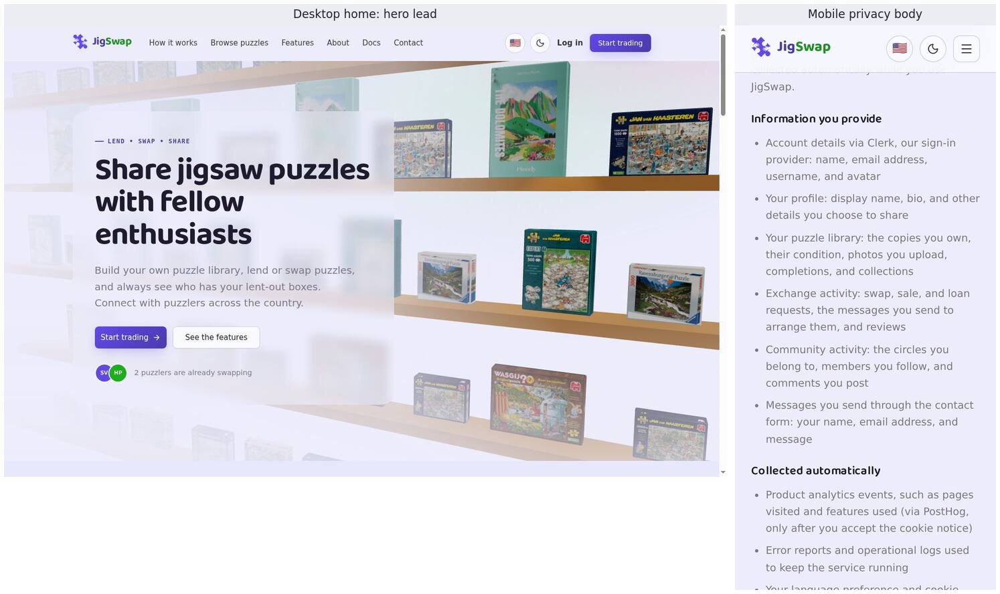

**UX-13 — Invite landing CTAs render as plain text** · _from MKT-3_

- **Problem:** The page uses `<Button asChild variant="brand"><SignUpLink/></Button>`. Radix Slot passes the button's className and ref to its child, but `SignUpLink` only forwards `to`, `params`, `search` and `children`. All three signed-out CTAs (header Follow, "Sign up to follow", "Sign up free") therefore lose their button styling. `/members/<handle>?invite=…` is where shared invite links land.
- **Evidence:** `tiles/desktop-light/pub__members_sander__01.jpg`; `tiles/mobile-light/pub__members_sander__01.jpg` and `__03.jpg`. Image below.
- **Root cause:** `apps/web/src/components/members/profile-body.tsx:803-819`; used at `:316`, `:716` and `:831`.
- **Fix:**
  - Make `SignUpLink` a `React.forwardRef` that spreads `...rest` onto `<Link>`.
  - Add a render test that asserts `data-slot="button"` and the brand variant class.

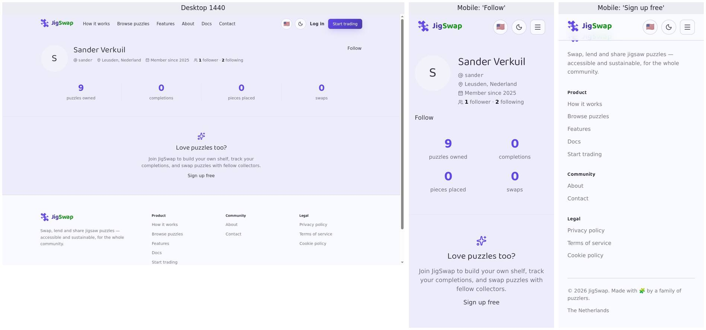

**UX-14 — SEO and share metadata gaps** · _from MKT-5_

- **Problem:**
  - Only the catalogue routes emit a description and OG tags. The home page, which is what gets pasted into WhatsApp, has none.
  - Docs routes have no `head()`, so every guide is titled "JigSwap".
  - EN and NL are negotiated on the same URL with no hreflang. Production returns `lang="en"` to Googlebot, so the Dutch copy is effectively unindexable.
  - `/catalog/nope` and `/docs/nope/nope` return 200 (soft 404s).
  - The `/catalog` title is hard-coded in English.
  - The sitemap lists only catalogue URLs. That is a documented choice, but it is worth extending.
- **Evidence:**
  - curl on production: 0 `meta description` tags and 0 `og:` tags on `/`.
  - `shots/desktop-light/pub__docs_getting-started_accounts-and-sign-in.json`: title "JigSwap".
  - curl: soft-404 status codes.
- **Root cause:**
  - `apps/web/src/routes/index.tsx:30`
  - `routes/_public/docs/$.tsx:12,25` (`notFound()` is thrown during render, not in a loader)
  - `routes/_public/docs/index.tsx:12`
  - `routes/_public/catalog/$id.tsx:61-63,92`
  - `routes/_public/catalog/index.tsx:43`
  - `lib/page-title.ts:13-15`
  - `lib/i18n.ts:62-66`
  - `routes/sitemap[.]xml.ts:9`
- **Fix:**
  - Add a shared `marketingHead(context, key)` returning title, description, og:* and twitter:card, with a static 1200×630 brand image.
  - Add docs `head()` built from frontmatter, with the page lookup moved into a loader. Throw `notFound()` from that loader and from the catalogue loader.
  - Add a crawlable locale URL (`?lang=nl` or `/nl`) plus `hreflang` alternates and `x-default`.
  - Add `Vary: Accept-Language, Cookie`.

**UX-15 — Catalogue filter dropdowns have no name** · _from MKT-6 (+ A11Y-2 catalogue part)_

- **Problem:** The brand and piece-count SelectTriggers are comboboxes, and a combobox doesn't take its name from its content. Screen readers only hear "Ravensburger, combobox". The search field's only label is its placeholder. Card titles are `h3` directly under the `h1`. This fails WCAG 4.1.2 (A) on the main public discovery page.
- **Evidence:** axe `button-name` (critical) ×2 per variant in `shots/*-light/pub__catalog.json`; aria snapshot `combobox: All brands`.
- **Root cause:** `apps/web/src/routes/_public/catalog/index.tsx:164-169,175,195`.
- **Fix:**
  - Add `aria-label`s: "Brand"/"Merk" and "Piece count"/"Aantal stukjes".
  - Give the input `type="search"` and an `aria-label`.
  - Add an sr-only `h2` above the grid.

**UX-73 — Auth pages are chrome-less** · _from MKT-7, JOURNEY-2_

- **Problem:**
  - `/sign-in` and `/sign-up` render the Clerk card in a bare flex container. There is no logo or link home, no footer, no language switch and no `<main>`, and the Clerk logo isn't configured in production either.
  - In the reviewed build, sign-up shows the dev instance's "Access restricted / Join waitlist". Production sign-up is open (`sign_up.mode = public`), so that part is plausible only. If production were ever restricted, this becomes a blocker.
  - In restricted mode, the stock Clerk nl-NL strings are garbled ("We wachten op je toegang tot de wachtlijst"), and the sign-in link is relabelled as a support link.
- **Evidence:** `tiles/desktop-light/pub__sign-in__01.jpg`, `tiles/mobile-light/pub__sign-in__01.jpg`, `tiles/mobile-nl/pub__sign-up__01.jpg`; axe `landmark-one-main` and `region` in `shots/desktop-light/pub__sign-in.json`. Image below.
- **Root cause:** `apps/web/src/routes/sign-in.$.tsx:15-27`, `sign-up.$.tsx:15-27`; the `nlNL` localization is passed unmodified at `routes/__root.tsx:181`.
- **Fix:**
  - Add a shared AuthShell: Wordmark link to `/`, `<main>` around the card, a footer with privacy, terms and catalogue links, and the language switcher.
  - Set the Clerk logo.
  - Override `nlNL.signUp.restrictedAccess.*` in `__root.tsx`.

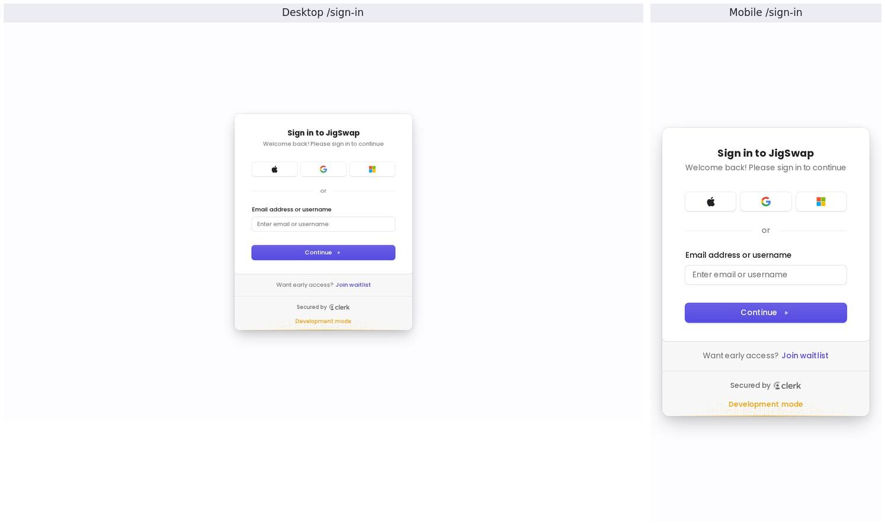

**UX-74 — Cookie banner** · _from MKT-9_

- **Problem:**
  - Below 640px each button contains an `sr-only sm:hidden` duplicate of its label, so screen readers say "Decline Decline" and "Accept Accept".
  - The buttons are `h-7` (28px).
  - The text says "please see our cookie policy" but contains no link.
  - The container has no `role` or label.
  - Refuted: the claim that the banner floats over dialog overlays. The overlay sits above it.
- **Evidence:** `tiles/first-visit/mobile__cookie-banner.jpg` (image below); a read-only check gave `textContent` "DeclineDecline".
- **Root cause:** `apps/web/src/components/blocks/cookie-consent.tsx:193-204` and `:180-211`, with the wrapper at `:95-104`; `components/providers.tsx:57` passes no `learnMoreHref`.
- **Fix:**
  - Delete the sr-only spans.
  - Buttons → `h-10 px-4 text-sm`.
  - Link "cookie policy" to `/privacy#p-cookies`.
  - Give the wrapper `role="region" aria-label={t('title')}`.

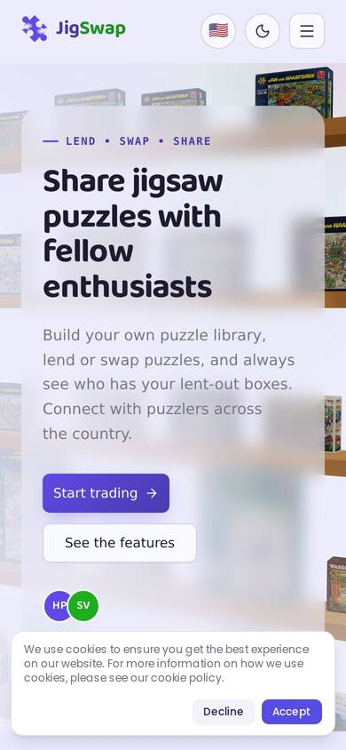

**UX-75 — Consent can't be withdrawn** · _from MKT-10_

- **Problem:**
  - The banner copy is boilerplate ("ensure you get the best experience") and doesn't say it is asking about EU-hosted PostHog analytics.
  - `writeAnalyticsConsent` is only called from the banner, and the cookie lasts 10 years.
  - There is no "Cookie settings" control anywhere, which conflicts with GDPR Art. 7(3).
  - The footer's "Cookie policy" and "Privacy policy" both point at `/privacy`.
- **Evidence:** `tiles/first-visit/desktop__cookie-banner.jpg`; `en.json` privacy.cookies.
- **Root cause:** `apps/web/src/lib/analytics-consent.ts:31-35`; `components/blocks/cookie-consent.tsx:52,76`; `components/marketing/footer.tsx:51-53`; `locales/en.json:1503`.
- **Fix:**
  - Add `resetAnalyticsConsent()`, which clears the cookie and calls PostHog `opt_out_capturing()` and `reset()`.
  - Add a "Cookie settings" button to the footer and to the privacy cookies section; it reopens the banner.
  - Rewrite the copy as "Allow analytics" / "No thanks" with one line on PostHog EU.
  - Point the footer link at `#p-cookies`.

**UX-76 — Catalogue detail copy** · _from MKT-11 (+ A11Y-7)_

- **Problem:**
  - The Dutch page shows a literal "pieces" and a raw, lowercase "medium".
  - The list says "1000 stukken / Gemiddeld" while the detail page says "1.000 pieces / medium".
  - The rating block always renders, so an unrated puzzle shows a large "0", empty stars and five 0% bars.
  - `ratingsCount` has no plural form, so one rating reads "1 ratings".
- **Evidence:** `tiles/mobile-nl/pub__catalog_m9712…__01.jpg` (image in §3.2), `tiles/mobile-nl/pub__catalog__01.jpg`, `tiles/desktop-light/pub__catalog_m9712…__02.jpg`.
- **Root cause:** `apps/web/src/routes/_public/catalog/$id.tsx:157-160,178,310-323`; `locales/en.json:4716`.
- **Fix:**
  - Use `t('piecesCount', {count})` with `format.number`, and the translated difficulty map.
  - When `rating.count === 0`, show "No ratings yet" instead of the block.
  - Make `ratingsCount` an ICU plural.

**UX-77 — Off-brand 404** · _from MKT-13_

- **Problem:**
  - The page is a generic shadcn Card with a warning triangle. It has no h1 (CardTitle is a div), no `<main>` and no footer.
  - "Browse Puzzles" links to members-only `/browse`, which redirects signed-out visitors to sign-in.
  - The Dutch strings use title case ("Pagina Niet Gevonden", "Terug naar Home").
  - The same card is reused for the catalogue and docs soft-404s.
- **Evidence:** `tiles/desktop-light/pub__this-page-does-not-exist__01.jpg`, `tiles/mobile-nl/pub__this-page-does-not-exist__01.jpg`; axe `page-has-heading-one` and `landmark-one-main`.
- **Root cause:** `apps/web/src/components/NotFound.tsx:18,28,42,54`; `routes/__root.tsx:139`; `routes/_public.tsx:14`.
- **Fix:**
  - Render the title as an h1 inside `<main>`, with MarketingFooter.
  - Change the actions to Home and "Browse the catalogue" (`/catalog`), plus links to docs and contact.
  - Keep `/browse` only in the in-app NotFound.
  - Change the Dutch strings to sentence case.

**UX-78 — Docs navigation on small screens** · _from MKT-14, SHELL-21_

- **Problem:**
  - In the sticky docs bar, the search button is a 16×16 hit area and the "Docs" button is 56×21.
  - The `aria-label` "Open documentation navigation" doesn't contain the visible word "Docs" (WCAG 2.5.3, A).
  - The search dialog input is 14px, so iOS zooms on focus.
  - The desktop `/docs` landing has no visible search; ⌘K works but isn't advertised.
  - All six docs categories use the same BookOpen icon.
- **Evidence:** `tapUnder24` in `shots/mobile-light/pub__docs_getting-started_accounts-and-sign-in.json`; axe `label-content-name-mismatch` on mobile and tablet docs; `agents/MKT/docs-mobile-search.jpg`; `tiles/desktop-light/pub__docs__01.jpg`.
- **Root cause:** `apps/web/src/components/docs/docs-mobile-bar.tsx:14-29`; `components/ui/command.tsx` (CommandInput `text-sm`); `routes/_public/docs/route.tsx:54-60`; `routes/_public/docs/index.tsx:44`.
- **Fix:**
  - Both bar buttons → `h-11 min-w-11`, and make the accessible name start with "Docs".
  - Docs CommandInput → `text-base md:text-sm`.
  - Add a search trigger to the `/docs` hero.
  - Give each category its own icon.

**UX-79 — Contact form semantics** · _from MKT-16_

- **Problem:**
  - Subject chips are plain buttons with no `aria-pressed` or radio role, and the "Subject" caption isn't associated with them.
  - Errors are not linked with `aria-describedby`, not announced, and focus doesn't move to them.
  - Name and email have no `autocomplete`.
  - The textarea is 15px, so iOS zooms on focus.
  - "Privacy policy" isn't a link.
  - On phones the form starts about one screen down.
- **Evidence:** `tiles/mobile-light/pub__contact__01.jpg`, `__02.jpg`; `zoomingInputs` in `shots/mobile-light/pub__contact.json`.
- **Root cause:** `apps/web/src/routes/_public/contact.tsx:130-138,193-216,220-236,251,267-269`.
- **Fix:**
  - Make the chips a `role="radiogroup"` with `aria-checked` and roving tabindex.
  - Give error messages ids and link them with `aria-describedby`; focus the first invalid field; `role="alert"` on the submit error.
  - Add `autoComplete` attributes.
  - Textarea → `text-base`.
  - Link the privacy note.

**UX-80 — Legal pages have no contents list below 900px** · _from MKT-17_

- **Problem:**
  - The sticky table of contents is `max-[900px]:hidden` with no fallback. Tablet and phone readers face 7–8 screens across 17 sections with no contents list.
  - The desktop entries are buttons that scroll with JavaScript, without updating the URL hash or moving focus, so sections can't be deep-linked.
- **Evidence:** `tiles/tablet-light/pub__privacy__01.jpg` to `__08.jpg`.
- **Root cause:** `apps/web/src/components/marketing/legal-doc.tsx:52-60,66,72-84`.
- **Fix:**
  - Make the entries `<a href="#id">` links (sections already have `scroll-mt`).
  - Below 900px, render the same list in a `
` "Contents" block.

**UX-81 — Marketing header below 861px** · _from MKT-19 (+ A11Y-18 menu part)_

- **Problem:**
  - Between 390 and 860px the header shows only the flag, the theme toggle and the hamburger. Log in and "Start trading" are only reachable through the menu, and the home page is 8 screens long with the CTA appearing only twice.
  - The menu toggle has no `aria-expanded` or `aria-controls`, the panel isn't a `<nav>`, and Escape doesn't close it.
- **Evidence:** `tiles/tablet-light/pub__home__01.jpg`; `agents/MKT/mobile-menu-open.jpg`.
- **Root cause:** `apps/web/src/components/marketing/header.tsx:81-95,105-112,115-141`.
- **Fix:**
  - Add a compact brand "Start trading" button before the hamburger (`min-[861px]:hidden`), and move the theme toggle into the menu.
  - Add `aria-expanded` and `aria-controls="mk-mobile-nav"`, an Escape handler, and return focus to the toggle on close.

**UX-82 — Public catalogue filters aren't in the URL** · _from MKT-20_

- **Problem:**
  - Search, brand, piece bucket and "Load more" pages live in component state, so Back from `/catalog/<id>` resets them, and a filtered view can't be shared.
  - On phones, three full-width controls take about 260px before the first result.
- **Evidence:** `tiles/mobile-light/pub__catalog__01.jpg`.
- **Root cause:** `apps/web/src/routes/_public/catalog/index.tsx:42-63,71-90,103`.
- **Fix:**
  - Add `validateSearch` for `q`, `brand` and `pieces`, and update the URL with `navigate({search, replace:true})`.
  - On phones, put the two selects side by side with `grid-cols-2`.
  - The in-app equivalent is UX-28.

**UX-162 — Catalogue detail cover on tablet and phone** · _from MKT-12_

- **Problem:** Below lg the cover is a full-width `aspect-square`, so landscape box art leaves 100–200px empty bands above and below. Title and CTA are still above the fold, but availability and stats are pushed down.
- **Evidence:** `tiles/tablet-light/pub__catalog_m9712…__01.jpg`, `tiles/mobile-light/pub__catalog_m9712…__01.jpg`.
- **Root cause:** `apps/web/src/routes/_public/catalog/$id.tsx:137-138`.
- **Fix:** Use a two-column grid from md (`md:grid-cols-[260px_minmax(0,1fr)]`) and an `aspect-[4/3]` cover on phones.

**UX-163 — Accounts guide uses labels that don't exist** · _from MKT-15_

- **Problem:**
  - The guide says "Click **Sign Up** / **Sign In**", but the UI says "Start trading" / "Log in". The NL guide says "Registreren", but the button is "Begin met ruilen".
  - The list of public pages leaves out the catalogue, docs and member profiles, and none of its entries are links.
- **Evidence:** `tiles/desktop-light/pub__docs_getting-started_accounts-and-sign-in__01.jpg` and `__02.jpg`.
- **Root cause:** `docs/user/en/getting-started/accounts-and-sign-in.md:14,20,28`; `docs/user/nl/getting-started/accounts-and-sign-in.md:14`.
- **Fix:** Use the real labels, and turn the public-pages list into links that include the catalogue, docs and member profiles.

**UX-164 — Anonymous trust story** · _from MKT-18_

- **Problem:**
  - The live counts render unconditionally: "13 puzzlers are already swapping" in production, 2 in dev.
  - The testimonial is attributed to "The family behind JigSwap".
  - The `/about` hero has no names or photo, and its right half is empty.
  - The verifier rated this polish: it is a content decision.
- **Evidence:** `tiles/desktop-light/pub__home__01.jpg`, `__02.jpg` and `__05.jpg`; `tiles/desktop-light/pub__about__01.jpg`.
- **Root cause:** `apps/web/src/components/marketing/home/hero.tsx:257-262`; `components/marketing/home/stats.tsx:15-19`.
- **Fix:**
  - Below about 50 members, change the copy to "Be one of our first puzzlers" and hide the stats.
  - On `/about`, add a family photo and first names, and link the founder's profile.

**UX-165 — Marketing copy drift** · _from MKT-21_

- **Problem:**
  - The EN CTA is "Start trading", but the NL one is "Begin met ruilen" (start swapping).
  - The home page says "three steps" while `/how-it-works` says "five steps".
  - "Across the country" (EN) vs "in heel Nederland" (NL).
  - The theme toggle's `aria-label` is hard-coded English.
  - The Dutch sample box titles on English pages are intentional, so they are not a defect. The flag is covered in UX-57, and stukken/stukjes in UX-65.
- **Evidence:** `tiles/desktop-light/pub__home__02.jpg`; `tiles/desktop-light/pub__how-it-works__01.jpg`.
- **Root cause:** `apps/web/locales/en.json:3340,3402`; `components/marketing/header.tsx:204`.
- **Fix:**
  - Align the CTA meaning across both languages.
  - Make the teaser say "three steps" and link to "the full five-step tour".
  - Say "across the Netherlands".
  - Use `t('toggleTheme')` for the label.

**UX-166 — Public semantic polish** · _from MKT-22, A11Y-18_

- **Problem:**
  - `/docs` and `/how-it-works` jump from h1 straight to h3.
  - The header, legal-TOC and on-page-TOC `<nav>`s have no labels (axe `landmark-unique`).
  - Collapsed FAQ answers are only hidden with `max-height:0`, so screen readers still read them.
  - The decorative JigPlank box labels ("Natuur", "1000 PCS" at 5.5px) are read aloud.
  - The public pending message is a hard-coded "Loading...".
- **Evidence:** axe in `shots/desktop-light/pub__docs.json`, `pub__how-it-works.json`, `pub__privacy.json`; `smallText` on `pub__home`.
- **Root cause:** `apps/web/src/routes/_public/docs/index.tsx:46`; `components/marketing/header.tsx:75`; `components/marketing/legal-doc.tsx:70`; `components/docs/on-page-toc.tsx:34`; `components/marketing/faq-item.tsx:33-36`; `components/marketing/home/feature-rows.tsx:94`; `routes/_public.tsx:12`.
- **Fix:**
  - Use h2 for those cards.
  - Label each nav with `aria-label`.
  - Add `inert` (or `hidden` after the transition) to collapsed FAQ answers, plus `aria-controls` on the toggle.
  - Add `aria-hidden` to the illustration wrapper.
  - Translate the loading message.

### 6.4 Onboarding, dashboard home, What's new & tours

Onboarding is well built: each step has its own URL, focus moves to each step's heading, the footer hides while the keyboard is up, and the onboarding prompts take turns instead of stacking. On screen, the activation path has two real problems:

- the big **Continue** button silently drops work the member hasn't saved yet;
- the 3D shelf, the dashboard's signature element, is cropped on tablet and phone.

The rest is consistency (step numbering), dashboard information density, and how easy guides are to find.

| ID     | Title                                                                                                                | Severity | Viewports | Effort | Status    |
| ------ | -------------------------------------------------------------------------------------------------------------------- | -------- | --------- | ------ | --------- |
| UX-16  | Quick-setup **Continue** silently discards unsaved picks, ticks and location                                         | major    | D, T, M   | M      | confirmed |
| UX-17  | 3D shelf crops the outer covers on tablet and phone; its fallback layer causes the regionOverflowX                   | major    | T, M      | M      | confirmed |
| UX-83  | Step counts and numbering disagree between dialog, eyebrow, stepper and card; the bar shows completion, not position | minor    | D, T, M   | S      | confirmed |
| UX-84  | Continue walks through steps already done; the done panel celebrates while steps are still open                      | minor    | D, T, M   | S      | confirmed |
| UX-85  | The "Find your people" step needs a username and sends you to `/profile` with no way back                            | minor    | D, T, M   | S      | confirmed |
| UX-86  | The welcome dialog only appears on `/dashboard`, so members who sign up from a deep link never see it                | minor    | D, T, M   | S      | confirmed |
| UX-87  | A new member's dashboard repeats the same puzzles and spends most of a phone screen on zeros                         | minor    | D, T, M   | S      | confirmed |
| UX-88  | Briefing headline ignores owned puzzles; first visit says "Welcome back"                                             | minor    | D, T, M   | S      | confirmed |
| UX-89  | The phone shelf renders 3D continuously, with a contact-shadow pass every frame                                      | minor    | M, T      | S      | confirmed |
| UX-90  | What's new shows 42 fully expanded entries (about 41 phone screens)                                                  | minor    | D, T, M   | M      | confirmed |
| UX-91  | Guides and tours are hard to find                                                                                    | minor    | D, T, M   | M      | confirmed |
| UX-167 | Guides tab: ten identical primary buttons, 36px on touch, resume state shown twice                                   | polish   | M, T, D   | S      | confirmed |
| UX-168 | The optional Household step includes four invite methods and "Revoke open links"                                     | polish   | D, T, M   | S      | confirmed |
| UX-169 | Flow header: truncated eyebrow, content spanning 1,100px, stepper items aren't links                                 | polish   | M, D, T   | S      | confirmed |
| UX-170 | Dashboard links: "View Collections" on the shelf, rating links to People, two links both named "All"                 | polish   | D, T, M   | S      | confirmed |

**UX-16 — Continue discards unsaved step work** · _from ONB-2, JOURNEY-3_

- **Problem:** Each `/welcome` step keeps its pending state locally and saves it with its own button: picks in CataloguePicker, ticks in PastSolvesList, the typed location in ProfileStep. The footer's Continue only navigates, which unmounts the step and drops that state with no guard and no toast.
  - On phones Continue is the full-width, dominant primary. The in-step button reads "Log 0 puzzles" while nothing is ticked.
  - A member who ticks three finished puzzles and taps Continue logs nothing, and the dashboard card still lists that step as to do.
- **Evidence:**
  - `tiles/{desktop-light,tablet-light,mobile-light,mobile-nl}/app__welcome__01.jpg` (image below)
  - `agents/ONB/mobile__welcome_puzzles.jpg`, `agents/JOURNEY/m-welcome-puzzles.jpg`
  - `shots/mobile-light/app__welcome.json`: "Log 0 puzzles" is 129×36.
- **Root cause:**
  - `apps/web/src/routes/_dashboard/welcome.tsx:85-93`
  - `components/solving/past-solves-form.tsx:118-120,183-189`
  - `components/catalogue-picker/catalogue-picker.tsx:61`
  - `components/quick-start/profile-step.tsx:56,82`
  - `components/quick-start/flow-view.tsx:123-145`
- **Fix:**
  - Let steps register a pending commit (e.g. a `StepCommitContext` with count, label and commit).
  - While something is pending, relabel Continue "Add 3 and continue" / "3 vastleggen en doorgaan", await the commit, then navigate.
  - Hide the in-step submit inside `/welcome`, or never show "Log 0".
  - At minimum, confirm before leaving a step with unsaved changes.
  - Fix the note "unless you switch on swapping below" (`en.json:1792`): the switches it refers to aren't below.

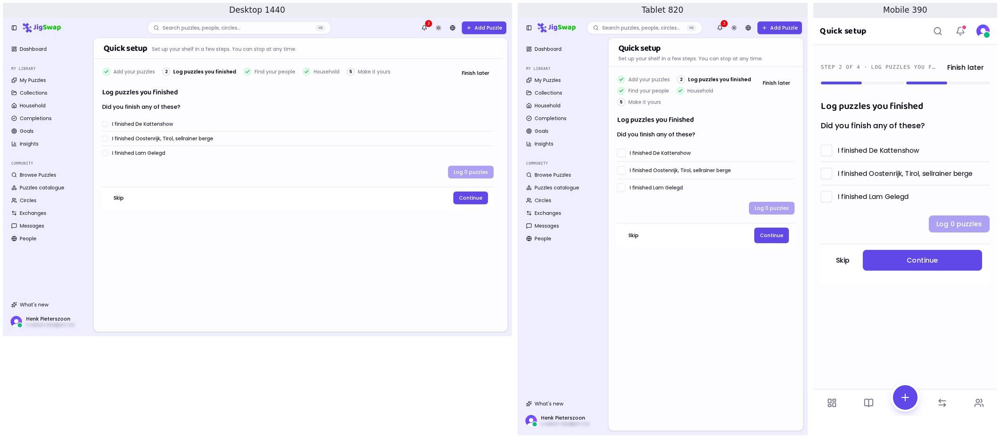

**UX-17 — 3D shelf crops on tablet and phone** · _from ONB-3, SOC-10_

- **Problem:**
  - The camera is framed to fit height only (`framedH`, with a `MIN_VIS_W` floor). It never uses the row width, so on near-square canvases (358×300 on a phone, 502×360 on a tablet) the outer boxes are cut mid-art. This happens on the dashboard and on `/profile`, and it gets worse with the 5–6 box maximum.
  - The CSS fallback plank (`width: fit-content`, 444–590px) sits in an unclipped `absolute inset-0` layer, which produces regionOverflowX 85/41 on the dashboard and 121/41 on the profile. It is invisible once WebGL draws, but visibly cut without WebGL.
  - The geometry is deterministic; this is not a software-GL artifact.
- **Evidence:** `tiles/tablet-light/app__dashboard__01.jpg`, `tiles/mobile-light/app__dashboard__02.jpg`, `tiles/mobile-light/app__profile__01.jpg`; `agents/ONB-verify/mobile__shelf.jpg`, `tablet__shelf.jpg`. Image in §3.2.
- **Root cause:** `apps/web/src/components/common/puzzle-plank-3d/scene.tsx:212-219,233`; `components/common/puzzle-plank-3d/index.tsx:153-174`; `components/common/puzzle-plank.tsx:40,136`.
- **Fix:**
  - Frame both axes: `contentH = max(framedH, (rowWidth + 0.3) / aspect, MIN_VIS_W / aspect)`.
  - Add `overflow: hidden` to the fallback container.
  - Scale the fallback with `transform: scale(min(1, containerW / plankW))`.
  - Optionally cap phones at 3 boxes.

**UX-83 — Step numbering disagrees** · _from ONB-4, JOURNEY-14_

- **Problem:**
  - The phone eyebrow counts only required steps ("Step 4 of 4 · Make it yours"). The desktop stepper and the dashboard card number all five steps by array index, so "Make it yours" is 5 and Household is 4.
  - The welcome dialog lists 3 steps.
  - The card's "2 of 4" means steps done, while the flow's "Step 2 of 4" means your position.
  - The progress bar fills only completed segments, so "Step 2 of 4" sits over an empty second segment between two filled ones.
- **Evidence:** `tiles/desktop-light/app__welcome__01.jpg`, `tiles/mobile-light/app__welcome__01.jpg`; `agents/ONB/mobile__welcome_profile.jpg` vs `desktop__welcome_profile.jpg`; `tiles/first-visit/mobile__whats-new-modal.jpg`.
- **Root cause:** `apps/web/src/components/quick-start/flow-view.tsx:59-62,102`; `components/quick-start/quick-setup-card.tsx:135`; `components/quick-start/logic.ts:52-67`; `components/quick-start/welcome-dialog.tsx:87`.
- **Fix:**
  - Use `stepPosition()` everywhere, and show Household as an "Optional" marker without a number.
  - Give the current segment its own style (e.g. a ring).
  - Card meta → "{done} of {total} done".
  - Make the dialog copy say "Four quick steps".

**UX-84 — Continue revisits steps already done** · _from ONB-5_

- **Problem:**
  - `nextFlowStep` is a plain index + 1, so starting from a dashboard card row, Continue walks through steps that are already done.
  - The people step calls the invite mutation on mount.
  - The done panel always says "Your shelf is ready", even while required steps are still open.
- **Evidence:** `agents/ONB/mobile__welcome_done.jpg`, next to the dashboard card's "2 of 4".
- **Root cause:** `apps/web/src/components/quick-start/logic.ts:38,45-49`; `routes/_dashboard/welcome.tsx:72-73,81,89`; `components/quick-start/flow-view.tsx:174-186`.
- **Fix:**
  - Add `nextOpenStep(step, view)` and use it for both Skip and Continue.
  - When `requiredDone < requiredTotal`, the done panel says "Almost there: {n} steps left" and links to the first open step.

**UX-85 — People step requires a username** · _from JOURNEY-15_

- **Problem:** Members without a username (common after OAuth sign-up) see "Set a username first". The button, "Open account settings", opens the public-profile page. There the username sits behind Edit Profile, which on a phone is the form that is wider than the screen (UX-03), and nothing brings the member back to the step. Step 4 never asks for a username either.
- **Evidence:** `agents/JOURNEY/m-welcome-people.jpg`; `tiles/mobile-light/app__profile__01.jpg`.
- **Root cause:** `apps/web/src/components/quick-start/people-step.tsx:62-63,131-145`; `locales/en.json:3017-3019`.
- **Fix:**
  - Embed the username field from `edit-profile-form` (extracted as `<UsernameField onSaved>`) directly in the step.
  - If a detour stays, link to `/profile?edit=1&returnTo=/welcome?step=people` and label it "Set username".

**UX-86 — Welcome dialog only on `/dashboard`** · _from JOURNEY-20_

- **Problem:** Members who sign up from a catalogue CTA, or through `require-auth`'s `redirect_url`, land on `/browse` or the page they came from. They never see the one-time welcome dialog.
- **Evidence:** `tiles/mobile-light/pub__catalog_m9712…__02.jpg` ("Join to see who" → `/sign-up?redirect_url=/browse?puzzle=…`).
- **Root cause:** `apps/web/src/routes/_dashboard/dashboard.tsx:29`; `components/quick-start/welcome-dialog.tsx:24-28`; `routes/_public/catalog/$id.tsx:294`; `lib/require-auth.ts:14`.
- **Fix:** Mount `WelcomeDialog` once in the `_dashboard` shell (it is already gated by `showWelcome` and the surface-busy flag). Suppress it on `/welcome` and on immersive routes.

**UX-87 — New-member dashboard is repetitive** · _from ONB-8_

- **Problem:**
  - "Fresh on the Shelf" and the shelf read the same newest-first list, so anyone with 5 or fewer copies sees the same puzzles twice.
  - All four stat rows render even when they are zero.
  - Feed rows don't name the puzzle ("added a puzzle to their shelf" three times).
  - On a phone, the shelf section with its stats is 652px tall, 77% of the screen.
- **Evidence:** `tiles/desktop-light/app__dashboard__02.jpg` vs `__03.jpg`; `tiles/mobile-light/app__dashboard__02.jpg` and `__03.jpg`; `agents/ONB/shelf.mjs`.
- **Root cause:** `apps/web/src/components/dashboard-home/fresh-section.tsx:47`; `shelf-section.tsx:127-133,169-194`; `pulse-section.tsx` (feed `t.rich` without the title).
- **Fix:**
  - Hide Fresh when there are 5 or fewer copies, or turn it into community "Fresh in Browse".
  - Use a 2×2 compact stats grid on phones, and hide zero rows for new members.
  - Put the puzzle title in feed rows, and merge runs by the same actor and kind.

**UX-88 — Briefing headline and greeting** · _from ONB-13, JOURNEY-18_

- **Problem:**
  - The headline variant depends only on swaps, pending requests and goals. A member with 3 puzzles still reads "Your shelf is ready when you are — add a puzzle…".
  - The greeting is always "Welcome back", even under the "Welcome to JigSwap!" dialog.
  - The phone h1 issue is covered in UX-66.
- **Evidence:** `tiles/desktop-light/app__dashboard__01.jpg` (next to the "3 Puzzles Owned" stat); `tiles/mobile-nl/app__dashboard__01.jpg`.
- **Root cause:** `apps/web/src/components/dashboard-home/briefing-hero.tsx:65-86`; `components/dashboard-layout/page-head.tsx:39-44`; `locales/en.json:1130,3653`.
- **Fix:**
  - Pass `ownedCount` and `offeredCount` to the briefing and add variants: "N puzzles on your shelf — offer a few for swap" and "N up for grabs — browse what others have".
  - Greet with "Welcome, {name}" during the first session.

**UX-89 — Phone shelf renders continuously** · _from ONB-9_

- **Problem:**
  - The canvas uses `frameloop="always"` whenever it is visible, and ContactShadows uses the default `frames = Infinity`. Parallax is driven by the pointer, which barely moves on touch.
  - Rendering pauses offscreen, which is good, but a static picture still costs a 60fps loop on the most-visited phone screen.
  - The impact is inferred from config: dev mode and software GL give no meaningful numbers.
- **Evidence:** `agents/ONB/mobile__shelf.jpg` (716×600 canvas); `ContactShadows.js:9,76` in node_modules.
- **Root cause:** `apps/web/src/components/common/puzzle-plank-3d/scene.tsx:61-85,122-146,272-279,306`.
- **Fix:**
  - Use `frameloop="demand"`, with `invalidate()` on pointermove and until damping settles.
  - Set `<ContactShadows frames={1}>`.
  - Skip Parallax on coarse pointers.
  - Defer `import('./scene')` to idle time.

**UX-90 — What's new is a wall of text** · _from ONB-10_

- **Problem:**
  - Every card renders its summary and the full markdown body. There are 42 entries, with no Read more, no "Show older" and no filter.
  - Two different entries share the title "Improvements to messages".
  - The copy says "Click Reload" even on touch devices.
- **Evidence:** `shots/mobile-light/app__whats-new.json` (pageHeight 34,734; mobile-nl 37,974; desktop regionScrollHeight 21,932); `tiles/desktop-light/app__whats-new__01.jpg` to `__08.jpg`.
- **Root cause:** `apps/web/src/components/whats-new/whats-new-list.tsx:36-66,116-122`; `docs/whats-new/*-messages*.md` frontmatter; `docs/whats-new/2026-10-21-new-version-prompt.en.md:12`.
- **Fix:**
  - Put the body in a `
` that opens for unread or deep-linked entries.
  - Show the latest 2 months plus "Show older".
  - Add category chips.
  - Give entries unique titles, and use "Choose" / "Kies" instead of "Click".

**UX-91 — Guides and tours are hard to find** · _from ONB-11_

- **Problem:**
  - Guides are the second tab of a changelog page. On phones that page is only reachable from the + quick sheet or the avatar menu.
  - "Show me around" appears only on the `/welcome` done panel.
  - The ? help button exists on just 4 routes, and it is 32px.
- **Evidence:** `agents/ONB/mobile__guides.jpg`; `agents/ONB/guides.mjs`.
- **Root cause:** `apps/web/src/components/dashboard-layout/mobile-quick-sheet.tsx:68-74`; `components/dashboard-layout/shell-user-button.tsx` (no help item); `components/tour/guide-help-button.tsx:36`; `routes/_dashboard/welcome.tsx:138-155`.
- **Fix:**
  - Add "Help & guides" to the account menu and the quick sheet, linking to `/whats-new?tab=guides`.
  - Add a "Take the 1-minute tour" row to QuickSetupCard.
  - Add GuideHelpButton to the dashboard and `/people`, with `pointer-coarse:size-11`.

**UX-167 — Guides tab button hierarchy** · _from ONB-15_

- **Problem:**
  - All ten guides have identical full-width violet "Take the tour" buttons, 36px tall on touch.
  - A resumable guide shows a "Step 3 of 3" chip and also says "Resume tour (step 3 of 3)" on its button.
  - Update CTAs are 316×36.
- **Evidence:** `agents/ONB/mobile__guides.jpg`; `shots/mobile-light/app__whats-new.json`.
- **Root cause:** `apps/web/src/components/whats-new/guides-list.tsx:116-120,176-189`; `components/whats-new/whats-new-list.tsx:164-177,200-206`.
- **Fix:**
  - Make not-started guides outline buttons, and keep one primary (the resumable guide, or "Getting started").
  - Shorten the label to "Resume" when the chip already shows the step.
  - Add `pointer-coarse:min-h-11`.

**UX-168 — Household step is heavy for an optional step** · _from ONB-16_

- **Problem:**
  - The step shows member search, "Create invite link", "Revoke open links" and email invite all at once.
  - A household with only you in it counts as done.
- **Evidence:** `agents/ONB/mobile__welcome_household.jpg`.
- **Root cause:** `apps/web/src/components/quick-start/household-step.tsx:186-199`; `components/household/household-invite-link.tsx` (always renders revoke).
- **Fix:**
  - Make sharing a link the primary action, and put "Invite by name or email" behind a `
`.
  - Show `showRevoke={false}` in onboarding.
  - Label a one-person household "Just you so far".

**UX-169 — Flow header** · _from ONB-17_

- **Problem:**
  - The 11px eyebrow repeats the step title and gets truncated ("STEP 2 OF 4 · LOG PUZZLES YOU F…", NL "STAP 2 VAN 4 · LEG VAST WAT…").
  - On desktop the step body spans about 1,100px, with Skip at the far left and the action at the far right.
  - Stepper items are plain `<li>` elements, even though every step has its own URL.
- **Evidence:** `tiles/mobile-light/app__welcome__01.jpg`, `tiles/mobile-nl/app__welcome__01.jpg`, `tiles/desktop-light/app__welcome__01.jpg`; `truncatedText` in `shots/mobile-light/app__welcome.json`.
- **Root cause:** `apps/web/src/components/quick-start/flow-view.tsx:59-62,76-89,91-108,110-123`.
- **Fix:**
  - Eyebrow shows only "Step 2 of 4".
  - Wrap the flow in `mx-auto max-w-2xl`.
  - Make stepper items `<Link to="/welcome" search={{step}}>`.

**UX-170 — Dashboard link targets** · _from ONB-18_

- **Problem:**
  - The shelf's action is "View Collections", a different concept.
  - The Average Rating row links to `/people`.
  - "Log a Completion" opens the list page.
  - The In Motion and Goals sections each have a link named just "All".
  - SectionHead meta truncates on phones ("3 on the…").
- **Evidence:** `tiles/desktop-light/app__dashboard__01.jpg` and `__03.jpg`; `truncatedText` in `shots/mobile-light/app__dashboard.json`.
- **Root cause:** `apps/web/src/components/dashboard-home/shelf-section.tsx:183-188,207-211`; `briefing-hero.tsx:178`; `section-head.tsx:44`; `pulse-section.tsx:159,280`.
- **Fix:**
  - Change the shelf action to "All my puzzles" → `/my-puzzles`.
  - Point the rating row at your own reviews.
  - Add sr-only context to the "All" links ("All exchanges", "All goals").
  - Hide the meta below sm.

### 6.5 Library: adding puzzles, copies, collections

The library looks tidy in light, dark and Dutch. Some parts are well built: the "Add several" picker, the segmented condition control, the copy history timelines, and the confirm dialogs for deletes. The add flow, though, has real functional defects:

- the cover the member picks is never saved;
- a single add pre-ticks "For Trade";
- after adding, the member lands on the community catalogue;
- the one-tap offer toggles silently make a copy visible.

My Puzzles also doesn't scale beyond a handful of copies.

| ID     | Title                                                                                                                        | Severity | Viewports | Effort | Status    |
| ------ | ---------------------------------------------------------------------------------------------------------------------------- | -------- | --------- | ------ | --------- |
| UX-18  | Cover colour or photo chosen while adding a copy is silently discarded                                                       | major    | D, T, M   | M      | confirmed |
| UX-19  | Single add pre-ticks "For Trade", which puts the copy up for swap; bulk add defaults to off                                  | major    | D, T, M   | S      | confirmed |
| UX-20  | One-tap offer toggles make a private copy visible and never switch it back                                                   | major    | D, T, M   | M      | confirmed |
| UX-21  | The collection "Add Puzzles" picker hides every copy that isn't offered for swap, lend or sale                               | major    | D, T, M   | S      | confirmed |
| UX-22  | My Puzzles doesn't scale: no search, sort or bulk actions; ⌘K doesn't find your copies; 25 per batch; no import              | major    | D, T, M   | L      | confirmed |
| UX-92  | After "Add to Library" the user lands on the community catalogue, and the toast says "collection"                            | minor    | D, T, M   | S      | confirmed |
| UX-93  | Add Puzzle chooser: clicking the card leaves the flow; the only add action is an unlabelled +; owned puzzles aren't marked   | minor    | D, T, M   | M      | confirmed |
| UX-94  | Copy detail: availability shown three ways, loan status and visibility missing, actions below the fold on phones             | minor    | D, T, M   | M      | plausible |
| UX-95  | Adding a copy of an existing puzzle is titled "Create a Puzzle — Add a brand-new puzzle to the catalogue"                    | minor    | D, T, M   | S      | confirmed |
| UX-96  | Condition label changes after saving; "New (sealed)" can't be selected; "<1m"; "Log a solve" vs "Log a Completion"           | minor    | D, T, M   | M      | confirmed |
| UX-97  | The copy page shows owner-only meta to everyone, and fields that can never be filled in                                      | minor    | D, T, M   | S      | confirmed |
| UX-98  | Library IA: the Library tab opens a launcher page, the same copy has two URLs, and crumb labels don't match the nav          | minor    | M, D, T   | M      | confirmed |
| UX-99  | Add-form inputs: tag field zooms on focus and has no focus ring; URL import field unlabelled; errors not announced           | minor    | M, T, D   | S      | confirmed |
| UX-100 | Mobile add form: a large preview with fake buttons and the readiness checklist sit below the submit button                   | minor    | M, T      | M      | confirmed |
| UX-101 | Collections: create dialog gives no validation or success feedback, tiles nest buttons, and there is no delete               | minor    | D, T, M   | S      | confirmed |
| UX-102 | Remove-from-collection is a one-tap red trash icon with no undo                                                              | minor    | D, T, M   | S      | confirmed |
| UX-103 | My Puzzles details: "add your first puzzle" shown when a filter matches nothing, "All / All" controls, Recall fails silently | minor    | D, T, M   | S      | confirmed |
| UX-171 | No camera barcode scan; a partial barcode shows three "Create new" buttons                                                   | polish   | M, T      | M      | confirmed |
| UX-172 | Add several: the picks tray and submit button drift below a growing results list                                             | polish   | M         | S      | confirmed |
| UX-173 | Card badges: availability looks like a tag, condition is unlabelled, menu rows are 32px                                      | polish   | D, T, M   | S      | confirmed |

**UX-18 — Cover picked while adding a copy is never saved** · _from LIB-1_

- **Problem:** The add form shows a "Cover colour — this is how your puzzle appears on the shelf" picker with swatches and Upload photo.
  - In copy mode the image is only uploaded when a new catalogue definition is created, so an uploaded photo is never stored.
  - `coverColor` is never saved in any mode; no backend field exists for it.
  - The live preview shows the uploaded photo, which wrongly confirms it was saved.
- **Evidence:** `tiles/desktop-light/app__my-puzzles_add_new_puzzleId_m9712…__01.jpg` (image in §3.1); `tiles/mobile-light/…__01-02.jpg`.
- **Root cause:** `apps/web/src/routes/_dashboard/my-puzzles/add/new.tsx:326,335,466,575,984`; `components/add-puzzle/live-preview-card.tsx:19-26`.
- **Fix:**
  - Remove the swatches, since nothing stores them.
  - In copy mode, either persist the photo after `createOwned` (`generateUploadUrl → addCopyPhoto → setCopyCover`, which needs the ownedPuzzles `_id` or a `coverImage` arg on `acquireCopy`), or hide the control.
  - Never preview data that won't be saved.

**UX-19 — Single add pre-ticks "For Trade"** · _from LIB-2_

- **Problem:** The main add paths (the catalogue + and "Add to Library") start with `forTrade: true`, so the copy is put on the market: it appears in Browse and can receive swap requests. Bulk add and the domain default are off. The readiness checklist also ticks "Availability set" as if it were required.
  - The claim that it also flips visibility was moot: new copies are already visible by default.
- **Evidence:** `tiles/*/app__my-puzzles_add_new_puzzleId_m9712…__01.jpg` (✓ For Trade); `tiles/desktop-light/app__my-puzzles_add_quick__01.jpg` (bulk add defaults off); `agents/LIB/m-addnew-full.jpg`.
- **Root cause:** `apps/web/src/routes/_dashboard/my-puzzles/add/new.tsx:118` vs `:138-141`, and `:1009-1016`.
- **Fix:**
  - Set `DEFAULT_FORM.availability` all false and delete `QUICK_FLOW_FORM`.
  - Drop "Availability set" from the checklist.
  - Hint: "Optional: switch on swapping or lending to show this copy in Browse."

**UX-20 — Offer toggles make a private copy visible** · _from LIB-9_

- **Problem:** The toggles on the copy page send `availabilityToSharing(…, snapshot.visibility)`, which forces visibility to "visible" whenever any offer is on. Withdrawing the offer then saves "visible" again, so the owner's earlier "Private" is lost for good.
  - The page never shows visibility.
  - There is no success toast and no undo.
  - The current state is shown as a filled brand button, which looks like a call to action.
- **Evidence:** `tiles/desktop-light/app__my-puzzles_m572…__01.jpg`; `agents/LIB/m-editcopy-01.jpg` (the explanation exists only in the Edit dialog).
- **Root cause:** `apps/web/src/routes/_dashboard/copies/$id.tsx:277-291`; `components/add-puzzle/add-puzzle-mappers.ts:12-22,74`.
- **Fix:**
  - Store the owner's chosen visibility separately from the effective one. The backend already derives the effective value.
  - Until then, confirm before offering a private copy ("Offering makes it visible; it goes back to private when you withdraw"), and send "private" when the last offer is withdrawn.
  - Show a toast with Undo after each change.
  - Render the offers as labelled Switch rows.

**UX-21 — Collection picker hides unoffered copies** · _from LIB-10_

- **Problem:** The collection "Add Puzzles" picker calls `ownedByOwner` with `includeUnavailable: false`, so only offered copies appear. Keep-only, private, lent-out and bulk-added copies can never be picked. The empty state then says "Add puzzles to your library first", even when the library is full.
  - The test data hides this: all three of Henk's copies are For Trade.
- **Evidence:** code. `tiles/*/app__collections__01.jpg` sends users to exactly this picker.
- **Root cause:** `apps/web/src/routes/_dashboard/collections/$id/add-puzzles.tsx:65,196-200`; `packages/backend/convex/library/getOwnedPuzzlesByOwner.ts:46-47`.
- **Fix:** Pass `includeUnavailable: true`, and split the empty state into three cases: library empty, everything already in the collection, and no search match.

**UX-22 — My Puzzles doesn't scale** · _from LIB-6, JOURNEY-9_

- **Problem:**
  - My Puzzles has status pills, an owner select and a view toggle, but no text search, no sort and no multi-select.
  - The "⌘K" hint is hidden for members in a household and below sm. ⌘K searches the catalogue, not the member's own copies.
  - View, status and owner are plain `useState`, so they reset on every visit.
  - Adding goes 25 picks per batch, with no camera scan and no list import.
  - Offering 50 copies, or filing them into collections, means 50 separate ⋯ menus.
- **Evidence:** `tiles/*/app__my-puzzles__01.jpg`; `tiles/desktop-light/app__my-puzzles_add_quick__01.jpg`.
- **Root cause:**
  - `apps/web/src/routes/_dashboard/my-puzzles/index.tsx:127-133,207-231,276-296`
  - `packages/backend/convex/search/globalSearch.ts:55-68` (no owned-copies group)
  - `components/catalogue-picker/selection.ts:7` (`PICK_LIMIT`)
- **Fix:**
  - Add an inline search (title, brand, tags; `text-base`) and a sort select (Recently added, Title, Pieces).
  - Keep view, status, owner, query and sort in `validateSearch`.
  - Add a selection mode with bulk Offer for swap/lend, Add to collection and Share with circle, reusing the household Sharing tab's select-all pattern.
  - Add an "In your library" group to `globalSearch`.
  - Auto-chunk picker batches over 25.
  - CSV import is a separate ticket.

**UX-92 — After adding, the user lands on the catalogue** · _from LIB-3_

- **Problem:**
  - On success the app pushes `/puzzles` (Community → Puzzles catalogue), where the new copy isn't shown.
  - The toast says "Puzzle added to your collection", but Collections is a separate feature.
  - The verifier rated this minor because the toast does confirm the add.
- **Evidence:** code (`createOwned` returns an id that isn't used).
- **Root cause:** `apps/web/src/routes/_dashboard/my-puzzles/add/new.tsx:335,347-353`; `components/dashboard-layout/route-meta.ts:167`; `locales/*.json` `puzzles.puzzleAdded`.
- **Fix:** Navigate to `/my-puzzles/<copyId>` (or `/my-puzzles`), and toast "Added to My Puzzles" with a View action. Cancel should return to `/my-puzzles/add`.

**UX-93 — Add Puzzle chooser leaves the flow** · _from LIB-5_

- **Problem:**
  - The chooser reuses the catalogue card. Its stretched link and "View Details" both go to `/puzzles/<id>`.
  - The add action is a 36px icon-only + next to a heart.
  - Owned puzzles aren't marked, while the quick picker does show "On your shelf".
  - On tablet the button text truncates to "View Det…".
- **Evidence:** `tiles/desktop-light/app__my-puzzles_add__01.jpg`; `agents/LIB/m-quick-search.jpg`.
- **Root cause:** `apps/web/src/routes/_dashboard/my-puzzles/add/index.tsx:268-271`; `components/puzzles/puzzle-card.tsx:46-93`.
- **Fix:**
  - Add a `variant="pick"`: clicking the whole card adds, a labelled "Add to my puzzles" button, a small ghost "Details" link, and no heart.
  - Show the "On your shelf" badge.
  - Below sm, use the quick picker's 48px rows.

**UX-94 — Copy detail hierarchy** · _from LIB-8 (plausible)_

- **Problem:**
  - Availability is shown three ways: a cover chip, a "For Trade" badge and a filled toggle.
  - An "Unknown" difficulty badge is shown.
  - The title appears twice (page head and content h1).
  - Custody isn't shown: who has the copy on loan only appears in Lending History. Visibility isn't shown at all.
  - On phones the first action button starts at y=814 of 844.
  - While a loan is open the offer toggles stay active, and `updateCopySharing` has no `heldBy` guard. (The claim that a lent copy still shows "Available" is refuted: lending out withdraws the offers.)
- **Evidence:** `tiles/desktop-light/app__my-puzzles_m572…__01.jpg`; `agents/LIB/m-copy-owner-01.jpg` (image below).
- **Root cause:** `apps/web/src/routes/_dashboard/copies/$id.tsx:236,415-428,453-482,548-571`; `packages/domain/src/library/…/update-copy-sharing.ts`.
- **Fix:**
  - Add one status line under the h1: "On loan to Anna since 3 Mar · Recall", "Offered for swap · Visible to the community", or "Private".
  - Disable the offer toggles during a loan, and reject such updates in the domain.
  - Drop the duplicate badges and the "Unknown" difficulty.
  - On phones, cap the cover at about 45vh.

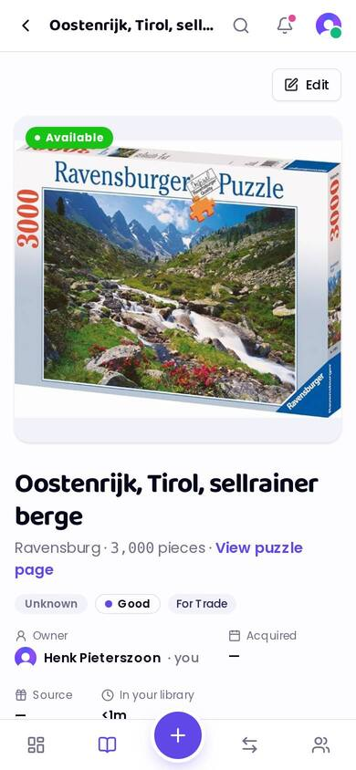

**UX-95 — Copy mode titled "Create a Puzzle"** · _from LIB-12_

- **Problem:** The page head says "Create a Puzzle · Add a brand-new puzzle to the catalogue and your shelf." directly above "ADDING A COPY OF Café". In NL it says "Een puzzel aanmaken".
- **Evidence:** `tiles/desktop-light/…add_new_puzzleId…__01.jpg`; `tiles/mobile-nl/…__01.jpg`.
- **Root cause:** `apps/web/src/components/dashboard-layout/route-meta.ts:147`; `routes/_dashboard/my-puzzles/add/new.tsx:56-58`.
- **Fix:** In copy mode, call `usePageHeader` with "Add your copy" / "Jouw exemplaar toevoegen" and the subtitle "Record its condition and how you'd like to share it."

**UX-96 — Condition and verb vocabulary** · _from LIB-13_

- **Problem:**
  - Choosing "Excellent" saves `like_new`, which then displays as "Like New" or "Like new", so the label the user picked changes after saving.
  - `new_sealed` can be displayed but not selected.
  - The card ⋯ menu says "Log a solve" while the copy page says "Log a Completion" (EN only).
  - "In your library: <1m" reads as minutes or metres.
  - The swap/trade terms are covered in UX-53.
- **Evidence:** `agents/LIB/m-mypuzzles-cardmenu.jpg`; `tiles/mobile-nl/app__my-puzzles__01.jpg`.
- **Root cause:** `apps/web/src/components/add-puzzle/add-puzzle-schema.ts:14-22`; `routes/_dashboard/copies/$id.tsx:383`; locale keys `puzzles.like_new`, `puzzles.condition_like_new`, `copyInstance.conditionLabel.*` and `copyInstance.durationLessThanMonth`.
- **Fix:**
  - Use one `condition.<value>` map for the picker, the badges and the copy page, and add `new_sealed`.
  - Say "Log a solve" everywhere.
  - Replace "<1m" with "Less than a month" / "Minder dan een maand".

**UX-97 — Owner-only and unfillable meta** · _from LIB-14, JOURNEY-19_

- **Problem:**
  - Visitors to someone else's copy see "In your library —" and "your rating of this copy —".
  - Owners see "Acquired —" and "Source —", but no form ever writes those fields. Only received swaps set them.
  - "Copy Reviews 0" offers no way to write one.
- **Evidence:** `tiles/desktop-light/app__copies_m578…__01.jpg`; `tiles/mobile-light/app__my-puzzles_m572…__03.jpg`.
- **Root cause:** `apps/web/src/routes/_dashboard/copies/$id.tsx:513-534,683-693`; `components/copies/edit-copy-dialog.tsx:137` (no acquisition fields, though `acquireCopy` accepts them).
- **Fix:**
  - Render the viewer-scoped items only for the owner.
  - Hide empty meta, or add "Acquired (month)" and "Source" to the Edit dialog with an "Add details" link.
  - Add a hint explaining where copy reviews come from.

**UX-98 — Library IA** · _from LIB-15 (+ JOURNEY-21 crumb)_

- **Problem:**
  - The Library tab opens a launcher of six static tiles, so My Puzzles is always two taps away.
  - Collection cards link to `/copies/<id>` while My Puzzles uses `/my-puzzles/<id>` for the same copy.
  - The crumb "Community › Owned Copies" links to `/browse`, which the sidebar calls "Browse Puzzles".
  - "My suggestions" takes the second header slot at every size.
- **Evidence:** `tiles/mobile-light/app__library__01.jpg` and `__02.jpg`; `tiles/desktop-light/app__copies_m578…__01.jpg`.
- **Root cause:** `apps/web/src/components/dashboard-layout/mobile-tab-bar.tsx:37`; `components/dashboard-layout/group-landing.tsx:19`; `components/ui/puzzle-card.tsx:277`; `routes/_dashboard/copies/$id.tsx:330`; `routes/_dashboard/my-puzzles/index.tsx:242-250`.
- **Fix:**
  - Point the Library tab at `/my-puzzles` with a scrollable sub-nav, or give the launcher tiles counts.
  - Pass `viewBasePath="/my-puzzles"` for owners.
  - Rename the crumb to the nav label.
  - Move "My suggestions" into an overflow menu as "My catalogue edits".

**UX-99 — Add-form input gaps** · _from LIB-16_

- **Problem:**
  - The tag input is 14px (iOS zooms) and has `outline-none` with no `focus-within` style, so focus is invisible (WCAG 2.4.7). Its remove button is a 12px icon.
  - The URL import field is labelled only by its placeholder.
  - Import errors aren't announced.
  - The English strings are covered in UX-64.
- **Evidence:** `agents/LIB/check2.mjs` (label = NONE, 14px); `agents/LIB/m-addnew-full.jpg`.
- **Root cause:** `apps/web/src/components/add-puzzle/tag-input.tsx:26,33-44,59`; `components/add-puzzle/import-zone.tsx:61-70,96-100`.
- **Fix:**
  - Tag input: `text-base md:text-sm`, a `focus-within:ring-[3px]` wrapper, a `size-6` remove button, and wire it to the visible label.
  - Add an sr-only label to the import field.
  - Wrap the import status in `role="status" aria-live="polite"`.

**UX-100 — Mobile add form order** · _from LIB-17_

- **Problem:** Below lg the order is: form → disabled "Add Puzzle" / "Save & Add Another" → a large live preview with disabled View/Add buttons that look like a broken second submit → the checklist at the very bottom. Paired fields squeeze to 171px ("e.g. Jumbo, Ravens"), and the import zone is indented 40px. The submit button sits at y≈1586 on a 2420px page.
- **Evidence:** `agents/LIB/m-addnew-full.jpg`; `tiles/mobile-light/…add_new_puzzleId…__02.jpg`.
- **Root cause:** `apps/web/src/components/add-puzzle/add-puzzle-layout.tsx:12-16`; `components/add-puzzle/live-preview-card.tsx:58-65`; `routes/_dashboard/my-puzzles/add/new.tsx:624,660`; `components/add-puzzle/import-zone.tsx:55,58,90`.
- **Fix:**
  - Show the preview only at lg (`hidden lg:flex`), with a compact summary row above the form on smaller screens.
  - Remove the fake buttons.
  - Use `grid-cols-1 sm:grid-cols-2` for paired fields and `sm:ml-10` for the import zone.
  - Optionally add a sticky footer above the tab bar.

**UX-101 — Collections create, tile and delete** · _from LIB-18_

- **Problem:**
  - Create is always enabled, even with an empty name. A failure only goes to `console.error`. On success the dialog just closes.
  - Tiles are `div role=button` elements that contain an unnamed 28px Settings button (nested interactive controls).
  - No UI path deletes a collection: the AlertDialog exists but nothing opens it.
- **Evidence:** code (the capture only shows the empty state).
- **Root cause:** `apps/web/src/routes/_dashboard/collections/index.tsx:109-141,298,321-361,393-415`.
- **Fix:**
  - Disable Create until the name is non-empty, show an inline error, and toast.
  - After creating, navigate to `/collections/<id>/add-puzzles`.
  - Make the tile a `<Link>` with the settings button as an absolutely positioned sibling, `aria-label` "Edit {name}", 36px or larger.
  - Add "Delete collection" to the edit dialog.

**UX-102 — Remove from collection is a red trash icon** · _from LIB-19_

- **Problem:** In the corner where My Puzzles has its ⋯ menu, collection cards show a red Trash2 icon that removes the copy immediately: no confirm, no undo, and only `console.error` on failure. The icon suggests deleting the puzzle itself. The explaining tooltip doesn't show on touch.
- **Evidence:** code; `agents/LIB/m-mypuzzles-cardmenu.jpg` for comparison.
- **Root cause:** `apps/web/src/components/ui/puzzle-card.tsx:240-270`; `routes/_dashboard/collections/$id/index.tsx:97-115`.
- **Fix:** Use the ⋯ menu with "Remove from this collection" (FolderMinus icon), toast with Undo, and `toast.error` on failure.

**UX-103 — My Puzzles small states** · _from LIB-20_

- **Problem:**
  - When a filter matches nothing, the page shows "No puzzles here yet / Add your first puzzle".
  - The owner select (which does have an `aria-label`) shows just "All", right next to the "All" pill.
  - Recall is one tap, `h-7`, with no confirmation and only `console.error` on failure.
  - The coachmark has `role=status`, and its dismiss button is 20px.
- **Evidence:** `tiles/mobile-light/app__my-puzzles__01.jpg`; `shots/mobile-light/app__my-puzzles.json`.
- **Root cause:** `apps/web/src/routes/_dashboard/my-puzzles/index.tsx:104-117,199-205,305-310,351-363,395-406`.
- **Fix:**
  - Empty filter: "No puzzles match '{filter}'" with a Show all button.
  - Label the select "Whose: All".
  - Put Recall behind an AlertDialog, with toasts.
  - Make the dismiss a `size-9` ghost button and drop `role=status`.

**UX-171 — Barcode entry** · _from LIB-22_

- **Problem:** A 7-digit term shows "No puzzles found" and three identical "Create new" buttons (header, empty state, footer). Barcodes are only recognised as 12 or 13 typed digits; there is no camera scan.
- **Evidence:** `agents/LIB/m-add-barcode.jpg`.
- **Root cause:** `apps/web/src/routes/_dashboard/my-puzzles/add/index.tsx:136-141,257-262,288-291`; `lib/catalogue-search.ts:6-9`.
- **Fix:**
  - Hide the footer CTA when the empty state already shows one.
  - For digit-only terms shorter than 12, show "Keep typing the barcode…".
  - Add BarcodeDetector + getUserMedia scanning on coarse pointers.

**UX-172 — Add several: tray position** · _from LIB-23_

- **Problem:** The picks tray and the "Add N puzzles" button render after the results and the register CTA, in normal flow. The note says "switch on swapping below" before those switches exist.
- **Evidence:** `agents/LIB/m-quick-search.jpg`.
- **Root cause:** `apps/web/src/components/catalogue-picker/catalogue-picker-view.tsx:172-249`.
- **Fix:**
  - On phones, make the submit button sticky, with a "Picked (3)" chip that toggles the tray.
  - Reword the note: "You can offer each one for swap after picking it."

**UX-173 — Card badge semantics** · _from LIB-24_

- **Problem:**
  - Condition ("Good"), availability ("For Trade") and tags use the same outline Badge style.
  - Condition has no label.
  - The ⋯ menu items are 32px on touch.
  - "Log a solve" and "Start puzzle" share the same icon.
- **Evidence:** `tiles/desktop-light/app__my-puzzles__01.jpg`.
- **Root cause:** `apps/web/src/components/ui/puzzle-card.tsx:177,188,330-366`; `components/puzzles/puzzle-card-shell.tsx:181-193`; `components/ui/dropdown-menu.tsx:76`.
- **Fix:**
  - Tinted chips with an icon for offers, and plain `#tag` text for tags.
  - Show condition as a dot plus label.
  - `pointer-coarse:min-h-11` on menu items.
  - Use a Play icon for "Start puzzle".

### 6.6 Catalogue & discovery (`/puzzles`, `/browse`, puzzle detail, contribute, suggest edit)

The card shell, the definition detail page, the suggest-edit diff model and the Browse query builder are well built. The basic discovery tasks fail, though:

- **Filtering:** the Filters panel never loads.
- **Search:** it only covers the pages already loaded.
- **Browse:** it stops at 50.
- **State:** Back resets everything.
- **Labels:** members can't tell "Browse Puzzles" from "Puzzles catalogue", or one "Add Puzzle" from another.
- **Browse actions:** the request action on Browse cards is an unlabelled icon.

| ID     | Title                                                                                                                  | Severity    | Viewports | Effort | Status    |
| ------ | ---------------------------------------------------------------------------------------------------------------------- | ----------- | --------- | ------ | --------- |
| UX-01  | The catalogue Filters panel never loads: the brand query throws on puzzles without a brand                             | **blocker** | D, T, M   | S      | confirmed |
| UX-23  | "Browse Puzzles" vs "Puzzles catalogue": two discovery pages members can't tell apart                                  | major       | D, T, M   | M      | confirmed |
| UX-24  | Three "Add Puzzle" controls lead to three different outcomes                                                           | major       | D, T, M   | S      | confirmed |
| UX-25  | Browse card actions: unnamed icon buttons, two identical chat icons, and a heart that does nothing                     | major       | D, T, M   | S      | confirmed |
| UX-26  | Catalogue search and filters only see pages already loaded; wrong count; empty state shown while still loading         | major       | D, T, M   | L      | confirmed |
| UX-27  | Browse silently stops at 50 copies                                                                                     | major       | D, T, M   | M      | confirmed |
| UX-28  | Search, filters, view mode and scroll position are lost after opening a puzzle and going back                          | major       | D, T, M   | M      | confirmed |
| UX-29  | Contribute flow: no duplicate check for manual entry, and a dead end after submitting                                  | major       | D, T, M   | M      | confirmed |
| UX-30  | Review form hides that a rating is required; stars are 20px, English-only and have no arrow-key support                | major       | D, T, M   | S      | confirmed |
| UX-104 | Suggest edit on a Dutch phone: "Foto bewerken" clipped and the hint squeezed into a narrow column                      | minor       | M         | S      | confirmed |
| UX-105 | Detail page shows missing data as broken values ("—d", "0 (0)", a large "0", "★ —")                                    | minor       | D, T, M   | S      | confirmed |
| UX-106 | Pluralisation: "1 puzzles found", "See all 1 available copies"; the count is shown twice                               | minor       | D, T, M   | S      | confirmed |
| UX-107 | Catalogue view toggles and search field have no accessible name                                                        | minor       | D, T, M   | S      | confirmed |
| UX-108 | Detail CTAs: "Add to Library" stays primary when you already own the puzzle; "Swap" wording used for lend and sale too | minor       | D, T, M   | S      | plausible |
| UX-109 | Tablet: every card shows "View Det…", the toolbar stacks into three rows, the cover fills the top of the detail page   | minor       | T         | S      | confirmed |
| UX-110 | Contribute form: preview and checklist below the submit button, English placeholders, "Medium" preselected             | minor       | M, T      | S      | plausible |
| UX-111 | Suggest edit below lg: no summary of changes, truncated inputs, defaults shown as if they were real values             | minor       | M, T, D   | S      | confirmed |
| UX-112 | Discovery i18n: English category names in Dutch Browse; "Catalog · Puzzle Definition" jargon; "For Lend"               | minor       | D, T, M   | S      | confirmed |
| UX-174 | Puzzle title shown twice on the detail page; two Tab stops per card for one destination                                | polish      | D, T, M   | S      | confirmed |
| UX-175 | Empty states blame filters even when none are set                                                                      | polish      | D, T, M   | S      | confirmed |

**UX-01 — Catalogue Filters panel never loads** · _from DISC-1_

- **Problem:**
  - `getAllBrands` returns `brands.map(b => b.brand)`. Any approved puzzle without a brand (brand is optional) adds `undefined`, which Convex can't serialize, so the query errors.
  - `PuzzleFilters` waits for all three queries and has no error branch, so it spins forever. Nobody can filter by brand, pieces, difficulty, category or tag.
  - The same query feeds brand autocomplete in contribute, suggest-edit, add/new and admin edit, which therefore show no suggestions. It also leaves the public `/catalog` brand select with only "All brands".
  - The Filters toggle has no `aria-expanded`.
- **Evidence:** `agents/DISC/d_puzzles_filters_open.jpg` (image in §3.1), `m_puzzles_filters_open.jpg`. A read-only Convex call to `catalog/getAllBrands` returns "undefined is not a valid Convex value (present at path [0] …)".
- **Root cause:**
  - `packages/backend/convex/catalog/getAllBrands.ts:20`
  - `apps/web/src/components/puzzles/puzzle-filters.tsx:81,101`
  - `components/puzzles/puzzle-client.tsx:200-207`
  - `packages/contracts/src/catalog/views.ts:103` (`BrandView` typed `string | undefined`)
- **Fix:**
  - `return brands.flatMap(b => b.brand?.trim() ? [b.brand] : [])`, and narrow `BrandView` to `string`. Add a Convex test with one brand-less puzzle.
  - In the web app, render each filter control independently, with a disabled "Couldn't load brands" state on error.
  - Use `SelectItem value="all"` instead of `brand || ""` (Radix forbids an empty value).
  - Add `aria-expanded` and `aria-controls` to the Filters toggle.

**UX-23 — Two indistinguishable discovery pages** · _from DISC-2, SHELL-8_

- **Problem:** Browse answers "who has a copy I can get?" and the catalogue answers "what puzzles exist?". Both pages:
  - sit in the same nav group;
  - use the same card and the same cover art;
  - have subtitles that blur the difference ("Discover puzzles from the community." vs "The shared puzzle catalogue.").

  They also have different filter models. Signed out, "Browse puzzles" means the catalogue (`/catalog`). In Dutch it is "Puzzels Ontdekken" in the page head but "Puzzels bladeren" in the tab title.

- **Evidence:** `tiles/desktop-light/app__browse__01.jpg` vs `app__puzzles__01.jpg`; `tiles/desktop-light/app__community__01.jpg`; `shots/mobile-nl/app__browse.json` (title).
- **Root cause:** `apps/web/locales/en.json:3718-3722,3767-3771,3304`; `nl.json:3592`; `routes/_dashboard/browse.tsx:146-180`; `components/puzzles/puzzle-client.tsx:170-252`.
- **Fix:**
  - Copy first (S): "Available from members" / "Beschikbaar bij leden" ("Copies other members offer to swap, lend or sell"), and "All puzzles" / "Alle puzzels" ("Every puzzle in JigSwap"). Rename the public nav item to "Puzzle catalogue".
  - Then (M):
    - add an "N available" chip on catalogue cards linking to `/browse?puzzle=`;
    - make owner and availability the first meta row on Browse cards;
    - use one shared toolbar on both pages.

**UX-24 — Three "Add Puzzle" outcomes** · _from DISC-4, JOURNEY-8, SHELL-8_

- **Problem:** The same "Add Puzzle" label does three different things:
  - **Top bar:** opens the library chooser.
  - **`/puzzles` page head:** opens the contribute form, which only submits a catalogue definition for moderation and puts nothing on the member's shelf.
  - **Card +:** `aria-label` "Add Puzzle", opens add-a-copy.

  The contribute preview even says "This is how your puzzle card will look to others on your shelf." Members who own an unlisted puzzle are likely to contribute it and end up with an empty shelf.

- **Evidence:** `tiles/desktop-light/app__puzzles__01.jpg` (image in §3.1); `tiles/desktop-light/app__puzzles_add__01.jpg`.
- **Root cause:** `apps/web/locales/en.json:331,429,526`; `components/dashboard-layout/top-bar.tsx:55-63`; `components/puzzles/puzzle-client.tsx:152-157`; `components/puzzles/puzzle-card.tsx:82-92`; `routes/_dashboard/puzzles/add.tsx:216-219`.
- **Fix:**
  - Page head: an outline "Suggest a new puzzle" / "Nieuwe puzzel voorstellen" button.
  - Card +: `t('addToLibrary')` (the key already exists).
  - Top bar: "Add to my puzzles".
  - Give the contribute form its own caption.
  - Hide the top-bar button on `/my-puzzles*` and `/puzzles*`.

**UX-25 — Browse card actions** · _from DISC-3, A11Y-2 (browse), JOURNEY-19 (heart)_

- **Problem:**
  - Request exchange and Message both use the MessageCircle icon. Neither has a name, a title or a tooltip, and both are 32px.
  - The heart only shows a toast, "Favorites are coming soon", while the catalogue heart works.
  - Requesting a copy is the whole point of Browse. This fails WCAG 4.1.2 (A).
- **Evidence:** axe `button-name` ×9 per variant in `shots/*/app__browse.json` (27 in total); `agents/DISC/d_browse_hover_icon.jpg` (no tooltip).
- **Root cause:** `apps/web/src/components/ui/puzzle-card.tsx:459-497`; `routes/_dashboard/browse.tsx:236`.
- **Fix:**
  - A labelled primary "Request" / "Aanvragen" (ArrowLeftRight icon, label taken from availability, see UX-38).
  - Message as `size="icon"` with an `aria-label` and a Tooltip, `size-10 pointer-coarse:size-11`.
  - Remove the heart until copy favourites exist, or wire it to the definition favourite with `aria-pressed`.

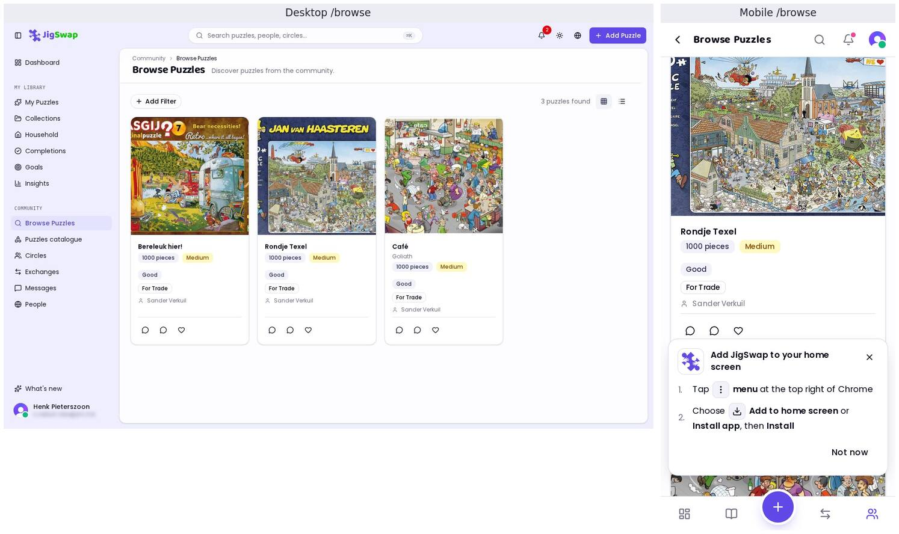

**UX-26 — Catalogue search only sees loaded pages** · _from DISC-6_

- **Problem:** The catalogue paginates `catalog.listAll` 20 at a time and filters only the loaded pages on the client. The count is the loaded matches, not a total.
  - A search for a puzzle outside the first page shows "No puzzles found" next to a loading spinner. Meanwhile the observer pages through the **entire catalogue**, 20 rows at a time.
  - "Favorites" only matches favourites that are already loaded.
  - A server-side search index already exists (`gateway.catalog.search`).
- **Evidence:** code; `agents/DISC/m_puzzles_search.jpg`. The dev catalogue has only 9 puzzles, so this can't be seen in captures.
- **Root cause:** `apps/web/src/components/puzzles/puzzle-client.tsx:46-75,79-123,150,254,259-272`.
- **Fix:**
  - Query `gateway.catalog.search` with the debounced term, and extend it with brand, piece, difficulty and category arguments.
  - Show the empty state only when `status === 'Exhausted'`; otherwise show a skeleton.
  - Replace the count with "Showing {n}".

**UX-27 — Browse stops at 50** · _from DISC-7_

- **Problem:** Browse sends `limit: 50` with no offset, ignores `total` and `hasMore`, and applies the availability filter on the client to those 50. In an active community, older offers become unreachable and "50 puzzles found" is wrong.
- **Evidence:** code.
- **Root cause:** `apps/web/src/routes/_dashboard/browse.tsx:95,113-123,161`; `packages/backend/convex/library/browseOwnedPuzzles.ts:52-72`.
- **Fix:**
  - Paginate with Load more, and show "Showing {shown} of {total}".
  - Move availability into the `browseOwned` arguments (as the TODO at `:113-116` says).

**UX-28 — State lost on Back** · _from DISC-8_

- **Problem:**
  - Query, filters, favourites-only and view mode live in `useState`. Only `?puzzle=` is in the URL.
  - Verified: search "haasteren", open the puzzle, press Back → the input is empty and all 9 cards show. Scroll to y=3000, open, press Back → scrollY is 0.
  - Scroll restoration is enabled but defeated, because `PuzzlesClient` returns a full-page `<PageLoading>` when it remounts.
- **Evidence:** `agents/DISCV/back.mjs`.
- **Root cause:** `apps/web/src/components/puzzles/puzzle-client.tsx:27-41,162-164`; `routes/_dashboard/browse.tsx:60-61`; `lib/browse-search.ts:5-13`.
- **Fix:**
  - `validateSearch` with `q`, `brand`, `minPieces`, `maxPieces`, `difficulty`, `category`, `tags[]`, `fav` and `view`.
  - Update the URL with `navigate({search, replace:true, resetScroll:false})`.
  - Show a fixed-height skeleton instead of `PageLoading` so restoration has something to land on.

**UX-29 — Contribute flow** · _from DISC-5_

- **Problem:**
  - Duplicate detection (`MatchConfirm`) only runs for the store-link import. Titles and EANs typed by hand are never checked against the catalogue.
  - On success the member is sent to `/puzzles`, which lists approved puzzles only, so the submission is invisible. Nothing is added to their shelf.
  - `createPuzzle` returns the new id, and the submitter can read a pending definition, so a hand-off is possible.
  - Pending submissions do appear in the add picker as "Pending review", but nothing points there.
- **Evidence:** `tiles/desktop-light/app__puzzles_add__01.jpg` and `__02.jpg`.
- **Root cause:** `apps/web/src/routes/_dashboard/puzzles/add.tsx:216-219,241-254`; `packages/backend/convex/catalog/listAllPuzzles.ts:13-16`.
- **Fix:**
  - Debounce a catalogue search on the title (3+ characters) and a barcode lookup on 12–13 digit EANs, and render `MatchConfirm` inline.
  - On success, go to `/puzzles/<newId>` and offer the toast action "Also add it to my shelf" (→ `/my-puzzles/add/new?puzzleId=…`).

**UX-30 — Review composer and star rating** · _from DISC-11, SOLVE-20 (+ A11Y-10 stars)_

- **Problem:**
  - Post stays disabled until a star is chosen, but the placeholder says "(optional)" and the stars sit **after** the button. The only "required" cue is the radiogroup's `aria-label`.
  - Stars are 20×20 with 2px gaps (axe `target-size`; the lg variant is 28px).
  - Every star is its own Tab stop, with no arrow-key roving and no way to clear a rating.
  - Labels are English ("3 stars").
  - Posting gives no toast.
- **Evidence:** `tiles/desktop-light/app__puzzles_m9712…__01.jpg` (image below); axe `target-size` in `shots/desktop-light/` and `shots/mobile-light/app__puzzles_m9712….json`; `tiles/mobile-nl/app__puzzles_m9712…__02.jpg` ("Beoordeel Café (option").
- **Root cause:** `apps/web/src/routes/_dashboard/puzzles/$id/index.tsx:527-591`; `components/ui/star-rating.tsx:20-24,45,63-95`; `components/solving/two-level-review-fields.tsx:41-65`.
- **Fix:**
  - Order: a visible "Your rating *" label, then `lg` stars (`size-8 pointer-coarse:size-11`), then optional text, then Post.
  - Helper text "Choose a rating to post", linked with `aria-describedby`.
  - Roving tabindex with arrow keys and Home/End, and a way to clear.
  - ICU star labels, and a success toast.

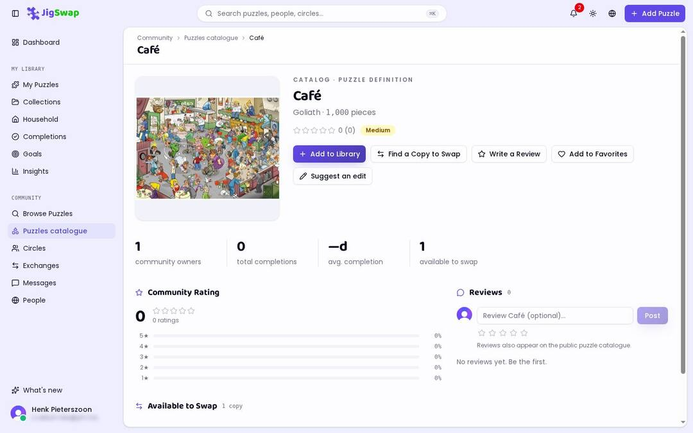

**UX-104 — Suggest edit on a Dutch phone** · _from DISC-10_

- **Problem:**
  - The cover row lays out a 96px thumbnail plus a non-wrapping button pair. In Dutch the buttons need about 445 of 358px, so "Foto bewerken" is clipped (the pencil stays tappable).
  - The actions row doesn't wrap either, which squeezes the hint into a 6-line column on desktop and on phones.
- **Evidence:** `shots/mobile-nl/app__puzzles_m9712…_suggest-edit.json` (regionOverflowX 87; English: 1); `tiles/mobile-nl/…suggest-edit__03.jpg` (image below).
- **Root cause:** `apps/web/src/components/suggest-edit/definition-fields.tsx:330-357`; `routes/_dashboard/puzzles/$id/suggest-edit.tsx:257-262`.
- **Fix:**
  - `flex flex-wrap gap-2` on the button pair, with `min-w-0 flex-1` on its parent.
  - Make the actions row `flex-wrap`, with the hint `basis-full`.

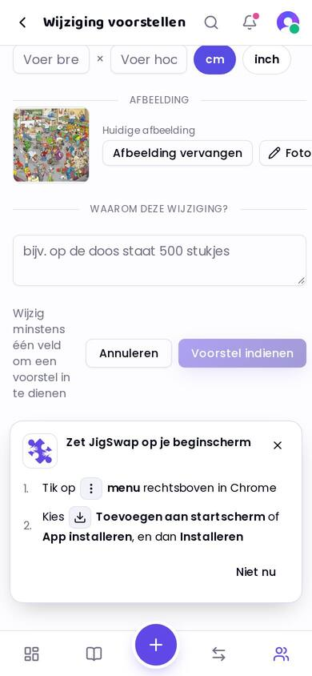

**UX-105 — Missing data shown as broken values** · _from DISC-12, JOURNEY-21, A11Y-20_

- **Problem:**
  - The average completion time renders as "—d" (a "{days}d" template fed "—").
  - The hero shows "0 (0)" and Community Rating a 36px "0" with five 0% bars.
  - Owner rows show "★ —".
  - Since most puzzles have little data, most detail pages look like this.
- **Evidence:** `tiles/desktop-light/app__puzzles_m9712…__01.jpg` and `__02.jpg`; `tiles/mobile-nl/…__02.jpg`.
- **Root cause:** `apps/web/src/routes/_dashboard/puzzles/$id/index.tsx:216-219,319-323,359-390,446-448`; `locales/en.json:4053`.
- **Fix:**
  - Add the unit only when a value exists.
  - With 0 ratings, show "No ratings yet" (a button that focuses the review form) instead of the score and histogram.
  - Omit "★ —".

**UX-106 — Pluralisation and duplicate count** · _from DISC-13_

- **Problem:** "1 puzzles found"; "See all 1 available copies →" (NL "Bekijk alle 1 beschikbare exemplaren"); "9 puzzles found" appears in both the head and the toolbar. Browse's `resultsCount` already uses the plural form correctly.
- **Evidence:** `agents/DISC/m_puzzles_search.jpg`; `tiles/desktop-light/app__puzzles_m9712…__02.jpg`; `tiles/desktop-light/app__puzzles__01.jpg`.
- **Root cause:** `apps/web/locales/en.json:433,4064` and the `nl.json` counterparts; `components/puzzles/puzzle-client.tsx:150,254`.
- **Fix:**
  - ICU plurals: `{count, plural, one {# puzzle found} other {# puzzles found}}`, and "View the available copy" for one copy.
  - Keep one count, and show it on mobile too.

**UX-107 — Catalogue toggles and search unnamed** · _from DISC-14, A11Y-2 (/puzzles)_

- **Problem:**
  - The `/puzzles` grid and list buttons are icon-only, with no name and no `aria-pressed`.
  - Browse's toggles have names but no pressed state.
  - The search field is a raw `<input>` named only by its placeholder (not the design-system Input, so it also misses `text-base`).
- **Evidence:** axe `button-name` ×2 per variant in `shots/*/app__puzzles.json`; Tab run shows `BUTTON ""` twice.
- **Root cause:** `apps/web/src/components/puzzles/puzzle-client.tsx:176-187,238-251`; `routes/_dashboard/browse.tsx:164-179`.
- **Fix:**
  - Use a shadcn ToggleGroup (`type="single"`) labelled `gridView` / `listView` on both pages.
  - `<Input type="search" aria-label>`.
  - The heading fix is in UX-66.

**UX-108 — Detail CTAs** · _from DISC-15 (plausible)_

- **Problem:**
  - "Add to Library" stays the primary action even when the viewer owns the puzzle.
  - "Find a Copy to Swap" shows even when no copies are available, and leads to an empty Browse.
  - "Available to Swap" covers lend and sale copies too.
  - On phones, five CTAs wrap into four rows.
  - The claim that all buttons have equal weight was refuted: Add is the brand primary.
- **Evidence:** `agents/DISC/m_detail_top.jpg`.
- **Root cause:** `apps/web/src/routes/_dashboard/puzzles/$id/index.tsx:262-307,392-423`; `locales/en.json:4058,4062`.
- **Fix:**
  - If owned, the primary becomes "View your copy".
  - "Get a copy ({n})", disabled with "No copies offered yet" when there are none.
  - Make Favourite an icon toggle, and Suggest an edit a text link.
  - Rename the section "Available from members".

**UX-109 — Tablet catalogue** · _from DISC-16_

- **Problem:**
  - Every card shows "View Det…" (9 truncated nodes).
  - The toolbar stacks into three full-width rows until lg.
  - On the detail page a ~500px cover pushes the title down to y≈728. It is still above the fold.
- **Evidence:** `tiles/tablet-light/app__puzzles__01.jpg`; `shots/tablet-light/app__puzzles.json` (truncatedText); `tiles/tablet-light/app__puzzles_m9712…__01.jpg`.
- **Root cause:** `apps/web/src/components/puzzles/puzzle-card.tsx:54-65`; `components/puzzles/puzzle-client.tsx:172`; `routes/_dashboard/puzzles/$id/index.tsx:185-189`.
- **Fix:**
  - Remove "View Details"; the stretched link already covers it, and this also fixes UX-174.
  - Use container queries (`@lg:flex-row`, `@xl:grid-cols-[220px_1fr]`) instead of viewport breakpoints.

**UX-110 — Contribute form on small screens** · _from DISC-17 (plausible)_

- **Problem:**
  - Below lg, the preview and checklist come after the submit button. An inline hint next to the submit does already state what's required.
  - The preview placeholders are English ("Your puzzle title", "Brand") inside the Dutch UI.
  - The caption talks about "your shelf".
  - Difficulty is preselected as "Medium", which skews catalogue data (6 of 9 cards say Medium).
- **Evidence:** `agents/DISC/t_add.jpg`; `tiles/mobile-nl/app__puzzles_add__03.jpg`.
- **Root cause:** `apps/web/src/components/add-puzzle/add-puzzle-layout.tsx:12-16`; `components/add-puzzle/live-preview-card.tsx:38,40`; `routes/_dashboard/puzzles/add.tsx:85`; `locales/en.json:526`.
- **Fix:**
  - Translate the placeholders, and use a contribute-specific caption.
  - Leave difficulty unset, with an "Unknown" option.
  - Below lg, hide the large preview.

**UX-111 — Suggest edit below lg** · _from DISC-18_

- **Problem:**
  - The "Changes (N)" summary is `hidden lg:block`, so phones and tablets get no recap of their changes.
  - The dimension inputs (`w-24`) truncate their placeholders ("Voer bre").
  - The tag input is 14px.
  - Difficulty and Shape pills show "Medium" and "Rectangular" through `|| 'medium'` fallbacks even when the puzzle has no value.
  - "Keep current category" shows for puzzles that have no category.
- **Evidence:** `tiles/mobile-nl/…suggest-edit__03.jpg`; `tiles/desktop-light/…suggest-edit__02.jpg`; `zoomingInputs` in `shots/mobile-light/…suggest-edit.json`.
- **Root cause:** `apps/web/src/routes/_dashboard/puzzles/$id/suggest-edit.tsx:293-327`; `components/suggest-edit/definition-fields.tsx:160,175,188,244-257`; `components/add-puzzle/tag-input.tsx:59`.
- **Fix:**
  - Render the chip summary above the actions below lg.
  - Shorter placeholders ("Width" / "Breedte") on `w-28` inputs.
  - Remove the fabricated defaults and add "Unknown".
  - "No category yet. Choose one" when there is none.

**UX-112 — Discovery i18n and jargon** · _from DISC-19_

- **Problem:**
  - Browse's category filter uses `category.name.en`, so Dutch members see "Animals" instead of "Dieren". The catalogue's own filters localise correctly.
  - The detail eyebrow reads "CATALOG · PUZZLE DEFINITION", an internal domain term in US spelling.
  - Badge text is "For Lend".
  - Piece formatting is covered in UX-63.
- **Evidence:** `tiles/desktop-light/app__puzzles_m9712…__01.jpg`.
- **Root cause:** `apps/web/src/routes/_dashboard/browse.tsx:103-109`; `locales/en.json:327,4049`.
- **Fix:**
  - `categoryOptions(categoriesRaw, locale)`.
  - Drop the eyebrow, or make it "Catalogue".
  - "For loan".

**UX-174 — Duplicate title and card links** · _from DISC-21_

- **Problem:**
  - The detail page publishes its title to the head and also renders a content h1.
  - Catalogue cards have both a stretched title link and a "View Details" link to the same place, so two Tab stops per card.
  - The card's only focus cue is the title underline.
- **Evidence:** `agents/DISCV/tab.mjs`; `agents/DISC/m_detail_top.jpg`.
- **Root cause:** `apps/web/src/routes/_dashboard/puzzles/$id/index.tsx:148,202-204`; `components/puzzles/puzzle-card-shell.tsx:147`; `components/puzzles/puzzle-card.tsx:55-65`.
- **Fix:**
  - Publish only the breadcrumb.
  - Remove "View Details".
  - `has-[a:focus-visible]:ring-2` on the card.

**UX-175 — Generic empty states** · _from DISC-22_

- **Problem:** Browse always says "No puzzles found — Try adjusting your filters", even when no filter is set or when arriving from "Find a Copy to Swap" with 0 copies. The catalogue's empty state does the same.
- **Evidence:** code.
- **Root cause:** `apps/web/src/routes/_dashboard/browse.tsx:185-189`; `components/puzzles/puzzle-client.tsx:259-272`.
- **Fix:** Branch the empty state:
  - **Only `?puzzle=` set:** "Nobody offers this puzzle yet", with Add to favourites.
  - **Filters active:** a Clear filters button.
  - **Nothing set:** "No members are offering puzzles yet", with links to the catalogue and to invite people.

### 6.7 Messaging

The message centre works well on desktop and in the phone thread view. Threads group by author with day separators, failed sends restore your text, and accessibility is strong (polite live region, author labels, focus handling). The safety tools are thorough: per-message Report, Report with "Also block", Block/Unblock, and collapsed messages from blocked members. Two layout problems are serious: the **tablet split view** (a blocker) and the install tip over phone threads (UX-07, in §6.1). The rest are composer and inbox gaps.

| ID     | Title                                                                                                      | Severity    | Viewports | Effort | Status    |
| ------ | ---------------------------------------------------------------------------------------------------------- | ----------- | --------- | ------ | --------- |
| UX-02  | Tablet split view squeezes the thread: 34px composer, no title, Report/Block pushed off the card           | **blocker** | T         | M      | confirmed |
| UX-113 | Enter always sends: no line breaks on phones, and no guard for IME input                                   | minor       | M, T      | S      | confirmed |
| UX-114 | "New → Message a member" leaves Messages for the People page instead of letting you pick someone           | minor       | D, T, M   | M      | confirmed |
| UX-115 | No unread marker in threads and no "new messages" jump; messages are marked read while you are scrolled up | minor       | D, T, M   | M      | confirmed |
| UX-116 | No inbox search or filter; only circle chats can be muted                                                  | minor       | D, T, M   | M      | confirmed |
| UX-176 | `/messages/new` without a puzzle is a dead end with the wrong message                                      | polish      | D, T, M   | S      | confirmed |
| UX-177 | Thread title shows a link-like underline on load                                                           | polish      | D, M      | S      | confirmed |
| UX-178 | Bubble text is smaller than what you typed; timestamps are 11px                                            | polish      | M, D, T   | S      | confirmed |
| UX-179 | Mobile attach sheet uses a 4-column grid for 3 options                                                     | polish      | M         | S      | confirmed |
| UX-180 | English placeholder ends in "..." while the rest of the app uses "…"                                       | polish      | D, T, M   | S      | confirmed |

**UX-02 — Tablet split view squeezes the thread pane** · _from MSG-1, JOURNEY-1_

- **Problem:** The two-pane layout (a fixed 340px list next to the thread) turns on at md (768px). That breakpoint ignores the 16rem sidebar, which is expanded by default. At 820px the thread gets about 210px:
  - The composer textarea is `flex-1` with no minimum width next to three fixed 40px buttons, so it shrinks to 34px and shows its placeholder one letter per line.
  - The DM heading shrinks to 0px.
  - The shrink-0 "View profile" button pushes the ⋯ menu past the card's clipped edge, so **Report and Block can't be reached** from the thread.
  - In the circle header, "Circle" overlaps "Circle chat".
  - The textarea is 14px, which will zoom on iPad.
  - Collapsing the sidebar fixes it (226px textarea), but that setting is forgotten on reload (UX-05). Every width from 768 to about 930px is affected.
- **Evidence:** `tiles/tablet-light/app__messages_04e0…__01.jpg`, `app__messages_ec1b…__01.jpg`, `app__messages__01.jpg`; `agents/JOURNEY-VERIFY/t-thread-sidebar-collapsed.jpg`. Measured at 820: textarea 34×160, H2 width 0, menu at x=801–837 against a card edge at 808. Image in §3.2.
- **Root cause:**
  - `apps/web/src/components/messaging/frame.ts:7-8,17-18`
  - `routes/_dashboard/messages/index.tsx:20`
  - `components/messaging/message-composer.tsx:282-337` (`:310` textarea)
  - `components/messaging/thread-view.tsx:421,427,439,567` (BackToInboxLink `md:hidden`)
  - `components/messaging/thread-quick-links.tsx:79`
  - `components/messaging/circle-thread-header.tsx:145`
  - `components/dashboard-layout/shell.tsx:60` (`overflow-hidden`)
- **Fix:**
  - Move the split view from `md:` to `lg:`, or use a container query on the content area at about 54rem. Between md and lg, show the list on `/messages` and only the thread on `/messages/$threadId`, and show BackToInboxLink below lg.
  - Give the title column `flex-1`.
  - Make the quick-link buttons icon-only below xl.
  - Give the textarea `min-w-32`, and `text-base lg:text-sm`.

**UX-113 — Enter always sends** · _from MSG-4_

- **Problem:**
  - Enter without Shift sends on every device. Soft keyboards have no Shift+Enter, so phone users can't write multi-paragraph messages (addresses, pickup arrangements).
  - There is no `enterKeyHint`.
  - There is no `isComposing` / keyCode 229 guard, so on Safari the Enter that confirms an IME composition sends a half-typed message.
- **Evidence:** read-only check: `enterkeyhint=null`.
- **Root cause:** `apps/web/src/components/messaging/message-composer.tsx:230-236`; `components/messaging/new-copy-conversation.tsx:189-197`.
- **Fix:**
  - Add a shared `shouldSendOnEnter(event)` that returns false while composing and on coarse pointers.
  - Set `enterKeyHint` to match.

**UX-114 — "Message a member" leaves the message centre** · _from MSG-5_

- **Problem:** Circle chat has an in-place picker, but a direct message (the most common "New" job) sends the user to a bare `/people` link. From there it's People → find → profile → Message.
- **Evidence:** `agents/MSG/m-new-sheet.jpg`; `tiles/desktop-light/app__messages__01.jpg`.
- **Root cause:** `apps/web/src/components/messaging/new-conversation-menu.tsx:97,122-127`.
- **Fix:**
  - First step (S): link to `/people?tab=find` and autofocus its search field.
  - Full fix (M): a MemberPicker step in the same sheet, with search plus "Recent" DM partners and "People you follow".

**UX-115 — No unread boundary in threads** · _from MSG-7_

- **Problem:**
  - The first load always jumps to the bottom, with no "New messages" divider.
  - Messages that arrive while you read older history show nothing on screen.
  - `markThreadRead` runs on every new message even when you're scrolled up, so the inbox badge clears for messages you haven't seen.
- **Evidence:** code. The test account's threads hold one message each.
- **Root cause:** `apps/web/src/components/messaging/thread-view.tsx:191-203,254-276`; `components/messaging/format.ts:303`; `components/messaging/thread-list.tsx:258`.
- **Fix:**
  - Snapshot the unread count before the first read receipt, insert a "New messages" divider, and scroll it into view.
  - When you're scrolled up and a message arrives, show a floating "1 new message ↓" pill.
  - Defer the read receipt until you're near the bottom.

**UX-116 — No inbox search; DMs can't be muted** · _from MSG-8_

- **Problem:**
  - The inbox mixes DMs, exchange chats and circle chats with no search, filter or archive.
  - Only the circle header offers Mute. The backend already supports muting any thread, so a noisy DM can only be silenced by blocking.
  - The search part only bites with dense data and is reasoned from code.
- **Evidence:** read-only menu dumps (the DM menu is View profile / Report / Block).
- **Root cause:** `apps/web/src/components/messaging/thread-quick-links.tsx:103-117`; `components/messaging/circle-thread-header.tsx:83-94`; `components/messaging/thread-list.tsx:205`; `packages/backend/convex/conversation/setThreadMuted.ts:13-31`.
- **Fix:**
  - Move `useThreadMute` into a shared hook, and add Mute/Unmute to the DM menu.
  - Add a client-side search box plus All / People / Exchanges / Circles chips once the inbox has more than about 10 threads.

**UX-176 — `/messages/new` dead end** · _from MSG-6_

- **Problem:** Without `?copy=`, the page says "This puzzle isn't available to message about." It offers no action, and there is no h1 on phones. No in-app link produces this URL; only stale or hand-typed URLs reach it.
- **Evidence:** `tiles/mobile-light/app__messages_new__01.jpg`; axe `page-has-heading-one`.
- **Root cause:** `apps/web/src/routes/_dashboard/messages/new.tsx:36-46`.
- **Fix:** In `beforeLoad`, redirect to `/messages` when `copy` is missing.

**UX-177 — Thread title looks like a link** · _from MSG-10_

- **Problem:** After a fresh load or a deep link, focus moves programmatically to the heading. `:focus-visible` then matches and draws an underline, so the plain-text name looks like a profile link that does nothing.
- **Evidence:** `tiles/desktop-light/app__messages_04e0…__01.jpg`; `tiles/mobile-light/app__messages_ec1b…__01.jpg`.
- **Root cause:** `apps/web/src/components/messaging/thread-view.tsx:324,402,427`.
- **Fix:** Use a non-link focus style (`rounded-sm focus-visible:bg-accent/60`), or make the DM name a real Link.

**UX-178 — Small message text** · _from MSG-11_

- **Problem:** You type at 16px, and your message appears in a 14px bubble. Group times are 11px muted grey, and the full date is only available as a hover tooltip.
- **Evidence:** `smallText` in `shots/mobile-light/app__messages_*.json` ("7:39 AM" 11px).
- **Root cause:** `apps/web/src/components/messaging/thread-view.tsx:957,1001-1002`.
- **Fix:** `BUBBLE_CLASS` → `text-[15px] md:text-sm`; group time → `text-xs`.

**UX-179 — Attach sheet grid** · _from MSG-12_

- **Problem:** Three options sit in a 4-column grid, leaving the 4th slot empty. "Attach a puzzle" wraps to two lines while the other labels are single words.
- **Evidence:** `agents/MSG/m-attach-sheet.jpg`.
- **Root cause:** `apps/web/src/components/messaging/attach-menu.tsx:131`.
- **Fix:**
  - Set the column count from the number of options.
  - Use a short sheet-only label: "Puzzle" / "Puzzel".

**UX-180 — Ellipsis** · _from MSG-13_

- **Problem:** `messages.typeMessage` reads "Type your message..." with three dots, while the NL string and the other placeholders use "…". `en.json` has 31 strings ending in "..." against 62 ending in "…".
- **Evidence:** `tiles/desktop-light/app__messages_04e0…__01.jpg`.
- **Root cause:** `apps/web/locales/en.json:839`; `locales/source.json:839`.
- **Fix:** Change it to U+2026, and optionally sweep the other 30 strings in the same change.

### 6.8 People, profiles & notifications

The building blocks here are well made:

- Member tiles have no nested controls and name-qualified labels.
- Notification rows are valid DOM, with Undo on follow-back.
- Follow requests offer "Approve & follow back".
- Discovery respects privacy.

The layouts break at exactly the widths that matter for a social app. On phones, the Edit Profile form hides the only post-onboarding privacy switch (a blocker). On tablets, the member name sits under the action buttons. On desktop, the notification-preferences panel floats over its own settings.

| ID     | Title                                                                                                        | Severity    | Viewports | Effort | Status    |
| ------ | ------------------------------------------------------------------------------------------------------------ | ----------- | --------- | ------ | --------- |
| UX-03  | Mobile Edit Profile form is wider than the screen; the Private switch and display-name Edit can't be reached | **blocker** | M         | S      | confirmed |
| UX-31  | Your own name runs under the Edit Profile button on phones                                                   | major       | M         | S      | confirmed |
| UX-32  | Tablet member profile: Follow, Message and ⋯ cover the name, and the meta wraps word by word                 | major       | T         | S      | confirmed |
| UX-33  | Desktop notification preferences: a transparent sticky panel covers the settings table and takes the clicks  | major       | D         | S      | confirmed |
| UX-34  | Phone preferences table: column headers scroll away, leaving three unlabelled switches per row               | major       | M, T      | M      | confirmed |
| UX-117 | Privacy switch saves instantly inside a Save/Cancel form; display name is edited somewhere else again        | minor       | D, T, M   | M      | confirmed |
| UX-118 | One-tap icon-only Unfollow, with no confirmation or undo                                                     | minor       | D, T, M   | M      | confirmed |
| UX-119 | "No longer available" notification rows and the resolved chip fail contrast; 10–11px meta text               | minor       | D, T, M   | S      | confirmed |
| UX-120 | Your own profile shows no visibility state and no "view as others see you"                                   | minor       | D, T, M   | S      | confirmed |
| UX-121 | Empty reputation shows "0.0 ☆☆☆☆☆"; trust-level copy doesn't match how it's calculated                       | minor       | D, T, M   | S      | confirmed |
| UX-122 | Notification filters take three rows on phones; a filter with no matches says "No notifications yet"         | minor       | M, T      | M      | confirmed |
| UX-123 | People on phones: tabs overflow, "Show my QR" appears 3 times, the no-results copy contradicts its button    | minor       | M         | S      | confirmed |
| UX-124 | Search and "Recently joined" tiles never show "Follows you"                                                  | minor       | D, T, M   | S      | confirmed |
| UX-181 | `/people` subtitle promises "near you"; small grammar slips                                                  | polish      | D, T      | S      | confirmed |
| UX-182 | Activity rows don't say which puzzle; the Activity tab uses the bell icon                                    | polish      | D, T, M   | M      | confirmed |
| UX-183 | Notifications page shows the preferences link and unread count twice; coarse date grouping                   | polish      | D         | S      | confirmed |
| UX-184 | QR dialog copies a different URL than it shows, and says "Copied" even when copying fails                    | polish      | D, T, M   | S      | confirmed |

**UX-03 — Mobile Edit Profile form is wider than the screen** · _from SOC-1_

- **Problem:** The form grid has no explicit column below sm, so its implicit track takes the min-content width of the nowrap, `truncate` profile-URL preview. For a member without a username, that URL falls back to `/members/<convex id>` (about 60 characters), and onboarding never sets a username. Every row then grows to about 544px in a 390px viewport, and the shell clips the rest with no way to scroll.
  - The Private-profile switch (x 511–543) and the display-name Edit button (x 465–543) are off-screen.
  - This is the only place to change visibility after onboarding. The `/people` "Review visibility" link and the QR dialog's "need a username" gate both send members here.
- **Evidence:** `agents/SOC/m-profile-edit-01.jpg`, `agents/SOC/mobile-profile-edit-visibility.jpg` (image in §3.3); `agents/SOCV/editform.mjs`: with the production origin, any handle of 9+ characters overflows, and at about 13 characters the switch starts to cross 390px.
- **Root cause:** `apps/web/src/components/profile/edit-profile-form.tsx:182,286,334-339,351,362,365,370`; `components/dashboard-layout/shell.tsx:71`; `routes/_dashboard/people.tsx:93`.
- **Fix:**
  - Grid → `grid grid-cols-1 gap-x-6 gap-y-4 sm:grid-cols-2`. Tested in the DOM: the switch stays at right=357 for every handle length.
  - URL preview → `break-all`.
  - `min-w-0` on the flex text blocks.
  - Add a regression check at 390px with a 30-character slug.

**UX-31 — Own name under the Edit Profile button** · _from SOC-2_

- **Problem:** The header is a wrapping flex row: an 84px avatar, a `min-w-0 flex-1` text column, and a non-shrinking button group. Because `flex-1` has a 0 basis, the row never wraps, so the name column shrinks to about 108px. The `text-3xl` surname then paints under "Edit Profile" / "Profiel Bewerken". Any surname longer than about 7 characters breaks.
- **Evidence:** `tiles/mobile-light/app__profile__01.jpg`, `tiles/mobile-nl/app__profile__01.jpg`, `tiles/mobile-dark/app__profile__01.jpg` (image in §3.3). Measured: h2 clientWidth 108 vs scrollWidth 152.
- **Root cause:** `apps/web/src/components/profile/identity-header.tsx:50,58,59,87-93`.
- **Fix:**
  - Actions → `basis-full sm:basis-auto`.
  - Text column → `basis-48`.
  - h2 → `text-2xl sm:text-3xl [overflow-wrap:anywhere]`.

**UX-32 — Tablet member profile** · _from SOC-3_

- **Problem:** The hero switches to `sm:flex-row` based on the viewport width. Inside the 820px app, the column is only about 510px, so the `shrink-0` actions (about 290px) leave the identity column about 85px. The h1 runs under Unfollow, and "Leusden, / Nederland" and "Member / since / 2025" break word by word.
- **Evidence:** `tiles/tablet-light/app__members_sander__01.jpg` (image in §3.2).
- **Root cause:** `apps/web/src/components/members/profile-body.tsx:116-120,193-208,300`.
- **Fix:**
  - Put `@container` on ProfileBody and use `@2xl:flex-row`, or switch at `lg:`.
  - Remove `shrink-0` from the actions and let them wrap.
  - Add `[overflow-wrap:anywhere]` to the h1.

**UX-33 — Desktop preferences panel covers the table** · _from SOC-5_

- **Problem:** `@container/prefs` and `@4xl/prefs:grid-cols-[300px_1fr]` sit on the **same element**. A container query never styles its own container, so the two-column layout never applies. The descendant aside still gets `@4xl/prefs:sticky`, though, and with a transparent background it sticks over the single-column table. A hit test found 20 of the 21 switches in its band return the aside instead of the switch, so those clicks are silently lost. (The claim that the Jump-to links are blocked was refuted: they still work.)
- **Evidence:** `tiles/desktop-light/app__notifications_preferences__02.jpg`, `__05.jpg`; `agents/SOC/d-prefs-scrolled.jpg`; `agents/SOCV/prefs.mjs`.
- **Root cause:** `apps/web/src/components/notifications/notification-preferences-panel.tsx:92-93`.
- **Fix:**
  - Wrap the grid in `
`.
  - Re-run the hit test so every switch is topmost.
  - Optionally style Jump-to as a nav.

**UX-34 — Phone preferences table loses its headers** · _from SOC-6_

- **Problem:**
  - The 10px In-app / Email / Push headers sit at the top of a table about 7 phone screens long, so most rows show three unlabelled switches.
  - Descriptions are `line-clamp-2`, which hides details like "Email comes as a short digest".
  - The reason an email switch is disabled exists only in a `title` tooltip, which never shows on touch.
  - `role="grid"` promises keyboard navigation that isn't implemented.
  - Each switch's name includes the whole row description.
  - Note: the wrapper's `overflow-hidden` makes it the sticky container, so just adding `sticky` won't work.
- **Evidence:** `tiles/mobile-light/app__notifications_preferences__02.jpg`, `__03.jpg` (image below); `tiles/mobile-nl/…__02.jpg`; `tiles/tablet-light/…__02.jpg`.
- **Root cause:** `apps/web/src/components/notifications/channel-matrix.tsx:100,102,104-124,189-219,246-253`.
- **Fix:**
  - `overflow-clip` on the wrapper, then `sticky top-[var(--app-sticky-top)] bg-background/95` on the header row.
  - Header labels → `text-xs`.
  - Remove the line-clamp below @2xl.
  - Show "Not available by email" as visible text.
  - `role="table"`.
  - `aria-labelledby` pointing at the title only, with the description as `aria-describedby`.
  - Follow-up: a per-channel segmented control on phones.

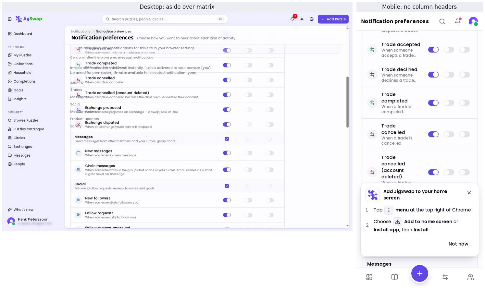

**UX-117 — Three save models in one form** · _from SOC-8_

- **Problem:**
  - Username, location, slug and bio wait for Save.
  - The visibility switch saves the moment it's toggled (with a "Profile saved" toast), and Cancel doesn't revert it.
  - Display name opens a separate dialog with its own Save.
  - The helper text points to a "public profile card" that doesn't exist here.
  - "Your display name as other members see them" is ungrammatical.
- **Evidence:** `agents/SOC/mobile-profile-edit-visibility.jpg`.
- **Root cause:** `apps/web/src/components/profile/edit-profile-form.tsx:274-283,362,388,395`; `locales/en.json:1035,1091`.
- **Fix:**
  - Move visibility to an always-visible Privacy row on `/profile` (saves instantly, with explicit status text). Deep-link to it from `/people`.
  - Make display name an inline field.
  - Fix the copy.

**UX-118 — One-tap Unfollow** · _from SOC-9_

- **Problem:**
  - Unfollow is an icon-only UserMinus, 6px from Message. It fires immediately with a plain toast, and the explaining tooltip doesn't show on touch.
  - For private members, following again means a new request.
  - In the network list, a one-way unfollow removes the tile immediately, so there's no on-screen way back.
- **Evidence:** `tiles/mobile-light/app__people__01.jpg`; `agents/SOC/m-people-find-sa.jpg`.
- **Root cause:** `apps/web/src/components/social/follow-button.tsx:101-108,122-139`; `components/social/member-tile.tsx:188-190`; `routes/_dashboard/people.tsx:186-196`.
- **Fix:**
  - An Undo action in the toast.
  - Confirm first for private members.
  - Show a "Following ✓" state that opens a menu containing Unfollow, instead of a direct destructive button.

**UX-119 — Faded notification rows fail contrast** · _from SOC-7_

- **Problem:**
  - "Unavailable" rows add `opacity-70` on top of muted text: 2.7:1 in light mode, 3.93:1 in dark.
  - The resolved chip is muted text on `bg-muted` (4.34:1).
  - Times are 11px and badges 10px.
- **Evidence:** axe in `shots/desktop-light/`, `shots/mobile-light/` and `shots/mobile-dark/app__notifications.json`; `tiles/mobile-light/app__notifications__02.jpg`.
- **Root cause:** `apps/web/src/components/notifications/notification-item.tsx:164,183,219,227`; `components/notifications/resolved-chip.tsx:28`.
- **Fix:**
  - Drop `opacity-70`. Signal "unavailable" with an icon and dim only the thumbnail.
  - Chip → `text-foreground/80`.
  - Times → `text-xs`; badges → `text-[11px]`.

**UX-120 — No visibility state on your own profile** · _from SOC-11_

- **Problem:**
  - The identity header shows only "Member since". Public/Private appears only inside the Edit form.
  - Nothing on `/profile` links to your public profile.
  - `/profile` and `/members/<handle>` show different stats.
- **Evidence:** `tiles/desktop-light/app__profile__01.jpg` vs `app__members_sander__01.jpg`.
- **Root cause:** `apps/web/src/components/profile/identity-header.tsx:62-79`; `routes/_dashboard/profile.tsx:58-71`.
- **Fix:**
  - Add a "Public · findable" / "Private" badge linking to the privacy control.
  - Add a "View public profile" link.
  - Align the stat sets.

**UX-121 — "0.0 ☆☆☆☆☆" reputation** · _from SOC-12_

- **Problem:**
  - The score always renders, so a member with no reviews sees "0.0 ☆☆☆☆☆" right next to "—" in the stats strip.
  - Trust level is based on `tradesCompleted` only, but the copy says "Based on completed trades and reviews".
  - The trust meter has no progressbar semantics and no "what's next" hint.
- **Evidence:** `tiles/desktop-light/app__profile__02.jpg`; `tiles/mobile-light/app__profile__02.jpg`.
- **Root cause:** `apps/web/src/components/reputation/reputation-section.tsx:61-82`; `components/profile/stats-section.tsx:12-16,57-58,90-95`; `locales/en.json:1013`.
- **Fix:**
  - With 0 reviews, show "No reviews yet — reviews appear after your first completed exchange".
  - Description: "Based on completed exchanges · N more to {next}".
  - `role="progressbar"` with `aria-value*` attributes.

**UX-122 — Notification filters on phones** · _from SOC-14_

- **Problem:**
  - Seven pills plus a toggle wrap to three rows, so the list starts at about 37% of the screen.
  - The pill group has no name.
  - Filtering happens on the client over the 30 rows already loaded. When nothing matches, the page shows "No notifications yet" even while the badge counts unread items (Load more is still shown).
- **Evidence:** `tiles/mobile-light/app__notifications__01.jpg`.
- **Root cause:** `apps/web/src/routes/_dashboard/notifications/index.tsx:54,181-190,235,310-326`.
- **Fix:**
  - A single scrolling row below md, with an `aria-label`.
  - Empty-state copy per filter: "Nothing matches these filters", "You're all caught up".
  - Longer term, filter on the server.

**UX-123 — People on phones** · _from SOC-15_

- **Problem:**
  - The tab strip (416px wide in a 358px space) cuts "Activity" to "Ac", with only a subtle fade.
  - "Show my QR" appears three times on the Find tab, which also squeezes the search placeholder.
  - The no-results text says "scan their QR" but the only button shows yours.
- **Evidence:** `tiles/mobile-light/app__people__01.jpg`; `agents/SOC/m-people-find.jpg`, `m-people-find-none.jpg`.
- **Root cause:** `apps/web/src/components/social/find-people.tsx:53-60,75,91,122`; `routes/_dashboard/people.tsx:205-224,244-260`.
- **Fix:**
  - Remove the QR button from the search row.
  - Hide the tab icons below sm.
  - Reword: "Ask them to open People › Show my QR…", with "Show my QR" and "Copy my link".

**UX-124 — "Follows you" missing in Find** · _from SOC-16_

- **Problem:** Find passes `followsYou={false}` to every result. The same member shows "Follows you" in Network but not in Find.
- **Evidence:** `tiles/mobile-light/app__people__01.jpg` vs `agents/SOC/m-people-find.jpg`.
- **Root cause:** `apps/web/src/components/social/find-people.tsx:103,130`.
- **Fix:** Derive it from `followRelation`, which FollowButton already fetches; the queries dedupe.

**UX-181 — Copy promises "near you"** · _from SOC-22_

- **Problem:**
  - The `/people` subtitle says "Members and profiles near you.", but there's no proximity search, and location is deliberately hidden on discovery tiles.
  - "…as other members see them" is ungrammatical.
  - "{rating} Trust" is unclear.
- **Evidence:** `tiles/desktop-light/app__people__01.jpg`.
- **Root cause:** `apps/web/locales/en.json:3744,1091,1015`.
- **Fix:** "Your network, member search and invites."; "…see it."; "★ {rating} · {count} reviews".

**UX-182 — Activity rows** · _from SOC-23_

- **Problem:**
  - Six identical "…added a puzzle to their shelf" rows, with no title or cover.
  - Every row's link is named "Open puzzle".
  - The tab uses the Bell icon, the same as notifications.
- **Evidence:** `agents/SOC/m-people-activity.jpg`.
- **Root cause:** `apps/web/src/components/social/activity-feed.tsx:68-84`; `routes/_dashboard/people.tsx:258`; `components/social/activity-links.tsx:65-85`.
- **Fix:**
  - Put the title in the sentence, and add a 40px cover.
  - Group same-day adds.
  - Use the Activity icon.
  - Name each link with the puzzle title.

**UX-183 — Notifications page repeats itself** · _from SOC-24_

- **Problem:**
  - At xl, the header and the right rail both show the unread count and a link to preferences.
  - Everything older than yesterday is lumped under "Earlier".
- **Evidence:** `tiles/desktop-light/app__notifications__01.jpg`.
- **Root cause:** `apps/web/src/routes/_dashboard/notifications/index.tsx:156-172,192-214,227-230,282-294`.
- **Fix:** Show the count in one place. Add "This week" and "This month" buckets.

**UX-184 — QR dialog** · _from SOC-25_

- **Problem:**
  - The caption shows `/members/<username>`, but Copy writes `/members/<id>?invite=<token>`.
  - `copy()` ignores the clipboard promise, so it shows "Copied" even when copying fails.
  - For members without a username, the invite token is minted before the username gate is checked.
- **Evidence:** code. Opening the dialog runs a mutation, so it wasn't exercised.
- **Root cause:** `apps/web/src/components/social/qr-dialog.tsx:51-69,74-85,113-117`.
- **Fix:**
  - Await `writeText` and show `toast.error` on failure.
  - Use an `aria-live` region for "Copied".
  - Explain the invite link in the caption.
  - Check the username gate before fetching.

### 6.9 Sharing: circles, household, exchanges, loans

The Household module is the most mature part of this area. Its tabs are in the URL, the invite dialog offers three methods, permissions can be set per copy with the source shown, and bulk changes are confirmed. Destructive membership actions are confirmed with copy specific to the consequence.

The **exchange lifecycle** is the weak spot:

- "Mark Complete" needs both parties, but nothing shows who has confirmed.
- The final click changes ownership irreversibly.
- The sale price is never shown to the owner.
- Failures are silent.
- Owners can't start a loan, and loans are scattered across pages.
- Sharing with a circle means one silent action per copy.

| ID     | Title                                                                                                             | Severity | Viewports | Effort | Status    |
| ------ | ----------------------------------------------------------------------------------------------------------------- | -------- | --------- | ------ | --------- |
| UX-35  | "Mark Complete" never shows who has confirmed, and the final irreversible handover has no confirmation            | major    | D, T, M   | M      | confirmed |
| UX-36  | The owner never sees the buyer's offered price before accepting a Sale (loans have no return date at all)         | major    | D, T, M   | S      | confirmed |
| UX-37  | Exchange, return and circle-share errors are silent; final actions have no confirmation                           | major    | D, T, M   | M      | confirmed |
| UX-38  | Owners can't start a loan; the borrower's only button says "Request swap", or is an unlabelled icon               | major    | D, T, M   | M      | confirmed |
| UX-39  | Loans are split across three places; there's no "Lent out" view; active loans are labelled "Completed"            | major    | D, T, M   | M      | confirmed |
| UX-40  | Exchange rows on phones leave about 130px for title and partner (about 75px in Dutch)                             | major    | M         | S      | confirmed |
| UX-41  | Sharing with a circle: one copy at a time, no search, no feedback, and copies that aren't on offer stay invisible | major    | D, T, M   | M      | confirmed |
| UX-125 | Circle members never see their own permission; view-only members get no explanation                               | minor    | D, T, M   | S      | confirmed |
| UX-126 | Who-sees-what (household, circle, public) isn't explained where the decision is made                              | minor    | D, T, M   | M      | confirmed |
| UX-127 | Exchanges empty state ignores the active tab and filter, and has no button; tabs mix three kinds of filter        | minor    | D, T, M   | S      | confirmed |
| UX-128 | Circle invites only reach existing mutual followers; the empty picker suggests no next step                       | minor    | D, T, M   | S      | plausible |
| UX-129 | "Sharing" and "View only" mean different things in household and circles                                          | minor    | D, T, M   | S      | confirmed |
| UX-130 | Circle avatars overlap, leaving 22px targets; exchange "View" toggles have no state or context                    | minor    | D, T, M   | S      | confirmed |
| UX-185 | Household Sharing tab buries the list under six mostly disabled bulk controls on phones                           | polish   | M         | M      | confirmed |
| UX-186 | Circle rows: the link to the circle isn't discoverable; Leave has the same weight as Chat; information repeats    | polish   | D, T, M   | S      | confirmed |
| UX-187 | A lone help "?" takes a whole row on phones                                                                       | polish   | M         | S      | confirmed |
| UX-188 | Exchanges use generic icons instead of puzzle covers                                                              | polish   | D, T, M   | M      | confirmed |

**UX-35 — Two-step completion is invisible** · _from SHARE-1_

- **Problem:** Completion needs **both** parties to press "Mark Complete". The first press only stamps a timestamp: the status stays "Accepted", the button stays, and no event or notification fires. A second press re-stamps silently. The other party's click settles the exchange, and for a swap or sale that moves the copy into the other member's library (irreversible), with no confirmation.
- **Evidence:** code (Henk has no exchanges). The read view already sends `initiatorConfirmationTimestamp` / `recipientConfirmationTimestamp`, and `grep` finds no use of them in `apps/web`.
- **Root cause:**
  - `apps/web/src/routes/_dashboard/trades.tsx:471-480`
  - `packages/backend/convex/exchange/readViews.ts:86-87`
  - `packages/domain/src/exchange/domain/exchange.ts:151-167,234-267`
  - `packages/backend/convex/library/transferOnSettlement.ts:13-16`
- **Fix:**
  - Derive mine/theirs from the timestamps.
  - Once you've confirmed, show a disabled "Waiting for {name}" with "You confirmed {time}".
  - When only they have confirmed, show a "Your turn" pill.
  - Put an AlertDialog worded per kind in front of the final click. Swap/sale: "…{title} moves to {name}'s library. This can't be undone." Loan: "…This starts the loan."
  - Optionally emit a `CompletionConfirmed` event so the other party is notified.

**UX-36 — Sale price never shown** · _from SHARE-2_

- **Problem:** The buyer types "Your offer (EUR)" and `salePrice` reaches both parties. The only reference to it in `apps/web` is the send, though. ExchangeDetail shows only titles and piece counts, so the owner accepts without seeing the price.
  - Loans have no return date because the request form never collects one. That part of the original claim was refuted as written.
- **Evidence:** code.
- **Root cause:** `apps/web/src/routes/_dashboard/trades.tsx:316-331,414-428,547`; `components/exchange/request-trade-dialog.tsx:128-136,236-249`; `packages/backend/convex/exchange/readViews.ts:83-84`.
- **Fix:**
  - Show "Offer: €15.00" (via `useFormatter`, currency EUR) above Accept/Decline and as a chip on the row.
  - For loans, first add an optional "Return by" field to the request, then display it.

**UX-37 — Silent failures and unguarded terminal actions** · _from SHARE-3_

- **Problem:**
  - `run()` catches every error with `console.error` and only shows a toast for NotPermittedInCircle.
  - The buttons aren't disabled while a request is pending.
  - Decline and Cancel are final and unconfirmed.
  - Return-loan errors are swallowed, with no confirm.
  - CircleShareSection swallows errors and just clears its select on success.
- **Evidence:** code.
- **Root cause:** `apps/web/src/routes/_dashboard/trades.tsx:388-401,439-480,593-599`; `routes/_dashboard/borrowed.tsx:97-103`; `components/circles/circle-share-section.tsx:41-49,74`.
- **Fix:**
  - Add an `exchange-error.ts` that mirrors `household-error.ts` (error code → i18n), and call `toast.error` from it.
  - `isPending` disables the buttons and swaps labels ("Accepting…").
  - Put Decline, Cancel and Return behind an AlertDialog with a one-line consequence.
  - Toast on circle-share success and failure.

**UX-38 — Lending: owners can't start a loan; borrower CTA mislabelled** · _from JOURNEY-4_

- **Problem:**
  - The owner can only toggle "Offer to Lend". To borrow, someone else has to find the copy and press "Request swap" (copy page) or an unlabelled MessageCircle icon (Browse), then choose "Borrow".
  - The CTA label ignores availability, so a copy offered only for lending still says "Request swap".
  - The toast is "Trade request sent".
  - A loan only starts after both parties have pressed Mark Complete.
- **Evidence:** `tiles/desktop-light/app__copies_m578…__01.jpg`; `tiles/desktop-light/app__browse__01.jpg`; `tiles/mobile-light/app__my-puzzles_m572…__02.jpg`; `tiles/mobile-light/pub__home__03.jpg` (the marketing promise "Lend & track").
- **Root cause:** `apps/web/src/routes/_dashboard/copies/$id.tsx:551-571,610-634`; `components/ui/puzzle-card.tsx:469-487`; `components/exchange/request-trade-dialog.tsx:95,137`.
- **Fix:**
  - Label from availability: lend only → "Ask to borrow", trade only → "Request swap", sale only → "Ask to buy", mixed → "Request…".
  - Distinct icons and named buttons (see UX-25).
  - Per-type toasts.
  - Separate ticket: an owner-side "Lend to…" for household members and mutual followers.

**UX-39 — Loans are scattered** · _from SHARE-6, JOURNEY-5_

- **Problem:**
  - `/borrowed` is listed under "removed from the nav but still alive". Its only inbound link is the exchanges tour, yet it's the only place a borrower can start or log a solve on a borrowed copy.
  - The Exchanges › Borrowed tab only offers Return. Its tab state is `useState`, so it can't be deep-linked.
  - Lent-out loans appear only as annotations on My Puzzles cards.
  - A lend settles to "completed", so a puzzle that is still with the borrower shows a green "Completed" pill.
  - The marketing mock shows a "Lent out" overview the app doesn't have.
- **Evidence:** `tiles/desktop-light/app__borrowed__01.jpg`; `tiles/tablet-light/app__trades__01.jpg`; `agents/JOURNEY/t-trades-borrowed.jpg`; `tiles/mobile-light/pub__home__05.jpg`.
- **Root cause:**
  - `apps/web/src/components/dashboard-layout/route-meta.ts:198-200`
  - `components/tour/definitions.ts:93`
  - `routes/_dashboard/borrowed.tsx:170-220`
  - `routes/_dashboard/trades.tsx:53,107,160,580-651`
  - `routes/_dashboard/copies/$id.tsx:255` (borrower excluded from `canSolve`)
  - `routes/_dashboard/my-puzzles/index.tsx:174-214`
  - `packages/domain/src/exchange/domain/exchange.ts:235`
- **Fix:**
  - Add a "Loans" tab (`?tab=loans` via `validateTradesSearch`) with two sections: "Borrowed by you" (keep the solve actions) and "Lent out" (Recall, Message).
  - Redirect `/borrowed`, and update the tour.
  - Show "On loan" / "Returned {date}" instead of "Completed".
  - Add a "Lent out" filter on My Puzzles.
  - Let borrowers log solves from the copy page.

**UX-40 — Exchange rows on phones** · _from SHARE-4_

- **Problem:** Each row is one non-wrapping line: a 44px chip, a truncating text block, a nowrap status pill and an outline "View" button. At 390px the text gets 129–137px (74–103px in Dutch), so the partner name and the "↔ what you get" title are always cut. The detail panel is indented `ml-[60px]` at every width.
- **Evidence:** `agents/SHARE/m_en_trades_mockrows.jpg`, `m_nl_trades_mockrows.jpg` (DOM replica; image in §3.3); `agents/SHARE/t_en_trades_mockrows.jpg` (tablet, about 275px, fine).
- **Root cause:** `apps/web/src/routes/_dashboard/trades.tsx:313-340,414`.
- **Fix:**
  - Below sm, move the pill into the meta line.
  - Make the whole row a `<button aria-expanded>` with a chevron.
  - Title → `line-clamp-2`.
  - Detail → `ml-0 sm:ml-[60px]`.

**UX-41 — Circle sharing is one silent action per copy** · _from JOURNEY-6_

- **Problem:**
  - Sharing uses a plain Select listing every copy: no search, already-shared copies not excluded. The select resets on success, and failures only go to `console.error`.
  - Members only see a shared copy while it's offered for swap, loan or sale, and the hint never says so. Sharing a copy that isn't offered therefore looks successful but shows members nothing.
  - There's no "Share with circle" on the copy page, and no way to unshare from the list.
- **Evidence:** `tiles/tablet-light/app__circles_3e51e703…__01.jpg`; `agents/JOURNEY/t-household-sharing.jpg` (the household's bulk pattern, for contrast).
- **Root cause:** `apps/web/src/components/circles/circle-share-section.tsx:41-50,58-77`; `components/circles/circle-page.tsx:331-340`; `packages/backend/convex/library/canViewCopy.ts:128-131`; `locales/en.json:2151-2153`.
- **Fix:**
  - A searchable multi-select (cmdk) that marks already-shared copies and flags "Not offered, so members won't see it", plus a result toast.
  - Hint: "Members see a shared copy while it's offered for swap, loan or sale."
  - Add "Share with circles…" to the copy page and the card ⋯ menu.

**UX-125 — Circle permission not shown** · _from SHARE-7_

- **Problem:**
  - The badge only says Owner or Member. Admin, Can exchange and View only are never shown to non-admins.
  - A view-only member sees "No puzzles have been shared in this circle yet." with no share control and no explanation.
  - The claim that they only learn they can't request by trying was refuted: the copy page already disables the button with an explanation.
- **Evidence:** `tiles/desktop-light/app__circles__01.jpg`, `app__circles_3e51e703…__01.jpg`.
- **Root cause:** `apps/web/src/components/circles/circle-page.tsx:91-93,331-343`; `routes/_dashboard/circles/index.tsx:261-263`.
- **Fix:**
  - Badge `t('permissions.{level}')` with a tooltip that explains it.
  - When the member can't share, add a footer: "You have view-only access here. Ask a circle admin for 'Can exchange'…"

**UX-126 — Who-sees-what isn't explained where it matters** · _from SHARE-9_

- **Problem:**
  - The household explainer appears only on the Settings tab.
  - Page subtitles are hidden on phones (`hidden md:block`).
  - The create-circle dialog doesn't mention that you can only invite mutual followers.
  - "Shared with you" describes circle membership as if it were a file share.
  - The who-sees-what guide is reachable from What's new › Guides, but no page links to it.
- **Evidence:** `agents/SHARE/m_household_settings.jpg`; `tiles/mobile-light/app__circles__01.jpg`, `app__household__01.jpg`.
- **Root cause:** `apps/web/src/components/household/household-page.tsx:413-416`; `components/dashboard-layout/page-head.tsx:66`; `locales/en.json:2055,2098,2137`; `components/tour/definitions.ts:97-105`.
- **Fix:**
  - Add `<GuideHelpButton tourId="who-sees-what">` to `/household`.
  - Move the explainer above the tabs.
  - Create-circle copy: "…You can invite people you follow each other with."
  - "Joined circle" instead of "Shared with you".

**UX-127 — Exchanges empty state and tabs** · _from SHARE-10 (+ JOURNEY-11)_

- **Problem:**
  - Every tab, and any status filter that hides all rows, shows the same "No trades yet / Start browsing puzzles…", with no button (the Borrowed empty state does have one).
  - The pills mix direction (Incoming), status (Completed) and type (Borrowed).
  - The status select has no "completed" option.
  - Rows waiting on you aren't flagged.
- **Evidence:** `tiles/desktop-light/app__trades__01.jpg`; `tiles/desktop-light/app__borrowed__01.jpg`.
- **Root cause:** `apps/web/src/routes/_dashboard/trades.tsx:159-172,190-214,221-225`; `components/exchange/borrowed-empty-state.tsx:14-22`.
- **Fix:**
  - Empty copy per tab, with "Show all statuses" when a filter is set.
  - A "Browse puzzles" button.
  - Tabs All / Incoming / Outgoing / Loans, with status in the select.
  - A "Needs you" group sorted to the top.

**UX-128 — Circle invites limited to mutual followers** · _from JOURNEY-7 (plausible)_

- **Problem:**
  - The invite picker only lists people the admin follows who follow back. Its empty state is plain text, and member profiles have no "Invite to circle".
  - Friends who aren't on JigSwap can only arrive through personal invite links or QR codes, which set up the mutual follow. Those exist but aren't signposted from here.
  - Limiting invites to mutual followers is a documented trust decision. Keep it.
- **Evidence:** `agents/JOURNEY/m-welcome-household.jpg`, for comparison with the household's options.
- **Root cause:** `apps/web/src/components/circles/circle-invite-picker.tsx:116-121`; `locales/en.json:2098`; `components/members/profile-body.tsx:334-342`.
- **Fix:**
  - Make the empty state actionable: "Share your invite link or QR; friends who join become invitable", with the share buttons inline.
  - Add "Invite to circle…" to mutual followers' profile ⋯ menu for circle admins.

**UX-129 — Household vs circle vocabulary** · _from JOURNEY-17_

- **Problem:** The same words mean different things in household and circles:
  - **"Sharing":** the household tab sets per-copy _permissions_; in circles, sharing means _visibility_.
  - **"View only":** in the household it means "can't manage"; in circles it means "can't request".
  - **Dutch:** "Delen" names both the household tab and the circle Share button.
  - **Copy page:** the select label "Use household default (currently: Can manag…" is truncated.
- **Evidence:** `agents/JOURNEY/t-household-sharing.jpg`; `tiles/tablet-light/app__circles_3e51e703…__01.jpg`; `tiles/mobile-light/app__my-puzzles_m572…__02.jpg`.
- **Root cause:** `apps/web/locales/en.json` and `nl.json`: `household.tabs.sharing`, `household.copyAccess.*`, `circles.permissions.*`, `circles.roleMember`.
- **Fix:**
  - Rename the household tab "Permissions" / "Rechten", with levels "Can lend & edit" / "Can see only".
  - Show the viewer's circle permission.
  - Shorten the default label to "Household default ({permission})".

**UX-130 — Avatar targets and View toggles** · _from SHARE-12 (+ A11Y-10 avatars)_

- **Problem:**
  - Circle avatars are `size-8` overlapping by `-ml-2.5`, leaving 22px each (axe target-size, serious).
  - Each exchange row has an identical "View" toggle, with no `aria-expanded` and no context. The Message toggle next to it does it right.
  - Headings are covered in UX-66, and the Swaps badge count in UX-09.
- **Evidence:** axe target-size in `shots/*-light/app__circles*.json`.
- **Root cause:** `apps/web/src/components/circles/circle-avatar-stack.tsx:42,139-146`; `routes/_dashboard/trades.tsx:334-340`.
- **Fix:**
  - `-ml-2` overlap, and update the `GAP`/`OVERLAP_PX` constants to match.
  - `aria-expanded` plus `aria-label` "View swap with {name}", or make the whole row the toggle (UX-40).

**UX-185 — Household Sharing tab on phones** · _from SHARE-15_

- **Problem:** The filter, Select all/none, "0 selected" and three bulk buttons take about 210px above the list, and they stay disabled until something is selected. The list is still visible on the first screen.
- **Evidence:** `agents/SHARE/m_household_sharing.jpg`.
- **Root cause:** `apps/web/src/components/household/my-household-copies.tsx:93-153`.
- **Fix:**
  - Render the bulk row only once something is selected, as a sticky bar on phones.
  - Shorten the default label to "Use default ({permission})".

**UX-186 — Circle rows** · _from SHARE-16_

- **Problem:**
  - The identity block links to the circle page, but only hover shows it, so touch users can't tell.
  - The red "Leave circle" has the same weight as "Open group chat" on every row. It is behind a confirm.
  - "2 members" repeats what the avatar stack already shows.
  - In Dutch the actions wrap into a right-aligned stack.
  - The detail page repeats the circle name as an h2.
- **Evidence:** `tiles/desktop-light/app__circles__01.jpg`; `tiles/mobile-nl/app__circles__01.jpg`.
- **Root cause:** `apps/web/src/routes/_dashboard/circles/index.tsx:273-318`; `components/circles/circle-page.tsx:75-97`.
- **Fix:**
  - Add a ChevronRight to the link.
  - Move Leave into a ⋯ menu.
  - Drop the MiniStat.
  - Below xl, use `justify-start` for the actions.
  - On the detail card, use a meta line instead of the repeated name.

**UX-187 — Lone help button takes a row on phones** · _from SHARE-17_

- **Problem:** `MobilePageActions` gives a page's header actions their own row, even when the only action is the guide "?" (about 60px on `/trades`).
- **Evidence:** `tiles/mobile-light/app__trades__01.jpg`, `app__circles__01.jpg`.
- **Root cause:** `apps/web/src/components/dashboard-layout/shell.tsx:96-112`; `routes/_dashboard/trades.tsx:111-114`.
- **Fix:** Render help buttons in the mobile top bar or the FilterBar's extra slot.

**UX-188 — Generic icons instead of covers** · _from SHARE-18_

- **Problem:** Exchange rows, the exchange detail and borrowed rows use kind icons or a Package glyph, while the read views already carry `requestedPuzzle.image` and `offeredPuzzle.image`. `LoanView` has no cover.
- **Evidence:** code.
- **Root cause:** `apps/web/src/routes/_dashboard/trades.tsx:314,560-561,619`; `routes/_dashboard/borrowed.tsx:136-138`; `packages/backend/convex/library/loanReadViews.ts:22-35`.
- **Fix:**
  - Show a 44px cover thumbnail (two overlapping covers for swaps) with the kind as a corner badge.
  - Add `coverUrl` to `toLoanView`.

### 6.10 Solving: completions, goals, insights

The solve loop itself is well built. In-progress and finished solves are kept apart, Finish is an inline action, and the follow-up flow is friendly: rating, review and photos, with retry that keeps already-uploaded photos. Past dates are handled carefully.

The problems are in how data is played back to the member:

- **Goals:** goal progress is wrong for anyone with history, and goals can't be edited.
- **Charts:** the Insights charts can't be read precisely, and have no text alternative.
- **Editing:** Edit is offered and then refused.
- **Keyboard and touch:** the picker isn't keyboard-operable, and phone ergonomics are weak.

| ID     | Title                                                                                                        | Severity | Viewports | Effort | Status    |
| ------ | ------------------------------------------------------------------------------------------------------------ | -------- | --------- | ------ | --------- |
| UX-42  | Goal progress counts every dated solve ever logged, not solves since the goal started or within its period   | major    | D, T, M   | M      | confirmed |
| UX-43  | Goals can't be edited, deleted or archived                                                                   | major    | D, T, M   | M      | confirmed |
| UX-44  | Puzzle cards on `/completions/new` can't be reached or chosen with the keyboard                              | major    | D, T, M   | S      | confirmed |
| UX-45  | Insights "Completions / month" toggle is pushed off-screen on phones                                         | major    | M         | S      | confirmed |
| UX-46  | Monthly bar charts show no values or axis, have no text alternative, and draw empty months as bars           | major    | D, T, M   | M      | confirmed |
| UX-47  | "By difficulty" donut has no legend, labels or values                                                        | major    | D, T, M   | S      | confirmed |
| UX-48  | Edit is offered on solves the server will always reject, including every back-dated or past-year solve       | major    | D, T, M   | S      | confirmed |
| UX-131 | Solve picker on phones: about one puzzle per screen, irrelevant badges, in-progress state not shown          | minor    | M, T      | M      | confirmed |
| UX-132 | Finish dialog is titled "Solve finished" and says "Leave empty…", which isn't allowed                        | minor    | D, T, M   | S      | confirmed |
| UX-133 | Tracked solve time never appears in the history; same-day solves read "finished in 1 day"                    | minor    | D, T, M   | S      | confirmed |
| UX-134 | Logging an in-progress solve means clearing a prefilled date; the first solve can't record a time            | minor    | M, T, D   | M      | confirmed |
| UX-135 | "Today" defaults and date parsing use UTC instead of local time                                              | minor    | D, T, M   | S      | confirmed |
| UX-136 | Insights "Unknown"/"Other" stay English; Dutch buttons inconsistent; star labels English                     | minor    | D, T, M   | S      | confirmed |
| UX-137 | Insights on phones opens with nine stat blocks of zeros and no guidance                                      | minor    | M, T      | S      | confirmed |
| UX-138 | History rows on touch: 32px icon actions, photo previews only on hover, no paging                            | minor    | M, T      | M      | confirmed |
| UX-139 | Completions empty states give no button, no way to add past solves, and ignore borrowed puzzles              | minor    | D, T, M   | S      | confirmed |
| UX-140 | Goal form gives no validation feedback; no overdue state; two "New Goal" buttons                             | minor    | D, T, M   | S      | confirmed |
| UX-189 | Insights polish: chart title doesn't change with the toggle, "Unknown" ranked as a top brand, bars too thick | polish   | D, T, M   | S      | confirmed |
| UX-190 | "Export my data" only exists at the bottom of Insights                                                       | polish   | D, T, M   | S      | confirmed |

**UX-42 — Goal progress counts lifetime solves** · _from SOLVE-1_

- **Problem:** A new goal starts at 0, and creating it never recalculates progress. On the next solve, every active goal is set to `countCompletedByUser`, the member's lifetime count of finished day- and year-precision solves, with no date filter. The `/welcome` bulk past-solves import also counts.
  - A member with 30 earlier solves who creates "Solve 10 puzzles this year" sees 0/10, then jumps straight to 31/10 "Achieved" and gets a GoalAchieved notification.
  - Insights "Goals achieved" inherits the error.
  - The copy promises a period: "Personal targets for the year.", "like 10 this year".
  - A quick-start spec notes lifetime counting was deliberate "for now". The copy contradicts that choice.
- **Evidence:** `tiles/desktop-light/app__goals__01.jpg`; `agents/SOLVE/goal-dialog-mobile.jpg`.
- **Root cause:**
  - `packages/backend/convex/solving/createGoal.ts:14-41`
  - `packages/domain/src/solving/domain/goal.ts:76-90`
  - `packages/domain/src/solving/application/use-cases/recompute-goal-progress.ts:22-37`
  - `packages/backend/convex/solving/adapters/convexCompletionRepository.ts:123-137`
  - `packages/backend/convex/solving/adapters/inProcessEventPublisher.ts:27-35`
  - `apps/web/locales/en.json:3710`
- **Fix:**
  - Recalculate progress inside `createGoal`.
  - Count only within the goal's window: `countCompletedByUserBetween(userId, createdAt or startDate, targetDate)`, still excluding unknown dates.
  - Otherwise, change the copy to describe lifetime totals.

**UX-43 — Goals can't be edited or removed** · _from SOLVE-11_

- **Problem:** Only `createGoal` and `listMyGoals` exist. `isActive` never becomes false, so a typo, a wrong target, an abandoned goal or last year's goal stays forever and counts as "active" in Insights. Goal tiles have no actions.
- **Evidence:** code; `tiles/desktop-light/app__goals__01.jpg` (empty state).
- **Root cause:** `apps/web/src/routes/_dashboard/goals.tsx:247-320`; `packages/backend/convex/solving/createGoal.ts`; `packages/domain/src/insights/personal-stats.ts:109-112`; `packages/gateway/src/operations.ts:314-317`.
- **Fix:**
  - Add `updateGoal` and `archiveGoal` (or `deleteGoal`) with ownership checks.
  - Add a ⋯ menu with Edit (the create dialog, prefilled), Archive and Delete (confirmed).
  - Add a collapsible "Past goals" section.

**UX-44 — Picker cards not keyboard-operable** · _from SOLVE-2_

- **Problem:** In the "pick" variant, a puzzle is chosen by an `onClick` on the Card div. It has no role, no tabIndex and no key handling, and the cover link and overflow menu are removed. Tab goes from Search to BODY. This fails WCAG 2.1.1 (A) on the main "Log Completion" entry point.
- **Evidence:** `agents/SOLVE/log.mjs`, `agents/SOLVE-verify/v1.mjs`; heading-order in `shots/desktop-light/app__completions_new.json`.
- **Root cause:** `apps/web/src/components/puzzles/puzzle-card-shell.tsx:226-239`; `components/ui/puzzle-card.tsx:380-384,505-526`; `routes/_dashboard/completions/new.tsx:183-193`.
- **Fix:**
  - Render a real stretched `<button type="button" aria-label="{title} – Log a solve">` with a focus ring.
  - Add an sr-only h2 above the grid.

**UX-45 — Insights toggle clipped on phones** · _from SOLVE-3_

- **Problem:** SectionHead puts a nowrap h2 and the action slot in one row that doesn't wrap. The two nowrap pills need 442px out of 358, and the shell's `overflow-x-clip` hides "Solve minutes" at x=347–458 with no way to scroll. Dutch overflows the same way. SectionHead is shared with the dashboard, profile and find-people sections, so it probably also explains some of the mobile regionOverflowX signals there.
- **Evidence:** `shots/mobile-light/app__insights.json` (regionOverflowX 71, NL 73); `tiles/mobile-light/app__insights__01.jpg` (image in §3.3); `agents/SOLVE-verify/insights-head-en.jpg`, `insights-head-nl.jpg`.
- **Root cause:** `apps/web/src/components/dashboard-home/section-head.tsx:26-49`; `components/insights/completion-trends-chart.tsx:36-58`; `components/dashboard-layout/shell.tsx:71`.
- **Fix:**
  - `flex flex-wrap … gap-y-2`, with `sm:whitespace-nowrap` on the h2.
  - `pointer-coarse:min-h-9` on the pills.
  - Re-check `/dashboard` and `/profile` afterwards.

**UX-46 — Monthly bar charts can't be read** · _from SOLVE-5_

- **Problem:**
  - Values exist only in a `title` attribute, which you have to hover and which never appears on touch.
  - The charts have no role, name or data table.
  - Empty months get a 6px bar at 0.45 opacity, the same as a 1-of-20 month, which contradicts the domain's own "gap" intent.
  - The 12-month caption exists but is never rendered.
  - Labels are 10px.
  - This fails WCAG 1.1.1 on the page's two headline charts.
- **Evidence:** code (the account has no solves); `tiles/*/app__insights__01.jpg`.
- **Root cause:** `apps/web/src/components/insights/sparkbars.tsx:21-49`; `components/insights/completion-trends-chart.tsx:60-71`; `components/insights/trade-activity-chart.tsx:39-57`; `packages/domain/src/insights/completion-trends.ts:39-45`.
- **Fix:**
  - Wrap each chart in `<figure role="img" aria-label="{summary}">` with an sr-only table.
  - Draw zero months as a 1px baseline.
  - Show the value above each bar that isn't zero.
  - Labels → `text-xs`.
  - Render `t('trends.description')` as a caption.

**UX-47 — Donut has no legend** · _from SOLVE-6_

- **Problem:** The donut has a Pie, Cells and a hover-only tooltip, and nothing else:
  - Colour is assigned by sorted index, so a difficulty can change colour as counts change.
  - Tapping a slice on a phone shows nothing.
  - Tooltip labels are raw English enums ("medium", "Unknown").
  - Meaning is carried by colour alone (WCAG 1.4.1).
- **Evidence:** `tiles/desktop-light/app__insights__02.jpg` (image in §3.3); `tiles/desktop-dark/app__insights__02.jpg`; `agents/SOLVE-verify/donut-tap-mobile.jpg`.
- **Root cause:** `apps/web/src/components/insights/collection-breakdown.tsx:113-138`; `packages/domain/src/insights/collection-breakdown.ts:36`.
- **Fix:**
  - A fixed colour per difficulty.
  - Translated labels.
  - A list legend (dot, label, count, %) and the total in the centre.
  - An `aria-label` summary.
  - Or a stacked bar, which fits 2–4 categories better.

**UX-48 — Edit offered, then refused** · _from SOLVE-7_

- **Problem:** The pencil appears whenever a completion has an `aggregateId`. The domain anchors its 24-hour edit window on `endDate`, which is stored as **UTC midnight**:
  - A same-day solve logged at 21:00 Dutch time locks around 01:00–02:00, a few hours later.
  - A back-dated solve is locked the moment it's saved.
  - Year-only solves (stored with a 1 July placeholder) are locked from the start, even though the user guide tells members to "Edit the solve… within the 24-hour edit window" to add an exact date.

  The form stays open with a toast but can never succeed.

- **Evidence:** code; `packages/domain/src/solving/domain/completion-precision.spec.ts:254-259`; `docs/user/en/your-library/completions-and-goals.md`.
- **Root cause:** `packages/domain/src/solving/domain/completion.ts:264-271`; `apps/web/src/routes/_dashboard/completions/index.tsx:425-446`; `components/solving/edit-completion-dialog.tsx:82-106`.
- **Fix:**
  - Anchor the window on `createdAt`, or exempt notes and dates from it.
  - Return `editableUntil` from the server, and disable the pencil after it with a tooltip.
  - Update the guide.

**UX-131 — Solve picker on phones** · _from SOLVE-4_

- **Problem:**
  - The picker reuses the library grid, so phones show about one card per screen (see UX-54).
  - Condition and trade badges show even though they don't matter here.
  - In-progress copies look the same as the rest, so a tap silently opens the Finish dialog instead.
- **Evidence:** `tiles/mobile-light/app__completions_new__01.jpg` to `__03.jpg`; `tiles/tablet-light/app__completions_new__01.jpg`.
- **Root cause:** `apps/web/src/routes/_dashboard/completions/new.tsx:65-97,145-157,183-193`; `components/ui/puzzle-card.tsx:326-340,396-405`.
- **Fix:**
  - Two columns, or list view, below sm.
  - Pass `solveInProgress` so the existing badge shows.
  - Sort in-progress copies first under "In progress – finish one".
  - Skip the badges in the pick variant.

**UX-132 — Finish dialog copy** · _from SOLVE-8_

- **Problem:**
  - The title reuses the success-toast string "Solve finished" (NL "Voltooiing afgerond").
  - The description says "Leave empty to keep this solve in progress", but Save is disabled when the date is empty.
  - The Edit dialog shows the same hint on finished rows.
  - `/completions/new` silently redirects in-progress copies to this dialog.
- **Evidence:** code.
- **Root cause:** `apps/web/src/components/solving/finish-solve-dialog.tsx:78,96-99,156`; `components/solving/edit-completion-dialog.tsx:110-114`.
- **Fix:**
  - `finishTitle` "Finish your solve" / "Voltooiing afronden".
  - `finishDescription` "When did you finish {puzzle}?".
  - Show the hint only for in-progress rows.
  - "You started this on {date}" when redirected.

**UX-133 — Tracked time hidden** · _from SOLVE-10_

- **Problem:** When the piece count is known (nearly always), the meta line is "{pieces} pieces · finished in {days}d" with days ≥ 1, and `completionTimeMinutes` is never shown. A member who typed 3h 20m sees "finished in 1 day". The time is stored, and shows in Insights and the edit dialog.
- **Evidence:** code.
- **Root cause:** `apps/web/src/routes/_dashboard/completions/index.tsx:219-242`.
- **Fix:** Build the line from parts: pieces · explicit time if set, otherwise "over N days" when N ≥ 2, otherwise "same day". Ideally store whether the duration was entered explicitly.

**UX-134 — Logging an in-progress solve; first time not recorded** · _from SOLVE-12, JOURNEY-16_

- **Problem:**
  - Start and End both default to today. Leaving a solve in progress means clearing a native date input, which few users can find on Android or iOS.
  - Duration fields only show once `trackCompletionDuration === true`. For new members the question appears as a modal _after_ saving, so the first solve's time is lost.
  - One save can chain three modals.
  - The hours and minutes inputs are labelled only by placeholder.
- **Evidence:** `agents/SOLVE/log-dialog-mobile.jpg`.
- **Root cause:** `apps/web/src/components/solving/log-solve-dialog.tsx:72-85,118-128,155-158,213-257`; `components/solving/duration-prompt-provider.tsx:49-56`.
- **Fix:**
  - A "Finished / Still solving" toggle that hides End.
  - If the preference isn't set yet, show the duration fields inline as "How long did it take? (optional)" with a "Don't track times" link, and drop the modal shown after saving.
  - Visible labels for hours and minutes.

**UX-135 — UTC dates** · _from SOLVE-16_

- **Problem:**
  - `todayInputValue()` is `toISOString().slice(0,10)`, so between 00:00 and 01:00/02:00 Dutch time the default date is yesterday.
  - `dateInputToMs` parses as UTC midnight, despite its "local midnight" comment. This also shortens the edit window (UX-48).
  - The narrower claim holds: storage is UTC everywhere, so it is consistent.
- **Evidence:** code.
- **Root cause:** `apps/web/src/components/solving/log-solve-dialog.tsx:26-38`; `components/solving/start-solve-dialog.tsx:22-30`; `components/solving/finish-solve-dialog.tsx:25-27`; `components/solving/edit-completion-dialog.tsx:24-33`.
- **Fix:**
  - One `lib/date-input.ts` (`localTodayInput`, `dateInputToMs`, `msToDateInput`) with a single convention.
  - Fix the misleading comment.

**UX-136 — Insights and solve i18n** · _from SOLVE-15_

- **Problem:**
  - "Unknown" and "Other" are English strings in the domain projection (Dutch Top brands shows "Unknown").
  - The Dutch call to action is "Voltooiing Loggen", but the page it opens is "Voltooiing vastleggen". "Nieuw Doel" is in title case.
  - The Dutch time formats differ: "{hours} u {minutes} m" vs "{hours}u {minutes}m".
  - Star labels are English.
  - Date formatting is covered in UX-63.
- **Evidence:** `tiles/mobile-nl/app__insights__03.jpg`, `app__completions__01.jpg`, `app__goals__01.jpg`.
- **Root cause:** `packages/domain/src/insights/collection-breakdown.ts:36-37`; `apps/web/src/components/ui/star-rating.tsx:45,75`; `locales/nl.json` (`solving.completions.logAction`, `solving.goals.create`, the time keys).
- **Fix:**
  - Emit `__unknown` / `__other` sentinels from the domain and translate them on the client.
  - Fix the Dutch call-to-action strings.
  - Align the two time formats.
  - ICU star labels.

**UX-137 — Insights opens with zeros** · _from SOLVE-14_

- **Problem:**
  - On a phone the whole first screen is nine stats (0, 0m, 3, 0, 0, 3, 0, —, —), and the charts start below the fold.
  - The page-level empty key `insights.empty` exists but is never used.
  - "0 of 0 active" is ambiguous.
- **Evidence:** `tiles/mobile-light/app__insights__01.jpg`; `tiles/mobile-nl/app__insights__01.jpg`.
- **Root cause:** `apps/web/src/routes/_dashboard/insights.tsx:86-99`; `components/insights/stat-cards.tsx:45-96`; `components/library/stat-row.tsx:22`.
- **Fix:**
  - With zero completions, show an EmptyState with "Log a solve" and "Set a goal", and hide the all-zero row.
  - Use a 3-column secondary grid on phones.
  - Reword to "{achieved} of {total} goals".

**UX-138 — History rows on touch** · _from SOLVE-17_

- **Problem:**
  - Review, Edit and Delete are 32px ghost icons 4px apart. Delete is confirmed, and the earlier "gap falls through" claim was refuted.
  - Solve photos enlarge only in a Radix Tooltip, which never opens on tap.
  - The list isn't paged.
  - "Most recent first" is static text.
  - This is reasoned from code: the account has 0 completions.
- **Evidence:** `tiles/desktop-light/app__completions__01.jpg`.
- **Root cause:** `apps/web/src/routes/_dashboard/completions/index.tsx:143-145,244-294,332-383,386-464`.
- **Fix:**
  - Below sm, put the actions in a `size-11` ⋯ menu, with Finish kept visible.
  - Open photos in the existing `photo-lightbox`.
  - Group by year, with "Show more".

**UX-139 — Completions empty states** · _from SOLVE-18_

- **Problem:**
  - The empty state is text only, while Goals has a button.
  - The bulk "I've solved these" form exists only in `/welcome`.
  - `/completions/new` lists only owned copies, and says "Add puzzles to your library first" even to members who mostly borrow.
- **Evidence:** `tiles/desktop-light/app__completions__01.jpg` vs `app__goals__01.jpg`.
- **Root cause:** `apps/web/src/routes/_dashboard/completions/index.tsx:482-485`; `routes/_dashboard/welcome.tsx:111`; `routes/_dashboard/completions/new.tsx:51-58,180-182`.
- **Fix:**
  - A primary "Log a solve" button plus "Already solved some? Mark past solves" (→ `/welcome?step=solves`).
  - A "Borrowed & household" section in the picker, or reworded copy.

**UX-140 — Goal form feedback and states** · _from SOLVE-19_

- **Problem:**
  - "Create goal" stays disabled with no hint about which fields are required.
  - A target of 0 enables a button that does nothing; 2.5 passes the form but fails on the server with a generic error.
  - The date accepts past dates.
  - There's no overdue state.
  - "Active" renders as an empty heading when every goal is achieved.
  - Two "New Goal" buttons appear on the same screen.
- **Evidence:** `agents/SOLVE/goal-dialog-mobile.jpg`; `tiles/mobile-light/app__goals__01.jpg`.
- **Root cause:** `apps/web/src/routes/_dashboard/goals.tsx:74-124,151-229,284-312`.
- **Fix:**
  - `step=1 min=1` with an inline error, and required markers.
  - Default the date to 31 December, with `min` set to today.
  - An "Ended" badge.
  - Hide empty sections.
  - Hide the header button while the empty state is showing.

**UX-189 — Insights polish** · _from SOLVE-22_

- **Problem:**
  - The chart title stays "Completions / month" after switching to minutes.
  - "Unknown" is ranked as the top brand.
  - Brand bars are 88px thick, because no bar size is set.
- **Evidence:** `tiles/desktop-light/app__insights__02.jpg`.
- **Root cause:** `apps/web/src/components/insights/completion-trends-chart.tsx:37`; `components/insights/collection-breakdown.tsx:80-111`.
- **Fix:**
  - Change the title per metric.
  - Exclude Unknown from the ranking and show "{n} puzzles without a brand" instead.
  - Set `maxBarSize={28}`.

**UX-190 — Export is buried** · _from JOURNEY-22_

- **Problem:** "Export my data" exists only at the bottom of Insights. The FAQ does point there.
- **Evidence:** `tiles/desktop-light/app__insights__02.jpg`.
- **Root cause:** `apps/web/src/routes/_dashboard/insights.tsx:97`.
- **Fix:** Also offer it in the Privacy & safety panel and in the command palette.

### 6.11 Admin console (code review only)

These findings are **not observed in the running app**: the test account isn't an admin. They come from reading the code, plus DOM replicas that copy the admin markup onto the app's real CSS (`agents/ADMIN/mock*.jpg`).

The foundations are sound:

- Admin lives inside the member shell.
- Every function re-checks the admin role on the server.
- Three flows stand out: the DSA report decision, the field-level proposal diff with conflict detection, and the CSAM hash-match handling.

The gaps are in error prevention and triage ergonomics:

- **Rejecting is unguarded:** a reject is one click, can't be undone, and gives no reason.
- **Appeals go nowhere:** members can ask for a photo review, but there's no admin screen for it.
- **Detail off-screen:** the queue's detail pane moves out of view.
- **Phone layouts break.**

| ID     | Title                                                                                                         | Severity | Viewports | Effort | Status                     |
| ------ | ------------------------------------------------------------------------------------------------------------- | -------- | --------- | ------ | -------------------------- |
| UX-49  | Rejecting a submission is one click, can't be undone, and sends the member no reason                          | major    | D, T, M   | M      | confirmed (code)           |
| UX-50  | Members can ask for a photo review, but there's no admin screen to handle the requests                        | major    | D, T, M   | M      | confirmed (code)           |
| UX-51  | The queue's detail pane goes out of view: stacked under the list below 1024px, not sticky above               | major    | M, T, D   | M      | confirmed (code + replica) |
| UX-52  | On phones, Dutch category rows squeeze the name to 0px and the buttons overlap it                             | major    | M         | S      | confirmed (replica)        |
| UX-141 | Confirmations get weaker as actions get more destructive                                                      | minor    | D, T, M   | S      | confirmed (code)           |
| UX-142 | Selection silently switches to another submission, even inside an open Edit & Approve dialog                  | minor    | D, T, M   | S      | confirmed (code)           |
| UX-143 | Most admin lists spin forever when their query fails                                                          | minor    | D, T, M   | S      | confirmed (code)           |
| UX-144 | Hovering lifts the blur on flagged images; reported photos are never blurred                                  | minor    | D, T, M   | S      | confirmed (code)           |
| UX-145 | Moderation tab and selected item aren't in the URL; notifications can't point at a specific item              | minor    | D, T, M   | M      | confirmed (code)           |
| UX-146 | No pending-work counts outside the console; Reports has no count; Unchecked count stops at the cap            | minor    | D, T, M   | M      | confirmed (code)           |
| UX-147 | Users table hides its row actions far off to the right on phones and tablets                                  | minor    | M, T      | M      | confirmed (replica)        |
| UX-148 | Long URLs in contact messages and feedback overflow and get cut off                                           | minor    | M, T      | S      | confirmed (replica)        |
| UX-149 | Contact inbox: no New/Handled filter, loads every message, senders can't be found by email                    | minor    | D, T, M   | M      | confirmed (code)           |
| UX-150 | Severity and source badges fail contrast (white on amber; white on dark-mode red)                             | minor    | D, T, M   | S      | confirmed (code)           |
| UX-151 | Puzzles console has no search or status filter                                                                | minor    | D, T, M   | M      | confirmed (code)           |
| UX-152 | Keyboard triage is slow: every queue row is a Tab stop, and focus is lost after each decision                 | minor    | D         | M      | confirmed (code)           |
| UX-153 | Report decisions: templates overwrite typed text, no "next report", members aren't linked                     | minor    | D, T, M   | S      | confirmed (code)           |
| UX-154 | Terminology collisions and outdated copy (NL "Meldingen" means two things; "Users" vs Members)                | minor    | D, T, M   | S      | confirmed (code)           |
| UX-155 | Category reordering can only be done by dragging with a pointer; missing-translation flags only show on hover | minor    | D, T, M   | S      | confirmed (code)           |
| UX-191 | Edit & Approve offers fewer fields than the full editor; the duplicate warning has no link                    | polish   | D, T, M   | M      | confirmed (code)           |
| UX-192 | Unchecked-photo help is one 98-word paragraph; KPI labels are truncated on phones                             | polish   | D, T, M   | S      | confirmed (code)           |
| UX-193 | Audit trail shows only the last 30 actions, with no filters or links; raw "disabled" status                   | polish   | D, T, M   | M      | confirmed (code)           |
| UX-194 | Docs feedback is a raw list of votes with no per-page summary                                                 | polish   | D, T, M   | M      | confirmed (code)           |
| UX-195 | Unused `admin-layout/admin-nav.tsx` is still in the codebase                                                  | polish   | —         | S      | confirmed (code)           |

**UX-49 — Reject is one click, final, and gives no reason** · _from ADMIN-1_

- **Problem:** In the Submissions queue, Reject immediately calls `catalog.reject`. There is no confirmation, no reason and no undo, and `rejected` is a terminal state. The submitter gets "was rejected" with only the title, linking to bare `/puzzles`. In the same console, re-enabling a puzzle (the safe direction) has an AlertDialog, and declining a proposal asks for an optional reason.
- **Root cause:** `apps/web/src/components/admin/moderation/submission-detail.tsx:183-191`; `routes/_dashboard/admin/moderation.tsx:146-161`; `packages/backend/convex/catalog/rejectPuzzleDefinition.ts:12`; `packages/domain/src/catalog/domain/approval.ts:14`; `packages/backend/convex/notifications/subscriber.ts:441-450`; `packages/backend/convex/notifications/viewRules.ts:277-278`.
- **Fix:**
  - Reuse the proposal-decline Dialog, with preset reasons (Duplicate, Incomplete or wrong details, Not a jigsaw, Other) and an optional note.
  - Pre-select "Duplicate of {title}" when the duplicate banner is showing.
  - Add `reason` to the mutation and to the notification text.

**UX-50 — Photo appeals have no admin screen** · _from ADMIN-2_

- **Problem:** Members see "Ask for a review" on auto-rejected message photos, then "Review requested". `admin.listImageReviewRequests` and `admin.decideImageReview` exist in the gateway but have no consumer in `apps/web`, and admins aren't notified. So the appeal waits forever.
- **Root cause:** `apps/web/src/components/messaging/photo-outbox.tsx:119-167`; `packages/gateway/src/operations.ts:641-643`; `packages/backend/convex/admin/listImageReviewRequests.ts:12-49`; `apps/web/src/routes/_dashboard/admin/moderation.tsx:289-323`.
- **Fix:**
  - Add a "Photo appeals" / "Bezwaren foto's" tab (with a count), using QueueList and a FlagDetail-style pane.
  - Two actions: Restore, and Keep removed (confirmed).
  - Until it ships, hide "Ask for a review".

**UX-51 — Queue detail pane out of view** · _from ADMIN-3_

- **Problem:**
  - Below lg (1024px, which includes every 820px tablet) the detail pane renders **after** the whole list, so tapping a row changes something off-screen.
  - At lg and above the detail pane isn't sticky, so after selecting row 10 or later the reviewer has to scroll back up.
  - Queues are large: unchecked holds up to 50 per source, and flagged photos are loaded with no cap.
- **Evidence:** `agents/ADMIN/mock-mobile-queue.jpg` (replica: with 8 rows, the detail starts at y=836 of 844).
- **Root cause:** `apps/web/src/components/admin/moderation/queue-list.tsx:27,36,50`; `packages/backend/convex/admin/listUncheckedPhotos.ts:20-22`; `packages/backend/convex/admin/listRejectedPhotos.ts:31`.
- **Fix:**
  - Below lg, open the detail in a Sheet, as the Reports tab already does (`reports-queue.tsx:149-164`).
  - At lg and above, make the detail `lg:sticky lg:top-[…] lg:self-start lg:max-h-[…] lg:overflow-y-auto`.

**UX-52 — Category rows on Dutch phones** · _from ADMIN-5_

- **Problem:** Each row is one non-wrapping line: grip, swatch, name column, and the buttons "Bewerken" and "Deactiveren" (about 220px). At 390px that leaves the name 0px wide (46px in English), so the name wraps under the buttons. It is fine at 820.
- **Evidence:** `agents/ADMIN/mock-mobile-categoriesNL.jpg` (replica, below).
- **Root cause:** `apps/web/src/components/admin/category-list.tsx:270,281-292,332`.
- **Fix:**
  - Let the row wrap below sm (`flex-wrap`, actions `w-full sm:w-auto`), and add `break-words` to the name.
  - Or use icon buttons with tooltips, or a ⋯ menu that also covers UX-155.

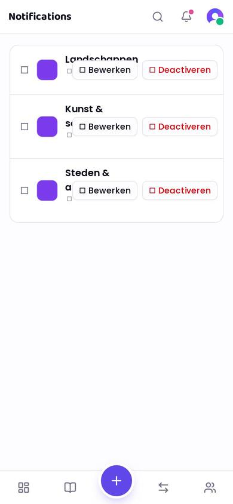

**UX-141 — Confirmations get weaker as actions get more destructive** · _from ADMIN-9_

- **Problem:** The irreversible actions have the lightest protection:
  - "Confirm Removal" (deletes the file and notifies the uploader) and "Reject Photo" (deletes the photo for everyone involved) use a 3-second inline "Are you sure?". Nothing announces it, and it disarms by itself.
  - CSAM "Close" ("Sluiten") has no confirmation.
  - The reversible actions, Deactivate and Disable/Re-enable, use AlertDialogs.
- **Root cause:** `apps/web/src/components/admin/moderation/flag-detail.tsx:62-71,136-139`; `components/admin/moderation/unchecked-detail.tsx:68-77,152-159`; `components/admin/moderation/csam-escalations.tsx:264-271`; `components/admin/puzzles/puzzle-lifecycle-action.tsx:80-123`; `components/admin/category-list.tsx:194-229`.
- **Fix:**
  - Use AlertDialogs for irreversible or notifying actions, naming the effect for each photo source (see UX-192).
  - Rename "Close" to "Close escalation" and add a confirmation.
  - Reversible actions get a toast with Undo instead.

**UX-142 — Selection swaps under the reviewer** · _from ADMIN-20_

- **Problem:** `selected = pending.find(id) ?? pending[0]`, and the initial `selectedId` is null, while the list is sorted newest first. When a new submission arrives, the default selection silently switches to it. If Edit & Approve is open, the dialog re-seeds from the new submission, wiping the admin's edits, and **Save approves the other item**. Flagged and unchecked selections fall back the same way.
- **Root cause:** `apps/web/src/routes/_dashboard/admin/moderation.tsx:131-133,163-179,196-197,233-235`; `components/admin/moderation/edit-approve-dialog.tsx:94-96`; `packages/backend/convex/catalog/listPendingPuzzleDefinitions.ts:15-19`.
- **Fix:**
  - Pin the selection on first load.
  - When the pinned item disappears, keep a snapshot with "Already handled elsewhere" and a Next button.
  - Seed the dialog only on open, and close it if its submission disappears.

**UX-143 — Infinite spinners on error** · _from ADMIN-16_

- **Problem:** The admin lists render `PageLoading` whenever `data === undefined`, which is also what a failed query returns, since there's no `throwOnError`. Those lists are the moderation tabs, the activity log, contact, feedback, categories, proposals and the report drawer. A role revoked mid-session, read limits on the uncapped `.collect()` queries, or a deleted report (`getReport` throws NotFound) all show a spinner forever. The user and puzzle detail pages do check `isError`.
- **Root cause:** `apps/web/src/routes/_dashboard/admin/moderation.tsx:328,375,430,492`; `components/admin/moderation/activity-log.tsx:77`; `routes/_dashboard/admin/contact.tsx:50`; `routes/_dashboard/admin/feedback.tsx:29`; `components/admin/moderation/reports-queue.tsx:174`; `apps/web/src/router.tsx:24-40`; `packages/backend/convex/admin/getReport.ts:20-22`.
- **Fix:**
  - A shared `<AdminQueryError onRetry={refetch}/>`, and "This report no longer exists" for deleted reports.
  - Give `listPendingPuzzleDefinitions` a `by_status` index instead of scanning the table with `.filter`.

**UX-144 — Blur guard defeated by hover** · _from ADMIN-11_

- **Problem:** The flagged and unchecked image guards use `group-hover:opacity-0`, so moving the pointer across the image reveals it ("Hover or tap to reveal"). The report drawer shows photos without any guard, whatever the reported reason. Unchecked also includes images whose CSAM hash check timed out.
- **Root cause:** `apps/web/src/components/admin/moderation/flag-detail.tsx:108`; `components/admin/moderation/unchecked-detail.tsx:113`; `components/admin/moderation/report-detail.tsx:118-141`.
- **Fix:**
  - Extract a `<RevealGuard>` that reveals only on click, tap or key press, with a "Hide again" button.
  - Use it in all three tabs.
  - Change the copy to "Click or tap to reveal".

**UX-145 — Moderation state isn't in the URL** · _from ADMIN-12_

- **Problem:**
  - The Tabs component is uncontrolled. The selected item, open report and report status filter all live in `useState`.
  - The `admin_definition_submitted` notification links to bare `/admin/moderation`.
  - The users search resets after you open a user and come back.
- **Root cause:** `apps/web/src/routes/_dashboard/admin/moderation.tsx:109-113,289`; `components/admin/moderation/reports-queue.tsx:39-40`; `routes/_dashboard/admin/users/index.tsx:39`; `packages/backend/convex/notifications/viewRules.ts:288-289`.
- **Fix:**
  - `validateSearch` with `tab`, `item`, `report` and `status`.
  - `/admin/users?q=`.
  - Point the notification at `?tab=submissions&item=<id>`.

**UX-146 — No pending counts** · _from ADMIN-13_

- **Problem:**
  - The Reports tab is the only queue without a count, even though open DSA notices are time-bound.
  - The Unchecked count is capped at 50 per source, while ScreeningHealth already shows "50+".
  - Nothing outside the console shows pending work.
- **Root cause:** `apps/web/src/routes/_dashboard/admin/moderation.tsx:305,316-319`; `components/dashboard-layout/group-landing.tsx:19-42`; `components/dashboard-layout/app-sidebar.tsx:72`; `packages/backend/convex/admin/listUncheckedPhotos.ts:22`.
- **Fix:**
  - An `admin.getPendingCounts` query with bounded takes, a `capped` flag and "50+".
  - Use it for TabCount, a sidebar badge (like Messages has) and the hub tiles.

**UX-147 — Users table on small screens** · _from ADMIN-6_

- **Problem:** A seven-column table inside `overflow-x-auto` is 1041px wide, so phones show 2 columns. "Make admin" sits at x=886 on a phone and x=1151 on a tablet.
- **Evidence:** `agents/ADMIN/mock-mobile-users.jpg` (replica).
- **Root cause:** `apps/web/src/routes/_dashboard/admin/users/index.tsx:74-160`.
- **Fix:**
  - `hidden md:table-cell` on Email, Joined and Copies, with the badges moved under the name.
  - Or use the `/admin/puzzles` list rows. Keep role changes on the detail page.

**UX-148 — Long URLs overflow** · _from ADMIN-7_

- **Problem:** Contact messages use `whitespace-pre-wrap` without `break-words`. A trade URL overflows (753px against 468px on a tablet) and is clipped by the shell. Docs feedback has the same issue.
- **Evidence:** `agents/ADMIN/mock-tablet-contact.jpg` (replica).
- **Root cause:** `apps/web/src/routes/_dashboard/admin/contact.tsx:79,91`; `routes/_dashboard/admin/feedback.tsx:68`.
- **Fix:** Add `break-words`, or `[overflow-wrap:anywhere]`, and optionally auto-link URLs.

**UX-149 — Contact inbox** · _from ADMIN-8_

- **Problem:**
  - The inbox runs `.order('desc').collect()` with no filter or paging, so new and handled messages are mixed.
  - "Mark as handled" has no undo, and nothing shows a count.
  - User search only matches name and username, so the email address in a support request can't find the member.
- **Root cause:** `packages/backend/convex/contact/listContactMessages.ts:9-15`; `apps/web/src/routes/_dashboard/admin/contact.tsx:58-107`; `packages/backend/convex/admin/listUsers.ts:44-56`.
- **Fix:**
  - New / Handled / All pills with counts, defaulting to New, and pagination.
  - An undo toast after "Mark as handled".
  - Exact email lookup in `listUsers`, and a "Find member" link on each message.

**UX-150 — Badge contrast** · _from ADMIN-10_

- **Problem:**
  - White on amber: 2.15:1 in light mode, 1.67:1 in dark.
  - White on dark-mode red: 2.89:1.
  - These are text-xs badges sitting on photos.
- **Root cause:** `apps/web/src/components/admin/moderation/flag-detail.tsx:27-28`; `components/admin/moderation/unchecked-detail.tsx:120`; `apps/web/src/styles/globals.css:37,89,102`.
- **Fix:** `bg-jigsaw-warning text-amber-950` for amber, and `bg-red-700 text-white` for high severity, both theme-independent.

**UX-151 — Puzzles console: no search or filter** · _from ADMIN-14_

- **Problem:** The console paginates 25 at a time with Load more, and has no search or status filter. Pending rows don't link to their moderation item.
- **Root cause:** `apps/web/src/routes/_dashboard/admin/puzzles/index.tsx:49-58,93-162`; `packages/backend/convex/admin/listPuzzleDefinitions.ts:17-28`.
- **Fix:**
  - `status` and `search` arguments, using the catalogue search index.
  - Status pills, with the filters kept in the URL.
  - A "Review" link on pending rows.

**UX-152 — Keyboard triage** · _from ADMIN-15_

- **Problem:**
  - Every queue row is its own `<button>`, so the reviewer tabs N times to reach the detail actions.
  - The keyed detail pane remounts after each decision, which sends focus to `<body>`.
  - There are no keyboard shortcuts.
- **Root cause:** `apps/web/src/components/admin/moderation/queue-list.tsx:29-47`; `routes/_dashboard/admin/moderation.tsx:417,475`.
- **Fix:**
  - Make the list a `role="listbox"` with roving tabindex and arrow keys.
  - After a decision, focus the next item's primary action.
  - Later: J/K/A shortcuts.

**UX-153 — Report decision workflow** · _from ADMIN-17_

- **Problem:**
  - Template buttons overwrite whatever the admin has typed.
  - Templates aren't tied to the decision, so the removal template can be sent with "warned".
  - After deciding, the sheet stays on the summary with no "Next report".
  - Reporter, reported member and "Other reports" aren't links.
- **Root cause:** `apps/web/src/components/admin/moderation/report-detail.tsx:50,55,80-86,200-214,278-293,354-356`.
- **Fix:**
  - Map each decision to its template, and fill it in automatically while the text is untouched.
  - Confirm before replacing text that differs from every template.
  - Add "Next open report →".
  - Link the members.

**UX-154 — Admin terminology** · _from ADMIN-18_

- **Problem:**
  - NL: "Meldingen" is both the Reports tab and the member notifications bell.
  - NL: "Meldingen afgehandeld" means flags cleared.
  - NL: "Afkeuren", "afgewezen" and "Afgekeurd" are three words for one action.
  - NL: "Beheerder verwijderen" sounds like deleting the person.
  - EN: the page is titled "Users" while every label says Member.
  - EN: "For lend".
  - The moderation subtitle covers only 1 of 6 tabs.
- **Root cause:** `apps/web/locales/nl.json:2291-2293,4171,4191-4192,4202,4643`; `locales/en.json:3791,3795,3809,4667`.
- **Fix:**
  - NL: "Rapportages", "Markeringen afgehandeld", "Afwijzen/Afgewezen", "Beheerdersrol intrekken".
  - EN: "Members", "For lending".
  - Rewrite the subtitles.

**UX-155 — Category reordering and translation flags** · _from ADMIN-19_

- **Problem:**
  - Pointer users can only reorder by dragging (WCAG 2.5.7). The grip is 16px.
  - Missing-translation flags are non-focusable spans with `aria-label` and a tooltip that only shows on hover.
- **Root cause:** `apps/web/src/components/admin/category-list.tsx:115-120,275-284,304-319`.
- **Fix:**
  - "Move up" / "Move down" items in a menu.
  - A 36–44px grip hit area.
  - A visible "NL missing" badge.

**UX-191 — Edit & Approve is a reduced editor** · _from ADMIN-22_

- **Problem:**
  - The dialog edits 7 fields: no category, cover, shape, barcodes or series.
  - Fixing any of those means approving first, then editing.
  - The duplicate banner names the matching title but doesn't link to it.
- **Root cause:** `apps/web/src/components/admin/moderation/edit-approve-dialog.tsx:47-55`; `components/admin/moderation/submission-detail.tsx:135-150`.
- **Fix:**
  - Add an "Open full editor" link (the full editor works for pending items).
  - Link the duplicate's title.
  - Add a "Reject as duplicate" preset.

**UX-192 — Unchecked-photo help and KPI labels** · _from ADMIN-23_

- **Problem:**
  - One 98-word paragraph explains every photo source, and the confirmation doesn't repeat what will happen.
  - On phones every KPI label is truncated with no title attribute.
  - The ScreeningHealth copy mentions a "runbook" and env-var names.
- **Root cause:** `apps/web/locales/en.json:4313`; `components/admin/moderation/unchecked-detail.tsx:136-138`; `components/admin/moderation/kpi-row.tsx:46-48`.
- **Fix:**
  - Show one sentence per photo source next to the buttons.
  - Use a single "This week" caption above the KPIs, and let labels wrap to two lines (`line-clamp-2`) with a `title`.
  - Link the runbook.

**UX-193 — Shallow audit trail** · _from ADMIN-24_

- **Problem:**
  - Only the latest 30 actions show, with no pagination or filters.
  - Rows are plain text, not links.
  - User-detail submissions aren't linked.
  - "disabled" status renders as a raw English string.
- **Root cause:** `packages/backend/convex/admin/getModerationActivity.ts:11,20`; `apps/web/src/components/admin/moderation/activity-log.tsx:72,94-101`; `routes/_dashboard/admin/users/$userId.tsx:30-35,186-204`.
- **Fix:**
  - Paginate, with kind and actor filters.
  - Link each target and actor.
  - Add the missing status variant and its translation.

**UX-194 — Docs feedback is a raw list** · _from ADMIN-26_

- **Problem:**
  - Each vote is its own row: no grouping by page, and the page slug isn't a link.
  - "Not helpful", the signal worth acting on, is the visually quieter badge.
- **Root cause:** `apps/web/src/routes/_dashboard/admin/feedback.tsx:37-72`.
- **Fix:**
  - Group by page, with helpful and not-helpful counts and the percentage unhelpful.
  - Sort by not-helpful.
  - Link to the docs page, and expand to show comments.
  - Emphasise negative votes.

**UX-195 — Dead admin nav** · _from ADMIN-25_

- **Problem:** `components/admin-layout/admin-nav.tsx` isn't imported anywhere. It contains hard-coded English and raw gray classes.
- **Root cause:** `apps/web/src/components/admin-layout/admin-nav.tsx:18-50`.
- **Fix:** Delete the folder (your call), then run type-check and arch:check.

---

## 7. Strengths: what to keep

**Brand, marketing & public pages**

- **Distinctive, coherent brand.** The 3D puzzle-shelf hero, Baloo 2 headings and the eyebrow/section rhythm hold together across home, features, how-it-works, about, docs and legal.
- **Clean reflow.** No public page overflows horizontally at 390, 820 or 1440, and grids step down cleanly at 860 and 540px.
- **Accessible reveal-on-scroll.** It is SSR-safe, its base state is visible, and it is skipped under reduced motion (`components/marketing/reveal.tsx`).
- **Honest data and privacy.** Stats come from real platform counts. The privacy policy names the data controller and states that PostHog is EU-hosted and opt-in, and the code really does keep it off after a decline (`analytics-consent.ts`, `providers.tsx`).
- **The public catalogue doesn't expose owners.** It shows aggregate availability only. Its calls to action carry `redirect_url` back to the same puzzle, and unknown top-level URLs return a real 404.
- **Docs are well structured on desktop.** Sidebar, breadcrumb, an "on this page" list that tracks your scroll position, previous/next pager, "Was this helpful?", ⌘K search with snippets, and a skip link.

**Shell & design system**

- **One source of truth for the IA.** `route-meta.ts` drives the sidebar, breadcrumbs, page head, palette, mobile tab highlighting and group landings.
- **Calm desktop shell.** The inset-card layout has a sticky frosted page head, clear active states and visible focus rings. A single page-header slot gives every page one consistent place for its primary action.
- **Carefully built mobile chrome.** 44px top-bar controls, safe-area padding, a sticky tab bar that tracks the visual viewport, immersive thread routes, and a 56px quick sheet.
- **Consistent empty states.** The same 🧩 + title + explanation + action pattern is used everywhere.
- **Dark mode is fully themed.** Box art keeps its fidelity, the card/chrome separation still reads, and the QR card stays white so it scans.

**Onboarding**

- **Prompts take turns.** A shared "surface busy" store stops prompts from competing: the welcome dialog beats What's new, which beats the install tip. Updates published before a member signed up never count as unread.
- **Each `/welcome` step has its own URL,** so the back button walks back through steps. Focus moves to each step's heading, and the footer hides while the keyboard is open.
- **The 3D shelf is defensive.** It has a CSS fallback, an error boundary, an offscreen pause, reduced-motion support, and is `aria-hidden`.
- **Invite tokens survive the Clerk redirect,** and a household invite drops the new member straight into the household step.

**Library, discovery, messaging**

- **Two accessible add controls.** The "Add several" picker has an sr-only label, `aria-pressed` rows, a live picked count, an "On your shelf" marker and 44px touch targets. The condition picker is a proper radiogroup with arrow keys.
- **The edit-copy dialog explains disabled options.** It says why Private is unavailable while a copy is on offer. That is the right model; it just isn't reused by the one-tap toggles (UX-20).
- **Rich puzzle detail.** It shows rating, owners and a deep link to Browse, has skeleton and not-found states, and copy history timelines with a lightbox.
- **Suggest-edit is careful.** It freezes the starting values, reopens your pending proposal instead of duplicating it, and maps server errors to clear messages.
- **Strong messaging.** Messages are grouped by author with day separators. New messages are announced politely to screen readers, failed sends restore your text, and safety tools are thorough (Report with "Also block", messages from blocked members collapsed, neutral "You can't reply" copy).

**Social & sharing**

- **Tiles and notifications are well built.** Member tiles have no nested controls and their buttons name the member. Notification rows have an sr-only "Unread," prefix and Undo on follow-back. "Approve & follow back" handles partial failure.
- **Privacy-minded discovery.** Find tiles hide location, private profiles show a locked card, and the owner-preview banner shows what visitors see.
- **Household is the most mature module.** Tabs are in the URL, invites work by member search, link or email, and each copy shows where its access setting comes from ("Household default" vs "Set for this puzzle"). Bulk changes are confirmed with counts, and Leave/Remove confirmations explain the consequence.
- **Explained refusals.** When someone with view-only access can't request, the copy page says so in place.

**Solving, a11y, i18n, admin**

- **Sound solve modelling.** In-progress is decided by `isCompleted`, not by whether an end date exists. Starting a duplicate solve offers to finish the existing one instead. The follow-up dialog retries failed uploads without losing the ones that succeeded. Past solves with only a year never invent a fake date.
- **i18n groundwork is solid.** `<html lang>` follows the locale, the locale files have full key parity (3748 keys) with ICU plurals, and Dutch marketing copy is idiomatic.
- **No zoom on focus for most inputs.** Phone inputs are 16px almost everywhere.
- **Admin is integrated and enforced on the server.** It lives inside the member shell. The DSA report flow requires a statement of reasons and confirms irreversible removals. Proposal review shows field-level diffs with conflict detection. CSAM matches are never displayed. ScreeningHealth surfaces infrastructure problems where moderators work.

---

## 8. Refuted candidates

**Whole findings refuted**

- **MKT-1:** "Every 'Start trading' CTA dead-ends on a waitlist." The waitlist is the dev Clerk instance's `sign_up.mode = waitlist`; production is `public`. No app code reads the sign-up mode.
- **MKT-8:** "Dutch sign-up drops the 'Sign in' link." Those `restrictedAccess` strings only render in restricted mode. Production shows `signUp.start` with "Heb je al een account? Inloggen".
- **SHARE-8:** "Non-admins can't see a circle's full member list." Every member can open CircleMembersSheet from "N members" or ⋯ › Members in the circle chat header. What remains is discoverability: the circle page itself doesn't open that sheet.

**Sub-claims refuted inside surviving findings**

- **Marketing (MKT):**
  - MKT-9: The cookie banner does not float over dialog overlays; the overlay sits above it.
  - MKT-21: Dutch sample box titles on English pages are intentional (`hero.tsx:17-19`).
  - MKT-5: The risk of "caches serving the wrong language" is low; production sends `max-age=0, must-revalidate`.
  - MKT-12: On the catalogue detail page, title and CTA are above the fold on both phone and tablet.
  - MKT-16: The contact form starts about one screen down, not two.
- **Onboarding (ONB):**
  - ONB-7: The tall install-tip variant only appears because headless Chrome never fires `beforeinstallprompt`. Real Android Chrome gets the shorter prompt variant.
- **Library (LIB):**
  - LIB-2: "Pre-ticking For Trade also flips visibility" is moot, because new copies are visible by default.
  - LIB-5: The "20px title links" under 24px are stretched links that cover the whole card, so that is a metric artifact.
  - LIB-8: A lent-out copy does not show "Available"; lending out withdraws its offers.
  - LIB-11: The selected availability chip is not colour-only; it has a check icon and `aria-pressed`.
  - LIB-20: The 20px "Dismiss hint" passes WCAG 2.5.8 through the spacing exception.
- **Discovery (DISC):**
  - DISC-5: Routing to `/my-puzzles/suggestions` would not show a new submission, because that page lists change proposals, not definitions.
  - DISC-6: Search results aren't "missing forever". The observer auto-pages through the whole catalogue instead, which costs more but finds them.
  - DISC-10: "Foto bewerken" is still tappable; only its label is clipped.
  - DISC-15: The detail CTAs aren't equal weight; "Add to Library" is the brand primary.
  - DISC-17: Requirements aren't hidden until a failed tap; an inline hint already sits next to Submit.
  - DISC-19: "1 , 000" is just font-mono glyph spacing. NL "Reviews" vs "beoordelingen" name different concepts.
- **Messaging (MSG):**
  - MSG-1: On the tablet inbox, the guide wraps at 2–3 words per line, not one word per line.
  - MSG-3: Phones do get an unread signal for messages, via notifications in the bell and push.
  - MSG-9: Duplicate notifications from the rate-limited heartbeat need about 8 visible tabs, or refusals lasting more than 75 seconds.
- **Social (SOC):**
  - SOC-5: The preferences "Jump to" links are not blocked; they stay on top.
  - SOC-15: The People tab strip does have a scroll hint (a fade mask).
  - SOC-18: Member pages show two h1s per viewport, not three.
- **Sharing (SHARE):**
  - SHARE-2: No loan return date is "never shown" because none is ever collected.
  - SHARE-7: View-only members do not learn of the restriction only after trying; the copy page disables the button and explains beforehand.
  - SHARE-9: The who-sees-what guide can be reached from What's new › Guides.
  - SHARE-15: The household Sharing list still starts on the first screen (at about 507 CSS px).
- **Solving (SOLVE):**
  - SOLVE-7: The edit form is not thrown away; it stays open with a toast.
  - SOLVE-16: The Finish dialog's minimum date doesn't block valid days, because storage is consistently UTC.
  - SOLVE-17: Taps in the gaps between row actions don't fall through to the row link.
- **Shell (SHELL):**
  - SHELL-16: Dark mode does have contrast failures: 21 app nodes in dark captures.
  - SHELL-5: Messages does have an unread signal on phones, through the bell (see MSG-3).
- **Accessibility (A11Y):**
  - A11Y-16: Mobile does have inputs that will zoom on focus: Clerk fields at 13px, the tag input and the status select.
  - A11Y-13: The icon-only tab bar was a deliberate decision (spec 2026-06-15), not an oversight.
  - A11Y-10: The dialog close button and "Dismiss hint" pass WCAG 2.5.8 through the spacing exception.
- **Journeys (JOURNEY):**
  - JOURNEY-2: The waitlist "blocker" is the dev instance only.
  - JOURNEY-7: Friends who aren't on JigSwap can be invited: an invite link or QR sets up the mutual follow.
  - JOURNEY-19: "Write a Review" is not a second place to review; it focuses the same review form.
